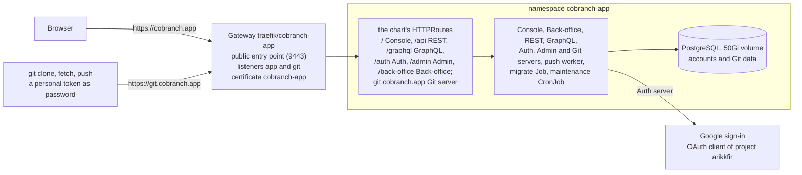

# Hosting cobranch.app

**Decision**: `https://cobranch.app` is Cobranch's hosted service: anyone signs up with Google, creates organizations and repositories, and clones, fetches and pushes at `https://git.cobranch.app`. The hub runs it in namespace `cobranch-app` from Cobranch's `main`, as the demo ran before it: every merge upgrades it in place, the migrate Job first, and its database volume keeps the data, Git repositories included, across every sync. It is public, on Traefik's public entry point through a Gateway of its own, with no hub sign-in in front: Cobranch signs everyone in itself, and its Back-office answers only the installation's administrator. It uses no bucket, and nothing backs it up yet (owner, 2026-11-01). It replaced the demo at `cobranch.dev.kfirs.com`, which the owner took down once `cobranch.app` answered and their first push to it worked (2026-11-02); previews stay ([Cobranch's previews](cobranch-previews.md)). Linear: [ENG-232](https://linear.app/arikkfir/issue/ENG-232). Its Google Cloud side is infra's ([cobranch.app in GCP](../../infra/designs/cobranch-app.md)).

## Why

The owner asked for Cobranch's own hosted service once Git hosting was live: `cobranch.app` open for sign-up, deploying Cobranch's `main` and keeping its data through upgrades, beside `cobranch.dev`'s static site ([Cobranch's site](cobranch-site.md)), with no demo left. The demo couldn't become it: it sat behind the hub's sign-in, and its users signed in through the hub's Keycloak, which admits only the people it declares.

## Design



### A merge to cobranch's main

```mermaid
sequenceDiagram
  participant G as cobranch's main
  participant P as pipeline main
  participant A as Argo CD
  participant K as namespace cobranch-app
  G->>P: push
  G-->>A: new commit (polled)
  A->>K: wave 0: PostgreSQL, its volume kept
  A->>K: wave 1: migrate Job at the commit's tag
  P-->>K: images pushed; the Job's pull succeeds
  K-->>A: the schema is the commit's
  A->>K: wave 2: servers, Console and Back-office roll out by surging
  Note over K: the old pods serve until the new ones are ready
```

It is the path the demo ran on, unchanged ([hosting Cobranch's demo](cobranch.md#a-merge-to-cobranchs-main)): Argo CD may sync a commit before its images exist, and the migrate Job then waits for them within its 30-minute deadline while the old pods keep serving. Nothing is recreated: the StatefulSet's volume outlives every sync, and a migration that fails leaves the old version running.

### Sign-in

```mermaid
sequenceDiagram
  participant B as Browser
  participant Au as Auth server, cobranch.app/auth
  participant Go as Google
  B->>Au: Sign in with Google
  Au->>Go: authorize, PKCE and nonce, redirect https://cobranch.app/auth/callback
  Go-->>B: consent screen of project arikkfir's app
  B->>Au: callback with code
  Au->>Go: exchange the code
  Au->>Au: new identity: sign up under the Back-office's policy (anyone until changed);<br/>the owner's email becomes Installation admin
  Au-->>B: cookie __Host-cobranch-session
```

### The hub's side

| Cobranch asks for | The hub provides |
| --- | --- |
| The chart, installed with its values | Application `cobranch-app`, project `cobranch-app`: `chart/cobranch` of `https://github.com/arikkfir-org/cobranch` at `main`, release `cobranch`, Helm's tests skipped, automated sync with prune and self-heal, ten retries, each from `main`'s newest commit; wave 1, after the Gateway |
| Its images | `me-west1-docker.pkg.dev/arikkfir/cobranch`, tagged `${ARGOCD_APP_REVISION_SHORT}` |
| `urls.*` | `https://cobranch.app` for the Console, `/api`, `/graphql`, `/auth`, `/admin` and `/back-office` beside it, and `https://git.cobranch.app` for the Git server. One host for everything but Git, so the session cookie is `__Host-cobranch-session` |
| `httpRoute` | On: the chart's own routes, one per workload, each stripping its URL's path, with `parentRefs` Gateway `traefik/cobranch-app`. AppProject `cobranch-app` admits HTTPRoutes, and the Gateway admits them from this namespace only |
| `auth.providers` | `google` (preset `google`), the client the owner made by hand ([manual steps](../../infra/designs/cobranch-app.md#manual-steps)); its secret is Secret `cobranch-google`, key `client-secret`, from ExternalSecret `cobranch-google` on `cobranch-app-google-client-secret`. Reloader restarts the Auth server when it changes |
| `auth.signUp`, `organizations.selfServe` | Left to the Back-office: anyone signs up and creates organizations until the administrator changes either there, with no deploy |
| `auth.admins` | The owner's email: the installation's administrator, who runs it from `https://cobranch.app/back-office` |
| `blob.url` | Unset: Cobranch keeps Git data in its PostgreSQL by default ([ENG-237](https://linear.app/arikkfir/issue/ENG-237)). No installation of ours uses a bucket (owner, 2026-11-01) |
| `postgresql.auth.existingSecret`, `secretsKey` | Secrets `cobranch-postgresql-password` and `cobranch-secrets-key`, made once in the cluster by ESO `Password` generators (`refreshPolicy: CreatedOnce`) |
| `postgresql.image` | `docker.io/library/postgres:18.6-alpine`, set here rather than taken from the chart ([decisions](#decisions)) |
| `postgresql.storage.size` | 50Gi, for everyone's Git data as well as their accounts. A StatefulSet's volume claim template can't change after its first sync: growing the volume later means editing its claim by hand, which the default storage class allows |
| Placement and size | Every pod on node pool `system` ([node pools](node-pools.md)), with the chart's requests and memory limits and no CPU limit ([resource requests](resource-requests.md)): Git's packing for a push takes only idle CPU beyond its request, and every neighbour keeps the CPU it requests |
| Admission | Policy `cobranch-app-http-routes`: an HTTPRoute in namespace `cobranch-app` attaches to Gateway `traefik/cobranch-app` only, never to `traefik/protected` or `traefik/public`, which take routes for any `*.kfirs.com` host. Policy `cobranch-app-cluster-ip-services`: its Services are of type `ClusterIP`, with no external IPs |
| Network admission | NetworkPolicy `cobranch`: only namespace `traefik`, on 8080, to the Console's, the Back-office's and the servers' pods. NetworkPolicy `cobranch-git-internal`: only the REST and GraphQL servers' pods, on 8081, to the Git server's, for their internal call that reads trees and files. The chart's own admits only the servers, the push worker, the migrate Job and the maintenance CronJob to PostgreSQL |

What `infra` provides, the records `cobranch.app` and `git.cobranch.app`, cert-manager's grant on zone `cobranch-app` and the secret's container, is in its pages ([cobranch.app in GCP](../../infra/designs/cobranch-app.md)). ClusterIssuers `letsencrypt` and `letsencrypt-staging` solve `cobranch.app`'s challenges in zone `cobranch-app`.

## Decisions

| Decision | Why | Rejected |
| --- | --- | --- |
| Start empty, in a namespace of its own | The demo's users are the hub's Keycloak identities: Cobranch refuses a new sign-up whose verified email another identity holds, so they couldn't sign in with Google; a public service starts without test data. A new namespace lets `cobranch.app` answer before the demo goes, all in Git | The demo turned into `cobranch.app` in place, keeping its data and the hub's provider |
| Sign-in with Google, directly, with a client in project `arikkfir` | Cobranch's `google` preset needs only a client; anyone with a Google account signs up. The client sits beside the hub's own Google client, under the project's existing consent screen (owner, 2026-11-01) | A Keycloak realm brokering Google: sign-in would pass through `id.kfirs.com`, and the client is still made by hand. A Google Cloud project of its own, whose consent screen would name Cobranch |
| Public, with no hub gate | The hub's gate covers `kfirs.com` only, and a hosted service is for anyone. The Admin API checks every caller's permissions, so the public Back-office answers only the administrator | The Back-office behind the hub's sign-in: on another domain, the session cookie couldn't be `__Host-`, and the chart's URLs must share a parent domain |
| A Gateway of its own | Listeners on `traefik/public` admit by label, which would let this namespace's routes answer for any `*.kfirs.com` name | Listeners on `traefik/public`, with `kfirs.com/public-ingress` on the namespace |
| The chart's routes | As any operator installs Cobranch; with no Middleware to add, the hub's own routes would repeat the chart's | The demo's own HTTPRoutes |
| Git at `git.cobranch.app`, HTTPS only | The Console owns every path of the apex; SSH needs a TCP entry point and an address of its own, which can come later | Git under `/git`; SSH from day one |
| PostgreSQL's image pinned here | A new major can't start on the old one's data, so moving to it is a dump and restore done on purpose, in a change of this repository | Following the chart's image, which a merge to Cobranch's `main` can move to a new major under live data |
| Git data in PostgreSQL, no bucket | Cobranch's default; a bucket stays a supported option of the product, which no installation of ours is to use (owner, 2026-11-01) | Bucket `arikkfir-cobranch-app`, which infra made first and removed before anything used it |
| No backups yet | The owner's call at launch (2026-11-01) | A nightly `pg_dump` to a bucket the dump could only add to; Backup for GKE |

## Security and failure modes

- **Anyone signs up.** Cobranch has no quotas yet: a user can create repositories and push up to the Git server's 2 GiB a push. The administrator can set sign-up to invitations or domains, or turn off self-serve organizations, in the Back-office at once. Repositories are never public: Cobranch has no anonymous grants yet.
- **The public Back-office and Admin API.** The Admin API denies by default; only `auth.admins` holds Installation admin, through a verified Google email.
- **A merge reaches the cluster unreviewed by this repository.** AppProject `cobranch-app` admits only namespace `cobranch-app` and the chart's kinds, HTTPRoutes included, with no cluster-scoped object and no Secret. Policy `cobranch-app-http-routes` holds the routes to Gateway `traefik/cobranch-app`, whose listeners answer only for `cobranch.app` and `git.cobranch.app`, and policy `cobranch-app-cluster-ip-services` keeps every Service inside the cluster, so nothing reaches the pods but through that Gateway. The namespace enforces the restricted Pod Security Standard.
- **The client's secret.** Bumping it in the Google Cloud console and adding a version of `cobranch-app-google-client-secret` rotates it; External Secrets syncs it within its refresh interval, and Reloader restarts the Auth server.
- **Losing the database.** Its volume, a zonal persistent disk replicated within its zone, holds everyone's data, Git repositories included, and nothing backs it up yet: losing it loses them all. Deleting namespace `cobranch-app`, or cascade-deleting Application `cobranch-app-environment`, deletes it.
- **A full volume.** Pushes, and then every write, fail once the 50Gi fill; Cobranch has no quotas yet. Growing the volume is the owner's, by editing its claim.
- **The password and secrets key.** Deleting either Secret makes a new one, which the database refuses, or which no longer opens the client secrets that the Back-office sealed.

## Rollout

1. `infra`: the records, cert-manager's grant and the secret's container ([infra#105](https://github.com/arikkfir-org/infra/pull/105)), applied by pipeline `apply` on merge; [infra#106](https://github.com/arikkfir-org/infra/pull/106) removes the two buckets it also made.
2. Cobranch: Git data in PostgreSQL by default, with `blob.url` optional ([ENG-237](https://linear.app/arikkfir/issue/ENG-237)), on Cobranch's `main`.
3. The owner makes the Google client and adds its secret ([manual steps](../../infra/designs/cobranch-app.md#manual-steps)).
4. This repository: `cobranch-app-environment` and its manifests, the ClusterIssuers' solver for `cobranch.app`, and the link from `cobranch.dev`. Open `https://cobranch.app`, sign up with Google, and push to a new repository at `https://git.cobranch.app`.
5. This repository and `infra`: the demo goes once the owner's first push to `cobranch.app` works (owner, 2026-11-02): `cobranch-environment` keeps only the previews and their Git listener ([delivery#112](https://github.com/arikkfir-org/delivery/pull/112)), and `infra` then removes the demo's records, Keycloak client and bucket ([hosting Cobranch's demo](cobranch.md#rollout)).
