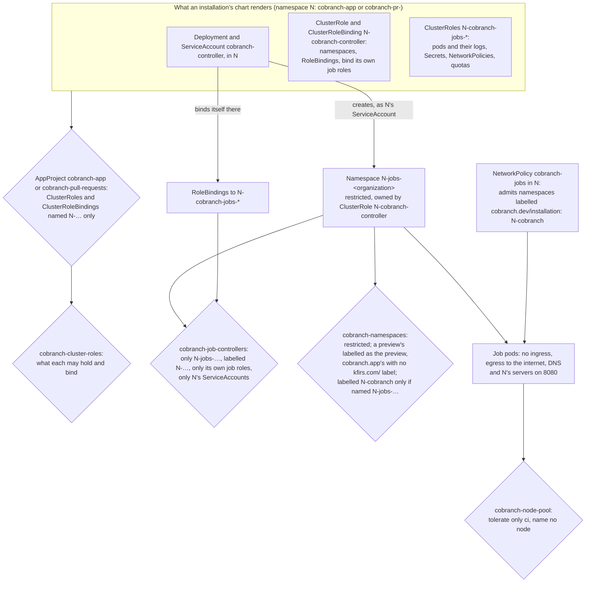

# Cobranch's jobs on the hub

**Decision**: every Cobranch installation on the hub, [cobranch.app](cobranch-app.md) and each [preview](cobranch-previews.md), runs Cobranch's job controller as its chart ships it, with its cluster-scoped RBAC, and the hub holds that RBAC and what the controller does with it in admission policies of its own. The controller creates a namespace per organization, `<installation's namespace>-jobs-<organization>`, binds itself there, and runs the organization's jobs in it on node pool `ci`, beside every repository's CI runs. AppProjects `cobranch-app` and `cobranch-pull-requests` admit the chart's ClusterRoles and ClusterRoleBinding by name alone, and policies `cobranch-cluster-roles`, `cobranch-job-controllers`, `cobranch-namespaces` and `cobranch-node-pool` hold what they say. Linear: [ENG-214](https://linear.app/arikkfir/issue/ENG-214). Cobranch's side is [Cobranch jobs](../../cobranch/designs/jobs.md).

## Why

Cobranch runs the jobs a repository declares in `/cobranch.yaml`: pods and scripts its controller starts in a namespace of the organization's own, with no ingress and egress only to the internet, DNS and the installation's own REST, GraphQL and Git servers ([Cobranch jobs](../../cobranch/designs/jobs.md)). Namespaces made at run time need cluster-scoped RBAC, which neither AppProject admitted: `cobranch-app` admitted no cluster-scoped kind, and `cobranch-pull-requests` only its Namespace. A preview's chart is a pull request's code, so whatever it may grant must be held to what the controller needs, whoever writes it.

## Design

### What the chart renders, and how the hub holds it

Every name starts with the installation's namespace, so two installations of release `cobranch` never share one. The table names what Cobranch's chart renders for release `cobranch` in namespace `N`; Cobranch's design is the source of what each role holds ([Cobranch jobs](../../cobranch/designs/jobs.md)).

| Object | Holds | Held by |
| --- | --- | --- |
| ClusterRole `N-cobranch-controller` | Namespaces and RoleBindings; `bind`, and `get`, on its own installation's ClusterRoles by name | `cobranch-cluster-roles`: a `…-controller` role holds those alone, and names only roles starting with `N-` |
| ClusterRoleBinding `N-cobranch-controller` | That role, to ServiceAccount `cobranch-controller` in `N` | `cobranch-cluster-roles`: only the `…-controller` role of its own name, only to ServiceAccounts of `N` |
| ClusterRoles `N-cobranch-jobs-*` | Pods, their logs, Secrets, ConfigMaps, events, NetworkPolicies, LimitRanges and ResourceQuotas | `cobranch-cluster-roles`: only those, never `bind`, `escalate`, `impersonate` or `exec`, no aggregation; bound nowhere cluster-wide |
| Namespace `N-jobs-<organization>` | The organization's runs; owned by ClusterRole `N-cobranch-controller`, so it goes with the installation; labelled `cobranch.dev/installation: N-cobranch` | `cobranch-job-controllers`: `N`'s ServiceAccounts create, change and delete only `N-jobs-…`, labelled with an installation starting with `N-`. `cobranch-namespaces`: restricted Pod Security; a preview's carries `kfirs.com/cobranch-pull-request: "true"` and no other `kfirs.com/` label, cobranch.app's none; any namespace labelled `cobranch.dev/installation: N-cobranch`, whoever writes it, is named `N-jobs-…` |
| RoleBindings in `N-jobs-<organization>` | `N-cobranch-jobs-*`, to `N`'s ServiceAccounts: the controller's, and the API servers' to read logs | `cobranch-job-controllers`: only in `N-jobs-…`, only `N`'s job roles, never its `…-controller` role, only `N`'s ServiceAccounts |
| Job pods | A run's pod or script | `cobranch-node-pool`: tolerate only `kfirs.com/pool=ci`, name no node |
| NetworkPolicy `cobranch-jobs` in `N` (this repository) | Admits namespaces labelled `cobranch.dev/installation: N-cobranch` to the REST, GraphQL and Git servers' port `8080`: runs' API calls and checkouts, which the chart's own egress rule sends to those pods alone | `cobranch-job-controllers`: only `N`'s job namespaces carry `N`'s label, so no other installation's jobs reach `N`'s servers past the sign-in |

The controller reaches pods and Secrets only in the namespaces it bound itself in, and `cobranch-job-controllers` keeps it from binding itself anywhere else: a pull request's chart that asks for more is refused at admission, and the Application shows the refusal.

### What the hub sets

Each preview runs its own pull request's chart, whose values schema refuses keys it doesn't know: a pull request whose chart predates them fails to render once pushed again, until it merges `main` ([rollout](#rollout)).

| Value | cobranch.app | A preview | Why |
| --- | --- | --- | --- |
| `controller.nodeSelector`, `tolerations` | Pool `system` | Pool `ci` | As the installation's other workloads ([node pools](node-pools.md)) |
| `jobs.nodeSelector`, `tolerations` | Pool `ci` | Pool `ci` | Jobs run their repositories' code, anyone's on cobranch.app: beside every repository's CI runs, never beside the hub's own components |
| `jobs.namespaceLabels` | None | `kfirs.com/cobranch-pull-request: "true"` | A preview's job namespaces start with its own name, so policy `cobranch-namespaces` holds them as the preview's; the label keeps ClusterSecretStore `gcp-secret-manager` out of their reach |
| `jobs.admissionPolicy` | `false` | `false` | The hub's policies hold the controller instead of the chart's own ([decisions](#decisions)) |

Everything else is the chart's: the job namespaces' prefix (`N-jobs-`), Pod Security level (`restricted`), NetworkPolicies, LimitRange and requests.

## Decisions

| Decision | Why | Rejected |
| --- | --- | --- |
| The hub's own policies, the chart's off | A ValidatingAdmissionPolicy acts on the whole cluster whatever its name: admitting the chart's would let a pull request's chart install one that refuses anything, anywhere. The hub's say what the chart's says, from this repository's `main` | Admitting the chart's policy and binding by name; no policy at all, trusting the chart's RBAC |
| Admit cluster RBAC by name, hold its contents by policy | An AppProject admits by kind and name only; what a ClusterRole grants is in its rules, and the policy reads them | Granting the controller a fixed role from this repository: the chart then can't evolve what its controller needs without a change here first, and other operators would install it differently |
| Roles held to a ceiling, not to the chart's exact rules | A new verb or kind within the ceiling (a ConfigMap for a script, events for a pod's failure) needs no change here; anything beyond it does, first, as delivery's rules ask of every new kind | Matching the chart's rules exactly, which breaks every preview at each change of them |
| Job namespaces owned by the installation's ClusterRole | Deleting a preview's Application deletes its ClusterRoles, and the garbage collector then deletes its job namespaces and their pods: nothing outlives the pull request | A cleanup the controller runs, which a deleted controller never runs |
| Pool `ci` for every installation's jobs | They run code anyone may push to cobranch.app, as CI runs code any pull request holds | Pool `system`, beside Argo CD, Traefik and Keycloak; a pool of their own, which costs a node while idle |

## Security and failure modes

- **A pull request's chart grants itself more.** `cobranch-cluster-roles` refuses any ClusterRole named after an installation that holds more than the ceiling, aggregates, or binds another installation's roles, and any binding of a job role cluster-wide; the AppProjects refuse every other cluster-scoped RBAC. Its Application shows the refusal and the preview's other workloads still run.
- **The controller binds itself elsewhere.** `cobranch-job-controllers` refuses its RoleBindings outside `N-jobs-…`, to any role but `N`'s job roles, or to another namespace's accounts; RBAC already refuses a `bind` on any other role.
- **Reads aren't admitted.** Kubernetes admits writes only: the controller's `get`, `list` and `watch` reach only the namespaces whose RoleBindings it holds, and namespaces themselves, which hold no secret.
- **A job namespace left behind.** If the controller's ClusterRole outlives its installation, so do its job namespaces; deleting that ClusterRole deletes them.
- **cobranch.app's job namespaces and Secret Manager.** They carry no `kfirs.com/cobranch-pull-request` label, so `gcp-secret-manager` would serve an ExternalSecret there; nothing in them may make one: the controller's roles hold no ExternalSecret, and job pods mount no ServiceAccount token.
- **Another installation's jobs reach `N`'s servers.** Policy `cobranch` admits only Traefik to the servers, and `cobranch-jobs` adds the namespaces carrying `N`'s installation label. `cobranch-namespaces` lets only a namespace named `N-jobs-…` carry it, whoever writes it, Argo CD included, and `cobranch-job-controllers` lets no other installation's controller make one: nothing a preview's or Fin's chart renders reaches cobranch.app's servers in the cluster, only through their routes and the sign-in. A preview's chart, which AppProject `cobranch-pull-requests` lets write any `cobranch-pr-*` namespace, could label one as another preview's job namespace, as it could already deploy into that preview: previews come from cobranch's members alone ([Cobranch's previews](cobranch-previews.md)).
- **A job holds a CI node.** Its pod runs within its run's timeout and the chart's requests; the pool scales from zero and back.

## Rollout

1. Cobranch: the chart's `controller` and `jobs` values, which nothing reads yet, and its design's snapshot, which names the cluster-scoped objects and job namespaces after the release's namespace, as the table above does.
2. This repository: the AppProjects, the policies and the values above, merged right after step 1: until Cobranch's `main` knows the values, cobranch.app would fail to render. A preview already rendered keeps running; one whose pull request predates step 1 fails to render at its next push, until it merges `main` ([Cobranch's previews](cobranch-previews.md#security-and-failure-modes)).
3. Cobranch: the controller, its RBAC and the job namespaces ([Cobranch jobs](../../cobranch/designs/jobs.md#rollout)), whose runs reach the servers through NetworkPolicy `cobranch-jobs`, in step 2. Its pull request's preview is the first to run a job here, and cobranch.app runs them once it merges.

## Open questions

- A quota per job namespace (`jobs.quota`): the pool's autoscaling bounds a runaway organization today; cobranch.app's paying organizations will want one each.
