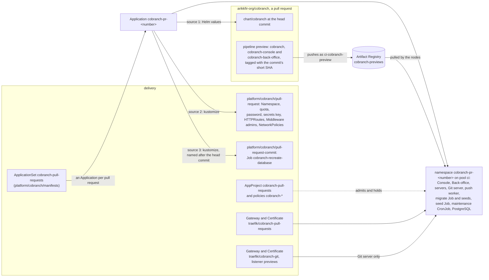
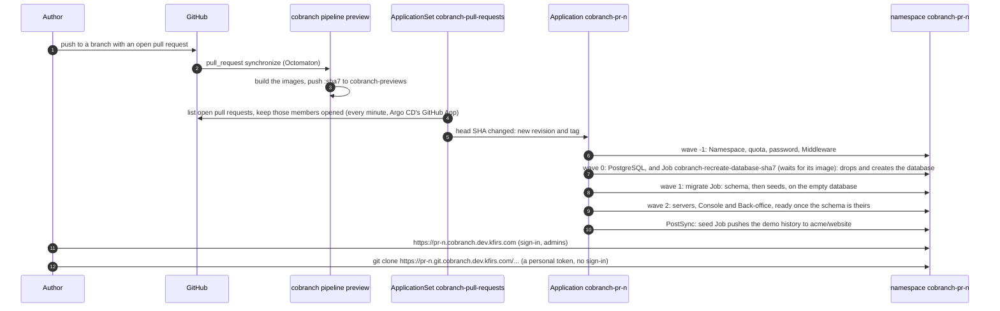
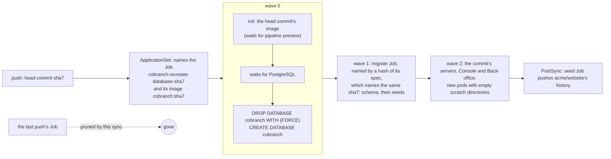
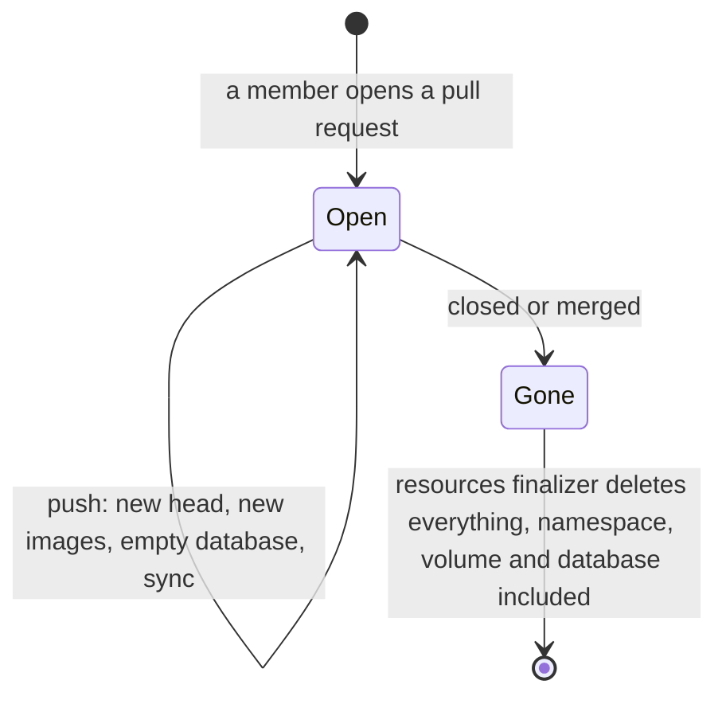
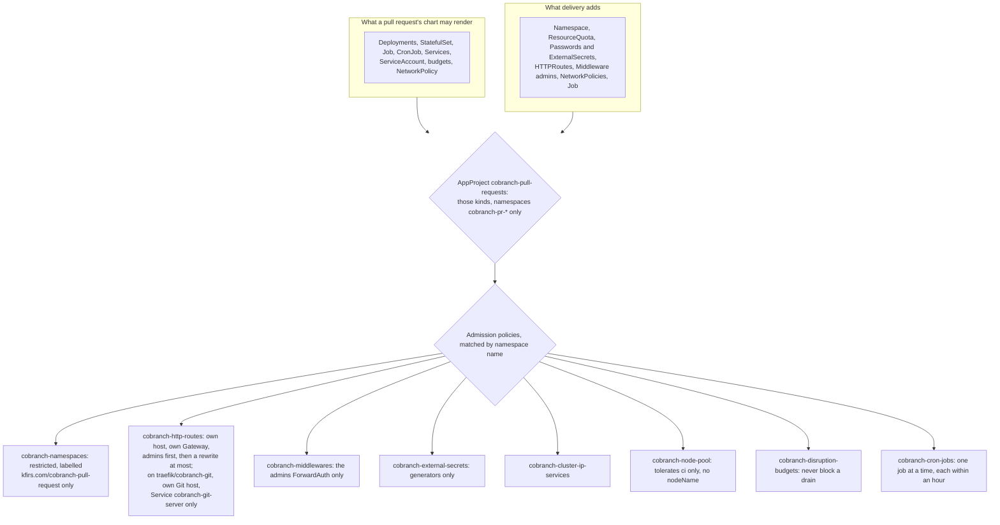

# Cobranch's previews

**Decision**: every open pull request that a member of [arikkfir-org/cobranch](https://github.com/arikkfir-org/cobranch) opens gets a Cobranch of its own, a preview, and no fork's pull request does: namespace `cobranch-pr-<number>`, at `https://pr-<number>.cobranch.dev.kfirs.com`, behind the hub's sign-in and Middleware `admins`, as the [demo](cobranch.md) is, and its Git server at `https://pr-<number>.git.cobranch.dev.kfirs.com`, public as the demo's is. Argo CD installs Cobranch's chart from the pull request's head commit, with that commit's images and its demo data (`seed.enabled`), on node pool `ci`; every push starts it from scratch, on a database emptied, migrated and seeded again ([ENG-239](https://linear.app/arikkfir/issue/ENG-239)); closing or merging the pull request deletes it, database and all. A preview is a real environment, for real testing: it runs the chart's replicas, resources and database volume, and the demo's values, but for what [differs from the demo](#what-differs-from-the-demo), each with the owner's reason ([ENG-236](https://linear.app/arikkfir/issue/ENG-236)). A pull request's code decides what runs in its namespace, so an AppProject admits only the kinds a preview needs and admission policies hold what each may say. Linear: [ENG-208](https://linear.app/arikkfir/issue/ENG-208). Cobranch's side, the seeds and the preview pipeline, is the [Helm chart design](https://claude.ai/artifact/LyMHXgSoNQNgHtHNfEjvA8#previews)'s.

## Why

A reviewer of a Cobranch pull request had to build both images and install the chart to try it. A preview shows the change within minutes of a push, seeded, with nothing to register or set up. Fin's pull requests have had this since its [environments](../../fin/designs/environments.md); Cobranch's follow the same shape, with the differences below.

## Design

What `infra` provides, repository `cobranch-previews`, `ci-cobranch-preview`'s grant on it and the record `*.cobranch.dev`, is documented in its pages: [Artifact Registry](../../infra/terraform/gcp.md#artifact-registry), [IAM](../../infra/terraform/gcp.md#iam) and [DNS](../../infra/terraform/gcp.md#dns).

### A push to a pull request

A sync can start before pipeline `preview` has pushed the commit's images: Job `cobranch-recreate-database-<sha7>` and the migrate Job wait for theirs within 1800 seconds each (the Job's own deadline, and the migrate Job's `migrate.activeDeadlineSeconds`), and the servers and the Console wait for the migrate Job. Until the images exist, the preview serves the last push, on its database. Once the sync is healthy, the chart's seed Job (a Helm `post-install,post-upgrade` hook, which Argo CD runs as PostSync) pushes a history to `acme/website` as the demo owner, through the Git server, which the empty database lacks ([code browsing](../../cobranch/designs/code-browsing.md#configuration)).

### Every push starts from scratch

**Decision**: each new head commit of a pull request gets an empty database. Job `cobranch-recreate-database`, from delivery's `platform/cobranch/pull-request-commit`, which the ApplicationSet names after the head commit (`cobranch-recreate-database-<sha7>`), drops database `cobranch` and creates it again, in wave 0, once the commit's image exists and PostgreSQL answers. Git's objects are in that database, as Cobranch keeps them by default, so they go with it; the migrate Job then migrates and seeds it, and the seed Job pushes the demo history (owner, 2026-11-01, [ENG-239](https://linear.app/arikkfir/issue/ENG-239)).

| What | At a new head commit |
| --- | --- |
| Database `cobranch`: every table, Git's refs and objects (large objects), sessions, personal tokens, whatever a reviewer made | ❌ Dropped and created empty, then migrated and seeded |
| Server, Console and Back-office pods, and their scratch directories | ❌ Replaced: their images are the new commit's |
| PostgreSQL's server, volume and generated password; the secrets key; the namespace, routes and quota | ✅ Kept: none holds data of the last push |

The Job runs once per head commit and never on another sync of it: a retry, a self-heal or a sync that delivery's `main` starts finds the Job of that name and leaves it, and Argo CD ignores its spec, which can't change, so an edit to it reaches an open preview with its next push. The migrate Job's pod annotation `kfirs.com/database-recreated-by` names the same Job, so its name, a hash of its spec, changes whenever the database is emptied, and an emptied database is always migrated again: the first sync after this Job came emptied every preview then open, whose migrate Jobs had already run. NetworkPolicy `cobranch-recreate-database` admits the Job to PostgreSQL, beside the chart's own policy. The Job names what the chart makes from its values: Service `cobranch-postgresql` (release `cobranch`), and the database and user `cobranch`, which the ApplicationSet pins in `postgresql.auth` at the chart's defaults, so that a chart whose defaults change leaves both in step; a change to either is made in both places. The Job is a third source of its own, rather than a part of `platform/cobranch/pull-request`, so that an Application renders it only with the name and image the ApplicationSet gives it: an Application that `main` reached before its ApplicationSet did would otherwise run it, unnamed, on an image that never comes.

### When the pull request closes

The generator stops listing a closed pull request, the ApplicationSet deletes its Application, and the resources finalizer deletes what it made, the Namespace with it. A reopened pull request starts again from an empty database.

### What holds a preview

| Holds | How |
| --- | --- |
| No cloud role | No grant in `infra` names a `cobranch-pr-*` namespace, and no Workload Identity pool trusts one. Git's packs live in the preview's own PostgreSQL, Cobranch's default |
| No Secret but its own | AppProject admits no Secret; the database's password and the secrets key come from Password generators; ClusterSecretStore `gcp-secret-manager` refuses namespaces labelled `kfirs.com/cobranch-pull-request`, and policy `cobranch-external-secrets` admits only generators |
| No reach beyond its host | Services are ClusterIP. A route attaches either to `traefik/cobranch-pull-requests`, with the namespace's own host, its rules sending to the namespace's Services behind `admins`, or to listener `previews` of `traefik/cobranch-git`, with the namespace's own Git host, its rules sending only to Service `cobranch-git-server` on port 80, unfiltered; NetworkPolicy `cobranch` admits only Traefik to the servers, the Git server, the Console and the Back-office, `cobranch-git-internal` only the REST and GraphQL servers to the Git server's internal port, `cobranch-seed` only the chart's seed Job to the Auth server, the REST server and the Git server, `cobranch-recreate-database` only Job `cobranch-recreate-database` to PostgreSQL, the chart's own only the servers, the push worker and the Job to PostgreSQL |
| Admins only | On `traefik/cobranch-pull-requests`, every rule asks Middleware `admins` first, which reads the hub's session cookie, then may only rewrite the URL: Traefik runs filters in order, so a redirect or mirror before `admins` would answer any hub user. Cookies pass through to the pods, Cobranch's own session cookie and the hub's (domain `.kfirs.com`) alike: a pull request's code can read the hub's, which is why only the owner's and Dependabot's pull requests get a preview (owner, 2026-10-30). The one exception is the Git route on `traefik/cobranch-git`, which Git clients reach without the hub's sign-in: it has no filter, and the Git server signs every request in with a personal token itself (owner, 2026-11-01) |
| Sign-in without a provider | `urls.auth` deploys the chart's Auth server at `/auth`, with no identity provider: neither Keycloak nor Google takes a wildcard host in a redirect URI, and a preview reads no secret. People sign in as the seeded users (`seed.enabled`), which the sign-in page offers ([ENG-197](https://linear.app/arikkfir/issue/ENG-197)); the [demo](cobranch.md) signs in through Keycloak. `auth.admins` lists the seeded administrator, Ada Admin (`ada@cobranch.example`), so signing in as her opens the Back-office at `/back-office` ([ENG-219](https://linear.app/arikkfir/issue/ENG-219)) |
| No room beyond its share | ResourceQuota `cobranch`: 3 CPUs and 4Gi requested, 16Gi of memory limits, 30 pods, one volume of up to 16Gi: the chart's replicas and resources while every Deployment surges one pod and the Jobs run, with room to spare, so it holds back only a chart that asks for more than the demo runs |
| No other pool | Policy `cobranch-node-pool`: pods tolerate only `kfirs.com/pool=ci` and name no node; budgets let every pod go, so a preview never keeps a CI node up |
| No runaway schedule | Policy `cobranch-cron-jobs`: a CronJob (the chart's maintenance) runs one job at a time, each ending within an hour, so a tightened schedule can't pile pods onto the pool |

## What differs from the demo

Everything else is the [demo](cobranch.md)'s: the chart's replicas, resources and database volume, PostgreSQL's image, pinned in this repository, the same migrate deadline, maintenance, secrets key and generated database password, the same routes behind the hub's sign-in and Middleware `admins`, and the same network admission. A value the demo gains goes to the previews in the same pull request.

| What | The demo | A preview | Why |
| --- | --- | --- | --- |
| The code | `main`'s newest commit, images from Artifact Registry repository `cobranch` | The pull request's head commit, images from `cobranch-previews`, which pipeline `preview` pushes from any branch | What a preview is for; images built from any branch stay out of the repository every installation pulls from (owner, 2026-10-30, [ENG-208](https://linear.app/arikkfir/issue/ENG-208)) |
| Hosts | `cobranch.dev.kfirs.com`, `git.cobranch.dev.kfirs.com` | `pr-<number>.cobranch.dev.kfirs.com`, `pr-<number>.git.cobranch.dev.kfirs.com` | One each, beside the demo (owner, 2026-10-30) |
| Sign-in | The hub's Keycloak, realm `hub`; the owner administers | The seeded users, with demo data (`seed.enabled`) and no identity provider; Ada Admin administers | No identity provider takes a wildcard host in a redirect URI, and a reviewer starts from demo data (owner, 2026-10-30) |
| Node pool | `system` | `ci` | It scales from zero beside cobranch's CI and costs nothing new (owner, 2026-10-30) |
| Git objects | In PostgreSQL, moving from bucket `arikkfir-cobranch` (`blob.moveFrom`) until maintenance logs `Moved every object` | In PostgreSQL | Both on Cobranch's default (owner, 2026-11-01: "Yes PG the default, no bucket anywhere", [ENG-237](https://linear.app/arikkfir/issue/ENG-237)); a preview starts empty, with nothing to move |
| Data across pushes | Kept: every merge upgrades the demo in place | Emptied at every push: a Job named after the head commit drops and creates the database, and the migrate Job migrates and seeds it again ([above](#every-push-starts-from-scratch)) | What one push left behind can break or hide what the next one does, so testing on it can't be trusted (owner, 2026-11-01, [ENG-239](https://linear.app/arikkfir/issue/ENG-239)) |
| Guards | None beyond AppProject `cobranch` | ResourceQuota `cobranch` and policies `cobranch-*` ([above](#what-holds-a-preview)) | They share pool `ci` with every repository's CI; sized and written to admit what the demo runs, so they change nothing a preview does while its chart stays within them |

A preview made before this table held keeps the 1Gi database volume it started with until its pull request closes: a StatefulSet's volume claim templates can't change, so the ApplicationSet ignores them on a preview that exists ([below](#decisions)).

## Decisions

| Decision | Why | Rejected |
| --- | --- | --- |
| Node pool `ci` | cobranch's pull requests' code already runs there, in CI; it scales from zero and costs nothing new (owner, 2026-10-30) | `system`, beside Argo CD, Traefik and Keycloak; `fin`, Fin's own; a fourth pool to pay for |
| Repository `cobranch-previews` and ServiceAccount `ci-cobranch-preview`, from any branch | `cobranch` is public and its pull requests' CI runs Dependabot's code: it must not be able to replace Fin's preview images in `previews`, nor `cobranch`'s `main` and release tags | `previews`, shared with Fin; `ci-cobranch-release`, `main` and `v*` only |
| Host `pr-<number>.cobranch.dev.kfirs.com`, beside the demo | Cobranch's hosts on the hub are temporary: its own installation will have a domain of its own. The demo's session cookie takes the `__Host-` prefix, which no preview can set for it (owner, 2026-10-30) | `pr-<number>.cobranch-previews.dev.kfirs.com`, off the demo's domain |
| Cookies reach a preview's pods | Cobranch signs people in with a cookie of its own, and Traefik's header filter can't drop one cookie and keep another; the hub's cookie is readable by code the owner or Dependabot wrote, which already runs in CI (owner, 2026-10-30) | Removing `Cookie` on every rule, as previews did until Cobranch's sign-in ([ENG-197](https://linear.app/arikkfir/issue/ENG-197)); a provider per preview |
| Label `kfirs.com/cobranch-pull-request` | Fin's `kfirs.com/pull-request` also admits a namespace to NATS, which takes no credentials, and to Fin's Gateway | Reusing Fin's label |
| The route, Middleware, quota, password and secrets key from delivery, as a second source, and the Job that empties the database as a third | A pull request's code then decides no host, Gateway or gate; the chart stays the product, with nothing of the hub in it | The chart's own HTTPRoute (`httpRoute.enabled`) |
| Pull requests that `cobranch`'s members open: its owner, whose sessions open them as the owner, and Dependabot | `cobranch` is public: GitHub lists forks' pull requests among `cobranch`'s and serves their head commits from `cobranch`, and Argo CD's generator drops the repository a pull request comes from, so a fork's chart could run anything on pool `ci`. Its post-selector on the author keeps every member's pull request automatic and every stranger's out; a new collaborator is added to it (owner, 2026-10-30) | A label `preview` that members add by hand; matching `cobranch`'s branch list, which still previews a fork named like a `cobranch` branch at its commit |
| A public Git host for every preview, Dependabot's included | A reviewer tries a pull request's Git changes with a real Git client, which can't pass the hub's sign-in. The Git server there is the pull request's own code, so anyone can reach what it serves, as the owner accepted (owner, 2026-11-01) | The owner's pull requests only; no Git in previews; listeners on `traefik/public`, which need `kfirs.com/public-ingress` on the namespace, which [policy `cobranch-namespaces`](#what-holds-a-preview) refuses |
| The chart's replicas, resources and database volume, as the demo's | "Preview should be treated as real environments, they are meant for real testing, and if they are configured as lightweight or not as real envs are configured, I can't trust the testing I do on them" (owner, 2026-11-01). Against one replica each, five open previews ask pool `ci` for about 1.6 CPUs and 2Gi more, a fifth of one of its nodes | One replica of every workload and a 1Gi volume, as previews ran until [ENG-236](https://linear.app/arikkfir/issue/ENG-236), which hid what only a second replica or a fuller database shows |
| A preview keeps the database volume it started with | A StatefulSet's volume claim templates can't change, so a chart or a value that sizes the volume otherwise would fail every sync of the previews already open; the ApplicationSet ignores them on a StatefulSet that exists (`RespectIgnoreDifferences`), and a new preview gets the chart's | Recreating every open preview by hand; syncs that fail until their pull requests close |
| A Job named after the head commit drops and creates the database, once the commit's image exists | Argo CD runs a Job of a new name once and leaves it on every later sync, as it does the chart's migrate Job, so a new head commit, and nothing else, empties the database; PostgreSQL keeps its volume, so nothing is left behind and nothing waits for a volume; waiting for the image keeps the last push serving while pipeline `preview` builds, and keeps it when the build fails. No change to the chart: the Job is the hub's, beside the routes | An Application, and a namespace, per head commit: the old preview's deletion races the new one's sync, and two namespaces share a host meanwhile; a database volume per head commit, which the chart can't name and a StatefulSet can't change; an `emptyDir` or ephemeral volume, which a drain or a restart empties too, unlike the demo's; a PreSync hook, which Argo CD runs on every sync, retries and self-heals included |
| Pull requests only, no merge queue entries | A preview is for a reviewer; Cobranch's CI tests the chart on kind for every merge group | Fin's per-entry environments, which its end-to-end suite needs |

## Security and failure modes

- A preview runs a pull request's code on pool `ci`, beside other repositories' CI runs, as cobranch's CI already does there. Only a pull request that `cobranch`'s owner or Dependabot opens gets one: a fork's pull request runs nothing here, as Octomaton runs nothing for it in CI. A collaborator who isn't in the ApplicationSet's list gets no previews until added.
- A preview's Git server faces the internet, and it runs the pull request's code, which could serve anything there: only the owner's and Dependabot's pull requests get a preview, and the route reaches no other workload.
- A pull request whose chart predates cobranch's `seed.enabled` value, its `maintenance` values, `urls.auth` and `authServer`, `urls.admin`, `urls.backOffice`, `images.backOffice`, `adminServer` and `backOffice`, `secretsKey`, or `urls.git`, `gitServer` and `pushWorker`, fails to render: the chart's values schema refuses unknown keys. So does one whose chart predates Git's packs in the database ([cobranch#38](https://github.com/arikkfir-org/cobranch/pull/38)), which required `blob.url`. Rebasing it on `main` fixes it; until then its Application shows the error and runs nothing.
- A preview's pods receive the hub's session cookie, so a pull request's code could act as its visitor on the hub's tools until the session ends: the ApplicationSet previews only pull requests the owner or Dependabot opens. Previews share the demo's domain, and a preview can set a cookie for `cobranch.dev.kfirs.com` that the demo receives, so the demo's session cookie takes the `__Host-` prefix, which no preview can set.
- A commit whose migrate Job fails keeps failing on every retry (the Job is named by a hash of its spec); the next push recovers.
- A commit whose images never come leaves Job `cobranch-recreate-database-<sha7>` waiting until its deadline, then failed: the preview keeps the last push's servers and database, and the next push recovers. Deleting that Job by hand makes Argo CD create it again, which empties the database without migrating it again; the next push recovers.
- Whatever a reviewer made in a preview (organizations, repositories, pushes, sessions, personal tokens) lasts until the pull request's next push.
- Argo CD's GitHub App lists the pull requests: the owner installs it on `cobranch` as well as `fin`. Without it the ApplicationSet lists nothing and no preview appears.

## Rollout

1. `infra`: repository `cobranch-previews`, its grants and the record `*.cobranch.dev`, applied on merge.
2. `delivery`: this design, ServiceAccount `ci-cobranch-preview`, the secret store's condition, the Gateway and Certificate, AppProject, policies and ApplicationSet. The owner adds `cobranch` to Argo CD's GitHub App installation.
3. `cobranch`: `db/seeds/`, `seed.enabled` and pipeline `preview`. Its own pull request is the first preview that renders; the others open before it fail to render until rebased on it.
4. `infra`: records `git.cobranch.dev` and `*.git.cobranch.dev` ([infra#103](https://github.com/arikkfir-org/infra/pull/103)); cobranch: the Git server and the push worker ([cobranch#29](https://github.com/arikkfir-org/cobranch/pull/29)); then `delivery`: Gateway `traefik/cobranch-git`, each preview's Git route and values, and the Git routes in policy `cobranch-http-routes` ([delivery#102](https://github.com/arikkfir-org/delivery/pull/102)). Pull requests opened before cobranch's Git server fail to render until rebased on it.
5. `delivery`: the chart's replicas, resources and database volume, the quota that fits them, and the table of what still differs from the demo ([ENG-236](https://linear.app/arikkfir/issue/ENG-236)). Open previews take them on their next sync; one made before keeps its 1Gi volume.
6. cobranch: Git's packs in PostgreSQL by default ([cobranch#38](https://github.com/arikkfir-org/cobranch/pull/38)); then `delivery`: the previews on that default, with the chart's two Git servers, and PostgreSQL's image pinned as the demo's ([ENG-237](https://linear.app/arikkfir/issue/ENG-237)). Open previews take them on their next sync; one whose chart predates cobranch#38 fails to render until rebased on it.
7. `delivery`: Job `cobranch-recreate-database` (`platform/cobranch/pull-request-commit`), its NetworkPolicy, and the ApplicationSet's third source and the migrate Job's annotation ([ENG-239](https://linear.app/arikkfir/issue/ENG-239)). Every open preview takes it on its next sync, which empties its database, migrates and seeds it once; every push after that starts from scratch.
