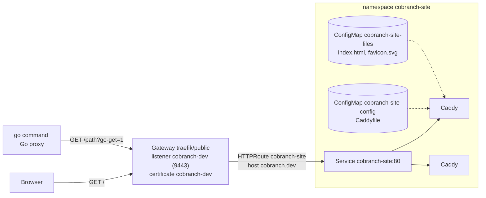

# Cobranch's site

**Decision**: `https://cobranch.dev`, the domain of Cobranch the open-source product, serves a static "Coming soon" page about Cobranch's features and capabilities, with no functionality: no scripts, no forms, nothing from another origin. One Caddy, Application `cobranch-site`, serves it from this repository's `platform/cobranch-site/manifests/site`, and also answers the `go` command's import requests for the domain, which is Cobranch's module path, so `go get cobranch.dev/...` keeps resolving. Linear: [ENG-232](https://linear.app/arikkfir/issue/ENG-232), which also launches Cobranch's hosted service at `cobranch.app`.

## Why

The owner asked for a public face for Cobranch at its own domain while the product is built: `cobranch.dev` for the product, which anyone installs, beside `cobranch.app`, our installation of it, which people sign up to. Until now the domain served only Cobranch's Go import page, from [`go-import`](go-import-pages.md), which sent browsers to the repository on GitHub.

## Design

| Request | Answer |
| --- | --- |
| `go-get=1`, any path | `200` with `<meta name="go-import" content="cobranch.dev git https://github.com/arikkfir-org/cobranch">` |
| `/`, `/index.html`, `/favicon.svg` | The file, with a Content-Security-Policy that admits only its own inline styles and images, and five minutes of caching |
| Any other path | `302` to `/` |
| `/healthz` | `200`, for the probes |

The page uses Cobranch's design system ([its tokens](../../cobranch/designs/design-system.md)): ink on white, inverted in the system's dark mode, violet only for AI, and a branch drawn as the Console will show it. It names the product, its principles and what it builds in, and links only to the public repository on GitHub, its design and its license. It says nothing about the hub, and nothing yet about `cobranch.app`, which links in once that answers.

### In the cluster

| Piece | Value |
| --- | --- |
| Application | `cobranch-site`, wave 4 (its route needs Traefik's Gateway API), `platform/cobranch-site/manifests`, project `default` |
| Namespace | `cobranch-site`, labelled `kfirs.com/public-ingress: "true"` and `pod-security.kubernetes.io/enforce: restricted` by the Application |
| ConfigMaps | `cobranch-site-config` (the Caddyfile) and `cobranch-site-files` (the site), from kustomize's `configMapGenerator`: each name carries a hash of its files, so a change rolls the Deployment out with no Reloader |
| Deployment | Two replicas of `docker.io/library/caddy:2.11.7-alpine`, spread over nodes, on node pool `system` ([node pools](node-pools.md)); a PodDisruptionBudget of `maxUnavailable: 1` ([disruption budgets](disruption-budgets.md)); rolls out by surging; the same container settings and requests as `go-import`'s ([resource requests](resource-requests.md)) |
| Service | `cobranch-site`, port 80 to 8080 |
| NetworkPolicy | `cobranch-site`: only namespace `traefik`, on 8080 |
| HTTPRoute | `cobranch-site`, host `cobranch.dev`, on listener `cobranch-dev` of Gateway `traefik/public` |
| Listener `cobranch-dev` | Admits routes only from namespace `cobranch-site`, while it carries `kfirs.com/public-ingress: "true"`; certificate `cobranch-dev`, solved in zone `cobranch-dev` ([platform](../platform.md#certificates)) |

What `infra` provides, the zone `cobranch-dev`, the apex record on the public gateway's address and cert-manager's grant on the zone, is documented in its pages ([DNS](../../infra/terraform/gcp.md#dns), [IAM](../../infra/terraform/gcp.md#iam)).

## Decisions

| Decision | Why | Rejected |
| --- | --- | --- |
| The site's Caddy answers the domain's `go-get` requests too | A host's requests reach one backend: the Go import page and the site share every path, and only the query tells them apart. Caddy's matcher reads the query; a route that sends `go-get=1` elsewhere relies on match precedence by query parameters, which Gateway API leaves to the implementation | Keeping `cobranch.dev` in `go-import` with an HTTPRoute query match; serving the site from `go-import`, which would make it a site server for one domain |
| The site's files in this repository | A static page with no build, deployed like every other hub site; the product's repository stays free of our installation | Its source in `arikkfir-org/cobranch`, built into an image of its own: a pipeline and a registry for one page |
| Plain HTML and CSS, no scripts | "No functionality, completely static" (owner, 2026-11-01); nothing to keep patched, and a policy that refuses every script | A static-site generator; a JavaScript framework |
| Fonts from the visitor's system | Inter and JetBrains Mono when installed, the system's sans and mono otherwise; nothing loads from another origin | Google Fonts, a third party seeing every visit; fonts in the ConfigMap, which would be most of its size |
| Unknown paths redirect to `/` | Someone who follows a package path, such as `cobranch.dev/internal/...`, lands on the page rather than a blank `404` | `404` |

## Security and failure modes

- **Public by design.** Anyone reaches `cobranch.dev`; it serves files and nothing else. The Content-Security-Policy refuses every script, frame, form and other origin, so even a mistake in the page can't run code.
- **The `go-import` tag.** It names only the public repository. If `cobranch-site` is down, `go get` of Cobranch's packages that the Go proxy hasn't cached fails until it is back; two replicas and a budget keep one serving through a drain.
- **The listener.** Only namespace `cobranch-site` can attach routes for `cobranch.dev`, and only while it carries the label; its contents come from reviewed commits on this repository's `main`.

## Rollout

1. This repository, in one pull request: Application `cobranch-site` and its manifests, `go-import` without `cobranch.dev`, and listener `cobranch-dev` admitting `cobranch-site` instead of `go-import`. Argo CD syncs the three Applications separately, so for a minute or so `cobranch.dev` may answer `404` until both routes and the listener settle.
2. Open `https://cobranch.dev`, then check `curl -s 'https://cobranch.dev/cmd/cobranch?go-get=1'` returns the `go-import` tag.
