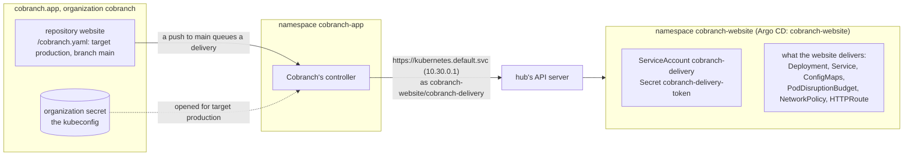

# Cobranch's website, delivered by Cobranch

**Decision**: Cobranch's website is repository `website` of organization `cobranch` on `cobranch.app`, and Cobranch's own delivery deploys it to the hub: target `production` of its `main` applies, through a kubeconfig the organization keeps as a secret, into namespace `cobranch-website`, as ServiceAccount `cobranch-delivery`, which may change only the kinds the website needs, there alone. This repository makes the namespace and the account; Cobranch delivers everything that runs in it. Linear: [ENG-270](https://linear.app/arikkfir/issue/ENG-270), dogfooding Cobranch with its own website.

## Why

The owner wants Cobranch to build and ship Cobranch's own things, starting with its website, so its delivery is used as a real organization uses it (owner, 2026-11-25). `cobranch.app` doesn't deliver into its own cluster: `delivery.inCluster.enabled` is off, since it would let every organization make namespaces in the hub. The owner chose instead a namespace for organization `cobranch` alone (decision card, 2026-11-27), which Cobranch reaches as it reaches any other cluster: through a kubeconfig ([Cobranch's delivery, other clusters](../../cobranch/designs/delivery.md#other-clusters)).

## Design



| Piece | Value |
| --- | --- |
| Application | `cobranch-website`, `platform/cobranch-website/manifests`, project `default` |
| Namespace | `cobranch-website`, labelled `pod-security.kubernetes.io/enforce: restricted` by the Application; not `kfirs.com/public-ingress` until the website takes over `cobranch.dev` |
| ServiceAccount | `cobranch-delivery`, no token mounted anywhere; its token in Secret `cobranch-delivery-token`, which Kubernetes fills and keeps until the Secret is deleted |
| Role `cobranch-delivery` | Every verb on ConfigMaps, Services, Deployments, PodDisruptionBudgets, NetworkPolicies and HTTPRoutes, in `cobranch-website` |
| ClusterRole `cobranch-website-namespace` | `get` on namespace `cobranch-website` alone: Cobranch reads an environment's namespace first, uses one that exists, and tries to make one it may not read |
| `cobranch.app`'s `delivery.clusters.allowedCIDRs` | `10.30.0.1/32`, Service `default/kubernetes`: the one private address a target's kubeconfig may name. The controller refuses every other address in `jobs.egress.except` |

The website's own repository holds what runs here, rendered by Cobranch from its `main`: the Caddy that serves its pages, two replicas on node pool `system` ([node pools](node-pools.md)), with a PodDisruptionBudget ([disruption budgets](disruption-budgets.md)), requests ([resource requests](resource-requests.md)) and a NetworkPolicy that admits only Traefik.

### The kubeconfig

The owner builds it once, from the token Secret, and adds it as an organization secret in the Console (organization `cobranch`, Settings, Secrets); the website's `/cobranch.yaml` names that secret's ID as target `production`'s `cluster`, and the target's principal gets the Secret reader role on it. Cobranch accepts only an `https` server, the CA inline and a token inline:

```sh
ns=cobranch-website
kubectl -n "$ns" get secret cobranch-delivery-token -o json | jq -r --arg ns "$ns" '
  "apiVersion: v1\nkind: Config\nclusters:\n- name: hub\n  cluster:\n    server: https://kubernetes.default.svc.cluster.local\n    certificate-authority-data: \(.data["ca.crt"])\nusers:\n- name: cobranch-delivery\n  user:\n    token: \(.data.token | @base64d)\ncontexts:\n- name: hub\n  context:\n    cluster: hub\n    user: cobranch-delivery\n    namespace: \($ns)\ncurrent-context: hub"'
```

## Decisions

| Decision | Why | Rejected |
| --- | --- | --- |
| A namespace and an account for organization `cobranch` alone | Dogfoods delivery now, without opening the hub to every organization of `cobranch.app` (owner, 2026-11-27) | `delivery.inCluster.enabled` on `cobranch.app`: every organization could make namespaces in the hub |
| Reach the API server at its in-cluster address | The controller runs in the hub, so its calls stay inside the cluster; the control plane's only other endpoint is GKE's DNS-based one, which the hub reaches with Google credentials ([the cluster](../../infra/terraform/gcp.md)) | The DNS-based endpoint, whose Google credentials need an exec plugin, which Cobranch refuses, or a key, which the hub never issues |
| Admit `10.30.0.1/32` alone | Any organization's kubeconfig may name the address, but reaches nothing without a token the API server takes; every other private address stays refused | Admitting `10.30.0.0/20`, every Service of the hub |
| A token Secret, not a short-lived token | Cobranch keeps a kubeconfig as a secret and never refreshes it; deleting the Secret revokes it | `kubectl create token`, which expires within a day by default |
| The namespace from Argo CD, read-only to Cobranch | Cobranch uses a namespace that exists and never deletes one it didn't make, so a teardown leaves the account in place | Letting Cobranch make it: the account would need to make namespaces, cluster-wide |

## Security and failure modes

- **The account's reach** is the Role's kinds in one namespace: it can't read Secrets, make pods directly, bind roles or touch another namespace. Pod Security `restricted` holds whatever its Deployments run.
- **A leaked kubeconfig** gives that much and no more. Revoke it by deleting Secret `cobranch-delivery-token` (Argo CD makes it again, with a new token), then replace the organization's secret.
- **Public exposure** waits for a change here: the namespace carries no `kfirs.com/public-ingress`, and no listener admits it, so an HTTPRoute delivered there attaches to nothing.
- **Cobranch's delivery fails** (a render error, the API server unreachable): the environment shows it, and what runs stays as it was.

## Rollout

1. Merge this: Argo CD makes the namespace and the account, and `cobranch.app` admits the address.
2. The owner builds the kubeconfig (above) and adds it as an organization secret of `cobranch`.
3. The website's `/cobranch.yaml` names target `production`; its principal gets Secret reader on that secret; its first push to `main` delivers.
4. Later, in a pull request of its own: listener `cobranch-dev` admits `cobranch-website` instead of `cobranch-site`, the namespace gets `kfirs.com/public-ingress`, and `cobranch-site` goes, once the website serves the Go import page too.

## Open questions

- Previews of the website's branches would need a namespace each; this design gives `main` one.
