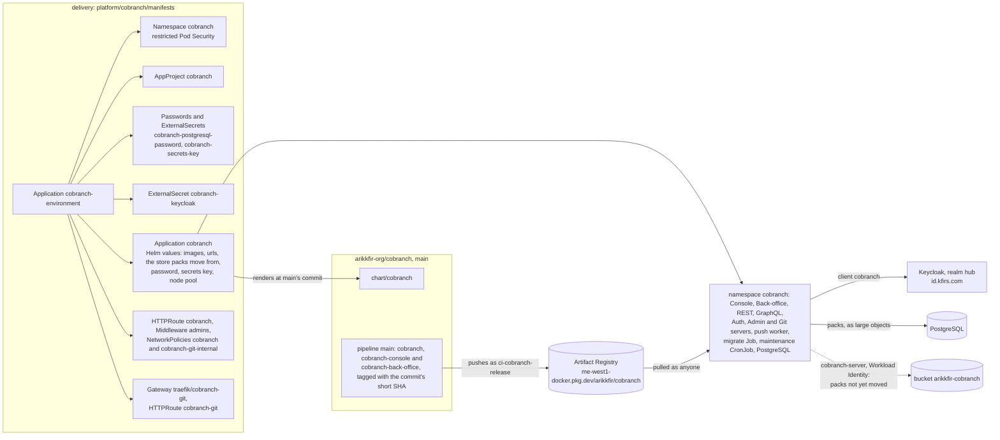
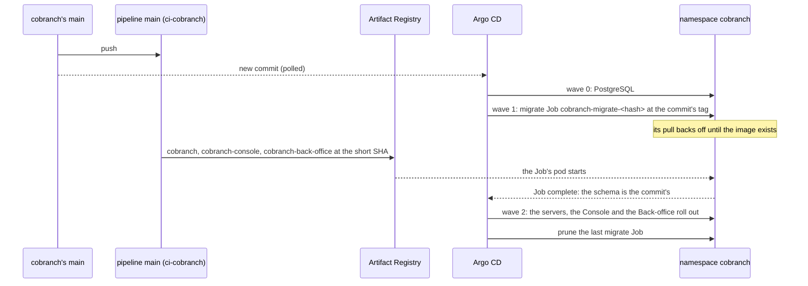
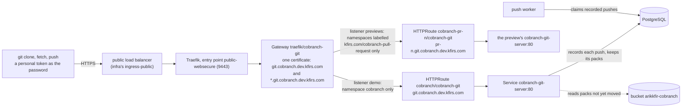

# Hosting Cobranch's demo

**Retired** (2026-11-02, [ENG-232](https://linear.app/arikkfir/issue/ENG-232)): [cobranch.app](cobranch-app.md) replaced the demo, and the owner took it down once it answered and their first push to it worked. Namespace `cobranch`, its database and its Keycloak client are gone; the previews remain, configured as cobranch.app is ([Cobranch's previews](cobranch-previews.md)). This page keeps the record of how the demo ran, in the present tense it was written in.

**Decision**: the hub runs Cobranch's `main` as a demo installation, in namespace `cobranch` at `cobranch.dev.kfirs.com`, behind the same gate as the hub's other tools: the protected gateway's sign-in, then Middleware `admins`. Argo CD installs Cobranch's Helm chart, `chart/cobranch` of [arikkfir-org/cobranch](https://github.com/arikkfir-org/cobranch), from cobranch's `main`, with the images of the commit it syncs, the way any operator installs Cobranch; everything the hub decides lives here, in `platform/cobranch/manifests`: the chart's values, the database's password, the route, the gate and who reaches each pod. Its Git server is the one exception to the gate: at `git.cobranch.dev.kfirs.com`, on the public entry point, since Git clients can't pass the hub's sign-in, and it signs every request in itself with Cobranch's personal tokens ([below](#git)). Linear: [ENG-209](https://linear.app/arikkfir/issue/ENG-209); the images come from [ENG-207](https://linear.app/arikkfir/issue/ENG-207)'s first part. Each open pull request that cobranch's members open gets a preview of its own, beside the demo: [Cobranch's previews](cobranch-previews.md).

Cobranch was DevHub until [ENG-221](https://linear.app/arikkfir/issue/ENG-221) renamed it: its demo ran in namespace `devhub` at `devhub.dev.kfirs.com`, from `apps/devhub-environment.yaml`, and its previews in `devhub-pr-<number>`. Removing Application `devhub` and ApplicationSet `devhub-pull-requests` deleted them, through their resources finalizers; what Argo CD needed while it deleted them, AppProjects `devhub` and `devhub-pull-requests` and the `devhub-*` policies, stayed in `devhub-environment` until removing it deleted them too, through its own. The new demo starts with an empty database: the old one held nothing.

## Why

Cobranch had no running installation: trying what `main` does meant building both images and installing the chart by hand. A demo that follows `main` shows every merge within minutes, to the people who reach the hub's tools and to no one else. Cobranch itself stays the product: nothing in its chart names the hub, and the hub hosts it as an operator would ([Cobranch's repository](https://github.com/arikkfir-org/cobranch#readme)).

## Design

What `infra` provides, its repository `cobranch`, its bucket `arikkfir-cobranch`, the grants on both and the record for `cobranch.dev`, is documented in its pages: [Artifact Registry](../../infra/terraform/gcp.md#artifact-registry), [buckets](../../infra/terraform/gcp.md#buckets), [IAM](../../infra/terraform/gcp.md#iam) and [DNS](../../infra/terraform/gcp.md#dns).

### A merge to cobranch's main

Argo CD can sync a commit before its pipeline has pushed its images. The migrate Job, the chart's first wave after PostgreSQL, then waits for its image, retrying the pull, within its deadline, raised here to 30 minutes; the servers, which need the schema it migrates, and the Console, which calls them, roll out only once it is done, and the old pods keep serving meanwhile. A Job that fails keeps its commit failing: the Job is named by a hash of its spec, so syncing the same commit again finds the same failed Job. Argo CD retries a failed sync from `main`'s newest commit, whose Job, if it is a newer commit, has a new name. The Job runs image `cobranch`; the Console runs `cobranch-console` and the Back-office `cobranch-back-office`, which the pipeline pushes right after, and each waits for its image within its Deployment's own 10-minute progress deadline. One that misses it fails the sync, which a retry of the same commit recovers once the image is there.

### The hub's side

| Cobranch asks for | The hub provides |
| --- | --- |
| The chart, installed with its values | Application `cobranch`, project `cobranch`: source `chart/cobranch` of `https://github.com/arikkfir-org/cobranch` at `main`, release `cobranch`, Helm's tests skipped (`skipTests`), automated sync with prune (which removes each superseded migrate Job) and self-heal, retries; no `CreateNamespace`. |
| Its images | `images.cobranch.repository`, `images.console.repository` and `images.backOffice.repository` in `me-west1-docker.pkg.dev/arikkfir/cobranch`, tagged `${ARGOCD_APP_REVISION_SHORT}`, the synced commit's first 7 characters, as Helm parameters (Argo CD substitutes its build environment in parameters only), as strings |
| `urls.console`, `urls.rest`, `urls.graphql`, `urls.auth`, `urls.admin`, `urls.backOffice` | `https://cobranch.dev.kfirs.com`, `…/api`, `…/graphql`, `…/auth`, `…/admin` and `…/back-office`: the servers' CORS origins and the URLs the Console's and the Back-office's `config.json` give. `urls.admin` runs the Admin server and the Back-office. One host, so Cobranch's session cookie is `__Host-cobranch-session`. The chart's own routes stay off (`httpRoute.enabled: false`): the hub's carries the gate |
| `urls.git` | `https://git.cobranch.dev.kfirs.com`, a host of its own on the public entry point ([below](#git)): it runs the Git server and the push worker, and the Console gives it as the base of every clone URL |
| `auth.providers`, `auth.admins` | Provider `hub`: issuer `https://id.kfirs.com/realms/hub`, client `cobranch` ([infra's Keycloak](../../infra/terraform/keycloak.md#clients)), so the demo's sign-in is the hub's Google sign-in, for the people realm `hub` declares. Its secret: Secret `cobranch-keycloak`, key `client-secret`, from ExternalSecret `cobranch-keycloak` on `keycloak-cobranch-client-secret` ([Secret Manager](../../infra/terraform/gcp.md#secret-manager)), which only the Auth server reads. The owner's email in `auth.admins` makes them the installation's administrator, who runs it from the Back-office at `/back-office` |
| `blob.url`, `blob.moveFrom` | `blob.url` unset: Git's packs live in the database, as large objects, Cobranch's default ([ENG-237](https://linear.app/arikkfir/issue/ENG-237)). `blob.moveFrom` is `gs://arikkfir-cobranch`, where the demo kept them until then: the Git servers read from it what the database lacks, and the maintenance CronJob's job copies it over every hour, both as ServiceAccount `cobranch-server` through Workload Identity, with no Google service account or key. Once a job logs `Moved every object`, `moveFrom` goes; the bucket and its grant go with the demo ([ENG-232](https://linear.app/arikkfir/issue/ENG-232)) |
| `postgresql.image` | `docker.io/library/postgres:18.6-alpine`, set here rather than taken from the chart ([decisions](#decisions)) |
| `postgresql.auth.existingSecret` | Secret `cobranch-postgresql-password`, key `password`, made once in the cluster by an ESO `Password` generator (`refreshPolicy: CreatedOnce`): under Argo CD the chart can't keep a password of its own |
| `secretsKey.existingSecret`, `secretsKey.secretKey` | Secret `cobranch-secrets-key`, key `password`, 48 letters and digits made once in the cluster the same way: the chart's own key would change at every render. The Auth and Admin servers seal the client secrets of the identity providers the Back-office adds with it |
| Placement | Every pod on node pool `system` (`nodeSelector` and `tolerations` of `authServer`, `restServer`, `graphqlServer`, `adminServer`, `gitServer`, `pushWorker`, `console`, `backOffice`, `migrate`, `maintenance` and `postgresql`) ([node pools](node-pools.md)) |
| Time for the images | `migrate.activeDeadlineSeconds: 1800` for image `cobranch` (the Console and the Back-office wait for theirs within their Deployments' default 10 minutes), and ten retries of a failed sync, each from `main`'s newest commit ([above](#a-merge-to-cobranchs-main)) |
| A route to each workload | HTTPRoute `cobranch` on Gateway `traefik/protected`, host `cobranch.dev.kfirs.com`: `/api` to `cobranch-rest-server`, `/graphql` to `cobranch-graphql-server`, `/auth` to `cobranch-auth-server`, `/admin` to `cobranch-admin-server` and `/back-office` to `cobranch-back-office`, each prefix rewritten to `/`, and everything else to `cobranch-console`; Middleware `admins` on every rule. HTTPRoute `cobranch-git` on Gateway `traefik/cobranch-git`, listener `demo`, host `git.cobranch.dev.kfirs.com`: everything to `cobranch-git-server`, with no Middleware |
| Network admission | NetworkPolicy `cobranch`: only namespace `traefik`, on 8080, to the Console's, the Back-office's and the servers' pods, the Auth, Admin and Git servers' included. NetworkPolicy `cobranch-git-internal`: only the REST and GraphQL servers' pods, on 8081, to the Git server's, for their internal call that reads trees and files. The chart's own admits only the servers, the push worker and the migrate Job to PostgreSQL |

Replicas, budgets, rollouts and requests are the chart's: two of the Console, of each server but the Admin server and of the push worker, one Admin server and one Back-office, each with a budget of `maxUnavailable: 1`, rolling out by surging, and one PostgreSQL on an 8Gi volume of the cluster's default storage class.

AppProject `cobranch` admits sources from cobranch's repository only, destination namespace `cobranch` only, no cluster-scoped kind, and the namespaced kinds the chart renders: Deployments, a StatefulSet, Services, a ServiceAccount, Jobs, CronJobs, PodDisruptionBudgets and a NetworkPolicy. A chart change that renders anything else, a Secret or an HTTPRoute say, fails the sync until the project admits it here.

### Git

Git clients can't pass the hub's sign-in: they follow no redirect to Keycloak and send only a Basic password or a bearer token. The Git server therefore sits on the public entry point, which signs nobody in and strips the sign-in's identity headers, and signs every request in itself: `401` with a Basic challenge without a personal token, `404` when the token's user can't read the repository, and a token reaches only what both its list and its user's grants allow ([Git over HTTPS](../../cobranch/designs/git-hosting.md#git-over-https)). Every other workload stays behind the gate. Gateway `traefik/cobranch-git` (`git-gateway.yaml`) is the demo's and every preview's: its listener `demo` takes routes from namespace `cobranch` alone, `previews` from the previews' namespaces, which policy `cobranch-http-routes` holds to their own host and to Service `cobranch-git-server` ([Cobranch's previews](cobranch-previews.md)). infra's records `git.cobranch.dev` and `*.git.cobranch.dev` send both names to the public gateway's address ([DNS](../../infra/terraform/gcp.md#dns)).

The chart renders the Git server and the push worker only once `urls.git` is set; their values here wait for the chart that knows them, since its schema refuses keys it doesn't know. Neither has an override but its placement: the chart's sizes (a 10Gi pack cache on a 16Gi emptyDir that it doesn't reserve, pushes up to 2Gi) are ceilings the demo's few repositories never reach.

## Decisions

| Decision | Why | Rejected |
| --- | --- | --- |
| Follow cobranch's `main`, with the synced commit's images | A demo of what was merged, minutes after the merge, as Fin's production follows Fin's `main` | Pinning a version ([Cobranch's releases](../../cobranch/designs/repository.md)): the demo would show only what was released, and take a pull request here per release |
| One host, the APIs under `/api` and `/graphql` | The Console calls the REST API from the same origin, so the sign-in's cookie goes with every call and no CORS preflight meets the sign-in's redirect; the wildcard `*.dev.kfirs.com` certificate covers one name | A host per workload: cross-origin calls behind a sign-in that redirects |
| The Back-office and the Admin API on the same host, under `/back-office` and `/admin` | Cobranch's session cookie keeps the `__Host-` prefix only while every workload shares one host, and that prefix is what keeps a preview from setting the demo's cookie; the Back-office then calls the Admin API from its own origin, as the Console calls REST ([ENG-219](https://linear.app/arikkfir/issue/ENG-219)) | A host of their own, such as `cobranch-admin.dev.kfirs.com`: the cookie would have to name the parent domain, which every preview shares |
| The hub's own HTTPRoute, the chart's off | The gate, Middleware `admins`, is Traefik's and the hub's; the hub's other hosted products (Octomaton) keep their routes here too | The chart's routes with a filters value in Cobranch's chart |
| The protected gateway and Middleware `admins` | The same gate as the docs site and every other tool: signed in, and in group `admins` ([admins only](admins-only.md)) | Any signed-in user, Fin's test users included |
| The chart's bundled PostgreSQL | Nothing to provision; a demo's data can be lost | Cloud SQL |
| Git's packs in PostgreSQL, Cobranch's default | One store to run, which both Git servers share; no installation of ours keeps Git objects in a bucket (owner, 2026-11-01, [ENG-237](https://linear.app/arikkfir/issue/ENG-237)) | Bucket `arikkfir-cobranch`, which the demo used until then; `file://` on an `emptyDir`, which two replicas can't share |
| Moving the packs over, not starting empty | The demo's repositories keep their history: maintenance copies the bucket's packs into the database while the Git servers read from either, and deletes nothing | Dropping the bucket's packs, which the database's repositories still name |
| PostgreSQL's image pinned here | A new major can't start on the old one's data, so moving to it is a dump and restore done on purpose, in a change of this repository, as for [cobranch.app](cobranch-app.md#decisions) | Following the chart's image, which a merge to Cobranch's `main` can move to a new major under live data |
| Images in Cobranch's own public repository | Cobranch is a product other clusters install ([ENG-207](https://linear.app/arikkfir/issue/ENG-207)) | The hub's private `images` |
| The chart's values inline in the Application, its only source | As Fin's and Octomaton's Applications hold their `kustomize` options: the product's repository is the only source, so the build environment's revision is its commit | A second source, this repository, for `platform/cobranch/values.yaml` |
| An AppProject of its own | Every merge to cobranch's `main` changes the cluster; the project holds it to its namespace and the chart's kinds | Project `default` |
| The Git server on the public entry point, the rest behind the gate | Git clients can't follow the sign-in, and the Git server signs every request in with Cobranch's personal tokens (owner, 2026-11-01) | Git behind the sign-in, which no Git client passes; leaving Git off the hub until SSH |
| A Gateway of its own, `traefik/cobranch-git` | Listeners on `traefik/public` admit only namespaces labelled `kfirs.com/public-ingress`, which would let any route of theirs answer for any `*.kfirs.com` name, and which no preview may carry; this Gateway admits namespace `cobranch` and the previews' alone, each to its own Git host | Listeners on `traefik/public`, with the label on `cobranch` and the previews' namespaces |
| One certificate for `git.cobranch.dev.kfirs.com` and `*.git.cobranch.dev.kfirs.com` | A wildcard covers one label, and a certificate per preview would run into Let's Encrypt's 50 a week for `kfirs.com`, as for the previews' own hosts | The wildcard `*.kfirs.com`, which covers neither name |

## Security and failure modes

- **Only admins reach it.** The protected entry point signs every request in, and Middleware `admins` answers 403 to anyone outside group `admins`. Cobranch's own sign-in, through Keycloak client `cobranch`, comes after that gate: the same people, signed in twice. The Git server alone is the exception ([Git](#git)).
- **The Git server faces the internet.** Anyone reaches `git.cobranch.dev.kfirs.com`; without a personal token it answers 401 to every repository, and it shows a token's user only the repositories their grants and the token's list let them read. A leaked token reaches what its list names until it ends or its user revokes it. A personal token is made only from a signed-in session, so only the people who pass the gate can make one.
- **Long pushes.** Traefik's entry points give a request 60 seconds to arrive, their default, so a push whose upload takes longer fails; the demo's repositories are small.
- **The Back-office.** It sits behind the same gate, and the Admin API checks every call's permissions: only those `auth.admins` lists, the owner, hold Installation admin, and anyone else who signs in gets 403 from it. Entering an organization from the Back-office makes the administrator its Owner and is recorded in its audit trail.
- **The Keycloak client's secret.** Secret `cobranch-keycloak` holds it, synced from Secret Manager; the chart hands it to the Auth server alone. Bumping `cobranch` in infra's `local.secret_versions` rotates it: External Secrets syncs the new value within its refresh interval, and Reloader (`reloader.stakater.com/auto` on the Auth server's pods) restarts the Auth server with it, so sign-in fails only between the two, at most an hour.
- **A merge reaches the cluster unreviewed by this repository.** The project admits only namespace `cobranch` and the chart's kinds, with no cluster-scoped object, no Secret and no route; the namespace enforces the restricted Pod Security Standard; the only cloud grant is `cobranch-server`'s, on its own bucket, which the demo reads only until its packs have moved into the database.
- **Images late or missing.** A commit whose pipeline fails never gets its images, nor does one that a newer push overtakes while its build waits (pipeline `main` builds only `main`'s newest commit). Its migrate Job waits for image `cobranch`, the old pods keep serving, and the Job fails after 30 minutes. A retry then syncs `main`'s newest commit, whose Job has a new name; if there is none, the sync stays failed until the next commit. If only image `cobranch-console` is missing, the Job and the servers roll out and the sync fails at the Console's 10-minute progress deadline instead; the retries recover it once the image is pushed.
- **The password.** Deleting Secret `cobranch-postgresql-password` makes a new one, which the database, initialized with the old one, refuses: delete the database's volume too, and its data with it.
- **The secrets key.** Deleting Secret `cobranch-secrets-key` makes a new one: the client secrets of the identity providers added in the Back-office no longer open, those providers leave the sign-in page, and an administrator enters each secret again.
- **Losing the data.** The database lives on one volume, without backups; the demo's data is disposable.
- **The move into the database.** During the first rollout with `blob.moveFrom`, a Git server not yet rolled out still reads only the bucket, so a fetch it serves for a pack a rolled-out one has just written to the database fails until both have rolled out: the change merges in a quiet moment ([Git object storage](../../cobranch/designs/git-object-storage.md)). While packs move, maintenance's compaction and a repository's deletion delete packs from both stores, so the bucket is a full copy only until either runs: restoring `blob.url: gs://arikkfir-cobranch` is a rollback only before then; after, move back with `blob.url: gs://arikkfir-cobranch` and `blob.moveFrom: postgres://`.

## Rollout

1. `infra`: repository `cobranch` with its grants, bucket `arikkfir-cobranch` with its grant, and record `cobranch.dev` ([infra#96](https://github.com/arikkfir-org/infra/pull/96); DevHub's came from [infra#91](https://github.com/arikkfir-org/infra/pull/91)), applied by pipeline `apply` on merge.
2. This repository: ServiceAccount `ci-cobranch-release` and this environment.
3. cobranch: pipeline `main`, which publishes the images of `main`'s newest commit ([cobranch#7](https://github.com/arikkfir-org/cobranch/pull/7)). Until its first run, the demo's sync failed, waiting for images; the pull request's merge was itself a new commit on `main`, which Argo CD synced.
4. cobranch: the Console rolls out with the servers, after the migrate Job ([cobranch#8](https://github.com/arikkfir-org/cobranch/pull/8)), so the Job, whose deadline this repository raises, waits for a commit's images.
5. Open `https://cobranch.dev.kfirs.com`: the Console shows the REST API's version.
6. `infra`: Keycloak client `cobranch` and its generated secret, `keycloak-cobranch-client-secret` ([infra#101](https://github.com/arikkfir-org/infra/pull/101)), applied by pipeline `apply` on merge; then cobranch: the Auth server and the chart's `urls.auth`, `auth` and `authServer` values ([cobranch#15](https://github.com/arikkfir-org/cobranch/pull/15)).
7. This repository: ExternalSecret `cobranch-keycloak`, the demo's sign-in values and `/auth` route, and the previews' seeded sign-in ([delivery#99](https://github.com/arikkfir-org/delivery/pull/99)), after both. Sign in at `https://cobranch.dev.kfirs.com` through the hub.
8. cobranch: the Admin server, the Back-office and their chart values ([cobranch#24](https://github.com/arikkfir-org/cobranch/pull/24)); then this repository: their values, routes and network admission for the demo and the previews ([delivery#100](https://github.com/arikkfir-org/delivery/pull/100)), after it, since the chart's schema refuses values it doesn't know. Open `https://cobranch.dev.kfirs.com/back-office`.
9. cobranch: the installation's settings, and the chart's `secretsKey`, which names the operator's key ([cobranch#26](https://github.com/arikkfir-org/cobranch/pull/26)); then this repository: Secret `cobranch-secrets-key` for the demo and the previews ([delivery#101](https://github.com/arikkfir-org/delivery/pull/101)); then cobranch: the identity providers, the last pull request of [ENG-219](https://linear.app/arikkfir/issue/ENG-219), whose chart generates a key when none is named, a Secret both projects refuse. Add an identity provider at `https://cobranch.dev.kfirs.com/back-office/providers`.
10. cobranch: the Git server and the push worker, and the chart's `urls.git`, `gitServer` and `pushWorker` values ([cobranch#29](https://github.com/arikkfir-org/cobranch/pull/29)), with infra's records `git.cobranch.dev` and `*.git.cobranch.dev` ([infra#103](https://github.com/arikkfir-org/infra/pull/103)); then this repository: Gateway `traefik/cobranch-git`, the demo's and the previews' Git routes, values and network admission, and policy `cobranch-http-routes`'s Git routes ([delivery#102](https://github.com/arikkfir-org/delivery/pull/102)). Make a personal token in the Console's settings, then `git clone https://git.cobranch.dev.kfirs.com/<organization>/<repository>.git` with it as the password.
11. cobranch: Git's packs in PostgreSQL by default ([cobranch#38](https://github.com/arikkfir-org/cobranch/pull/38)), and an installation's move from one store to another, `blob.moveFrom` ([cobranch#41](https://github.com/arikkfir-org/cobranch/pull/41)); then this repository: the demo's `blob.moveFrom` in place of `blob.url`, PostgreSQL's image pinned, and the previews on the default ([ENG-237](https://linear.app/arikkfir/issue/ENG-237)), after both, since the chart's schema refuses values it doesn't know. Watch the maintenance CronJob's jobs log `Moved every object`; then a pull request here drops `blob.moveFrom`.
12. This repository and `infra`: the demo goes, its data with it ([ENG-232](https://linear.app/arikkfir/issue/ENG-232)). Removing Application `cobranch`, which has no resources finalizer, with namespace `cobranch` deletes its workloads and its database's volume; the previews keep `cobranch-environment` and listener `previews` of Gateway `traefik/cobranch-git`. Then `infra` removes records `cobranch.dev` and `git.cobranch.dev`, Keycloak client `cobranch` and its secret, and bucket `arikkfir-cobranch` with its grants.
