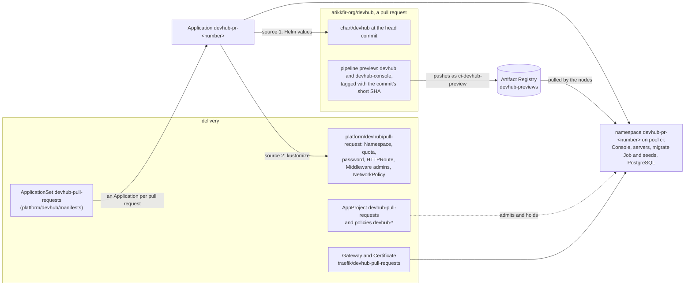
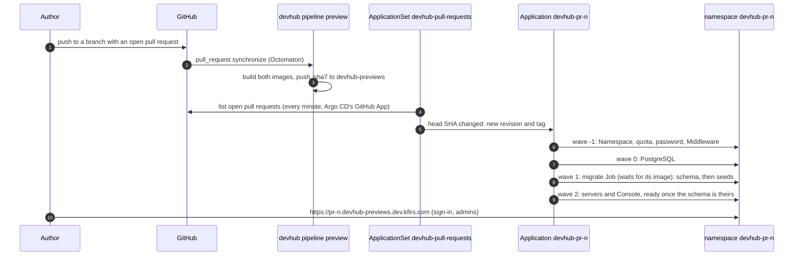
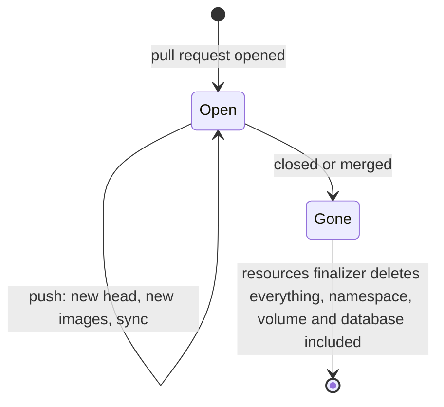
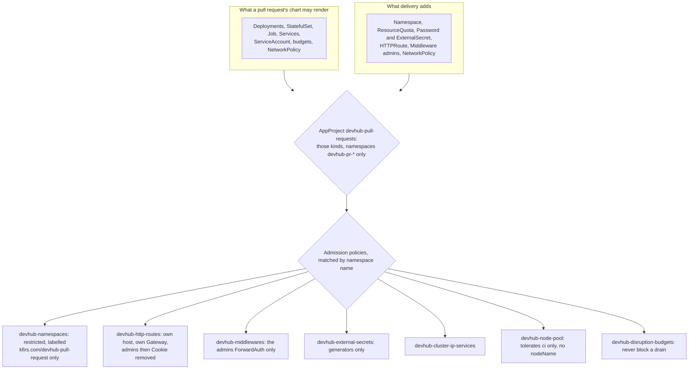

# DevHub's previews

**Decision**: every open pull request of [arikkfir-org/devhub](https://github.com/arikkfir-org/devhub) gets a DevHub of its own, a preview: namespace `devhub-pr-<number>`, at `https://pr-<number>.devhub-previews.dev.kfirs.com`, behind the hub's sign-in and Middleware `admins`, as the [demo](devhub.md) is. Argo CD installs DevHub's chart from the pull request's head commit, with that commit's images and its demo data (`seed.enabled`), on node pool `ci`; closing or merging the pull request deletes it, database and all. A pull request's code decides what runs in its namespace, so an AppProject admits only the kinds a preview needs and admission policies hold what each may say. Linear: [ENG-208](https://linear.app/arikkfir/issue/ENG-208). DevHub's side, the seeds and the preview pipeline, is the [Helm chart design](https://claude.ai/artifact/LyMHXgSoNQNgHtHNfEjvA8#previews)'s.

## Why

A reviewer of a DevHub pull request had to build both images and install the chart to try it. A preview shows the change within minutes of a push, seeded, with nothing to register or set up. Fin's pull requests have had this since its [environments](../../fin/designs/environments.md); DevHub's follow the same shape, with the differences below.

## Design

What `infra` provides, repository `devhub-previews`, `ci-devhub-preview`'s grant on it and the record `*.devhub-previews.dev`, is documented in its pages: [Artifact Registry](../../infra/terraform/gcp.md#artifact-registry), [IAM](../../infra/terraform/gcp.md#iam) and [DNS](../../infra/terraform/gcp.md#dns).

### A push to a pull request

A sync can start before pipeline `preview` has pushed the commit's images: the migrate Job waits for its image within `migrate.activeDeadlineSeconds` (1800 seconds), and the servers and the Console wait for the Job. The seeds keep a version table of their own, so a preview upgraded in place runs only the new ones.

### When the pull request closes

The generator stops listing a closed pull request, the ApplicationSet deletes its Application, and the resources finalizer deletes what it made, the Namespace with it. A reopened pull request starts again from an empty database.

### What holds a preview

| Holds | How |
| --- | --- |
| No cloud role | No grant in `infra` names a `devhub-pr-*` namespace, and no Workload Identity pool trusts one. The bucket is a `file://` directory on each server's emptyDir |
| No Secret but its own | AppProject admits no Secret; the database's password comes from a Password generator; ClusterSecretStore `gcp-secret-manager` refuses namespaces labelled `kfirs.com/devhub-pull-request`, and policy `devhub-external-secrets` admits only generators |
| No reach beyond its host | Services are ClusterIP; routes attach only to `traefik/devhub-pull-requests`, with the namespace's own host; NetworkPolicy `devhub` admits only Traefik to the servers and the Console, the chart's own only the servers and the Job to PostgreSQL |
| No hub session | Every rule asks Middleware `admins`, which reads the hub's session cookie, then removes `Cookie`: browsers send that cookie (domain `.kfirs.com`) to previews too |
| No room beyond its share | ResourceQuota `devhub`: 2 CPUs and 4Gi requested, 8Gi of memory limits, 10 pods, one 2Gi volume |
| No other pool | Policy `devhub-node-pool`: pods tolerate only `kfirs.com/pool=ci` and name no node; budgets let every pod go, so a preview never keeps a CI node up |

## Decisions

| Decision | Why | Rejected |
| --- | --- | --- |
| Node pool `ci` | devhub's pull requests' code already runs there, in CI; it scales from zero and costs nothing new (owner, 2026-10-30) | `system`, beside Argo CD, Traefik and Keycloak; `fin`, Fin's own; a fourth pool to pay for |
| Repository `devhub-previews` and ServiceAccount `ci-devhub-preview`, from any branch | `devhub` is public and its pull requests' CI runs Dependabot's code: it must not be able to replace Fin's preview images in `previews`, nor `devhub`'s `main` and release tags | `previews`, shared with Fin; `ci-devhub-release`, `main` and `v*` only |
| Host `pr-<number>.devhub-previews.dev.kfirs.com` | Off the demo's `devhub.dev`: nothing DevHub scopes to the demo's domain reaches a pull request's code | `pr-<number>.devhub.dev.kfirs.com` |
| Label `kfirs.com/devhub-pull-request` | Fin's `kfirs.com/pull-request` also admits a namespace to NATS, which takes no credentials, and to Fin's Gateway | Reusing Fin's label |
| The route, Middleware, quota and password from delivery, as a second source | A pull request's code then decides no host, Gateway or gate; the chart stays the product, with nothing of the hub in it | The chart's own HTTPRoute (`httpRoute.enabled`) |
| Pull requests only, no merge queue entries | A preview is for a reviewer; DevHub's CI tests the chart on kind for every merge group | Fin's per-entry environments, which its end-to-end suite needs |

## Security and failure modes

- A preview runs a pull request's code on pool `ci`, beside other repositories' CI runs, as devhub's CI already does there; only the organization's members push branches, and Octomaton ignores forks.
- A pull request opened before devhub's `seed.enabled` value existed fails to render: the chart's values schema refuses unknown keys. Rebasing it on `main` fixes it.
- Removing `Cookie` removes every cookie: once DevHub signs people in itself ([ENG-197](https://linear.app/arikkfir/issue/ENG-197)), its own session cookie needs another way through, and this design changes with it.
- A commit whose migrate Job fails keeps failing on every retry (the Job is named by a hash of its spec); the next push recovers.
- Argo CD's GitHub App lists the pull requests: the owner installs it on `devhub` as well as `fin`. Without it the ApplicationSet lists nothing and no preview appears.

## Rollout

1. `infra`: repository `devhub-previews`, its grants and the record `*.devhub-previews.dev`, applied on merge.
2. `delivery`: this design, ServiceAccount `ci-devhub-preview`, the secret store's condition, the Gateway and Certificate, AppProject, policies and ApplicationSet. The owner adds `devhub` to Argo CD's GitHub App installation.
3. `devhub`: `db/seeds/`, `seed.enabled` and pipeline `preview`. Its own pull request is the first preview.
