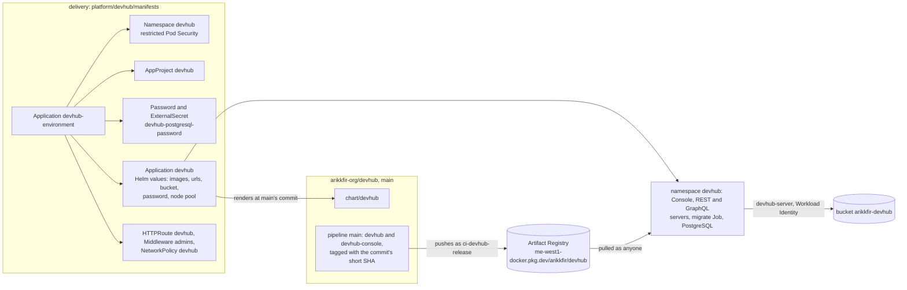
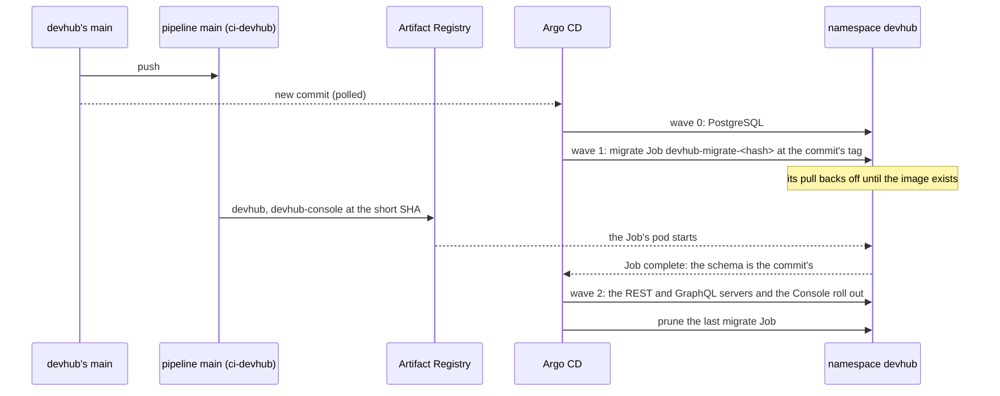

# Hosting DevHub's demo

**Decision**: the hub runs DevHub's `main` as a demo installation, in namespace `devhub` at `devhub.dev.kfirs.com`, behind the same gate as the hub's other tools: the protected gateway's sign-in, then Middleware `admins`. Argo CD installs DevHub's Helm chart, `chart/devhub` of [arikkfir-org/devhub](https://github.com/arikkfir-org/devhub), from devhub's `main`, with the images of the commit it syncs, the way any operator installs DevHub; everything the hub decides lives here, in `platform/devhub/manifests`: the chart's values, the database's password, the route, the gate and who reaches each pod. Linear: [ENG-209](https://linear.app/arikkfir/issue/ENG-209); the images come from [ENG-207](https://linear.app/arikkfir/issue/ENG-207)'s first part.

## Why

DevHub had no running installation: trying what `main` does meant building both images and installing the chart by hand. A demo that follows `main` shows every merge within minutes, to the people who reach the hub's tools and to no one else. DevHub itself stays the product: nothing in its chart names the hub, and the hub hosts it as an operator would ([DevHub's repository](https://github.com/arikkfir-org/devhub#readme)).

## Design

What `infra` provides, its repository `devhub`, its bucket `arikkfir-devhub`, the grants on both and the record for `devhub.dev`, is documented in its pages: [Artifact Registry](../../infra/terraform/gcp.md#artifact-registry), [buckets](../../infra/terraform/gcp.md#buckets), [IAM](../../infra/terraform/gcp.md#iam) and [DNS](../../infra/terraform/gcp.md#dns).

### A merge to devhub's main

Argo CD can sync a commit before its pipeline has pushed its images. The migrate Job, the chart's first wave after PostgreSQL, then waits for its image, retrying the pull, within its deadline, raised here to 30 minutes; the servers, which need the schema it migrates, and the Console, which calls them, roll out only once it is done, and the old pods keep serving meanwhile. A Job that fails keeps its commit failing: the Job is named by a hash of its spec, so syncing the same commit again finds the same failed Job. Argo CD retries a failed sync from `main`'s newest commit, whose Job, if it is a newer commit, has a new name.

### The hub's side

| DevHub asks for | The hub provides |
| --- | --- |
| The chart, installed with its values | Application `devhub`, project `devhub`: source `chart/devhub` of `https://github.com/arikkfir-org/devhub` at `main`, release `devhub`, Helm's tests skipped (`skipTests`), automated sync with prune (which removes each superseded migrate Job) and self-heal, retries; no finalizer and no `CreateNamespace` |
| Its images | `images.devhub.repository` and `images.console.repository` in `me-west1-docker.pkg.dev/arikkfir/devhub`, tagged `${ARGOCD_APP_REVISION_SHORT}`, the synced commit's first 7 characters, as Helm parameters (Argo CD substitutes its build environment in parameters only), as strings |
| `urls.console`, `urls.rest`, `urls.graphql` | `https://devhub.dev.kfirs.com`, `…/api` and `…/graphql`: the servers' CORS origin and the REST URL the Console's `config.json` gives. The chart's own routes stay off (`httpRoute.enabled: false`): the hub's carries the gate |
| `blob.url` | `gs://arikkfir-devhub`, which the servers' ServiceAccount, `devhub-server`, reaches through Workload Identity, with no Google service account or key |
| `postgresql.auth.existingSecret` | Secret `devhub-postgresql-password`, key `password`, made once in the cluster by an ESO `Password` generator (`refreshPolicy: CreatedOnce`): under Argo CD the chart can't keep a password of its own |
| Placement | Every pod on node pool `system` (`nodeSelector` and `tolerations` of `restServer`, `graphqlServer`, `console`, `migrate` and `postgresql`) ([node pools](node-pools.md)) |
| Time for the images | `migrate.activeDeadlineSeconds: 1800`, and ten retries of a failed sync, each from `main`'s newest commit ([above](#a-merge-to-devhubs-main)) |
| A route to each workload | HTTPRoute `devhub` on Gateway `traefik/protected`, host `devhub.dev.kfirs.com`: `/api` to `devhub-rest-server` and `/graphql` to `devhub-graphql-server`, each prefix rewritten to `/`, and everything else to `devhub-console`; Middleware `admins` on every rule |
| Network admission | NetworkPolicy `devhub`: only namespace `traefik`, on 8080, to the Console's and the servers' pods. The chart's own admits only the servers and the migrate Job to PostgreSQL |

Replicas, budgets, rollouts and requests are the chart's: two of each server and of the Console, each with a budget of `maxUnavailable: 1`, rolling out by surging, and one PostgreSQL on an 8Gi volume of the cluster's default storage class.

AppProject `devhub` admits sources from devhub's repository only, destination namespace `devhub` only, no cluster-scoped kind, and the namespaced kinds the chart renders: Deployments, a StatefulSet, Services, a ServiceAccount, Jobs, PodDisruptionBudgets and a NetworkPolicy. A chart change that renders anything else, a Secret or an HTTPRoute say, fails the sync until the project admits it here.

## Decisions

| Decision | Why | Rejected |
| --- | --- | --- |
| Follow devhub's `main`, with the synced commit's images | A demo of what was merged, minutes after the merge, as Fin's production follows Fin's `main` | Pinning a version, which DevHub doesn't release yet; a pull request here per merge |
| One host, the APIs under `/api` and `/graphql` | The Console calls the REST API from the same origin, so the sign-in's cookie goes with every call and no CORS preflight meets the sign-in's redirect; the wildcard `*.dev.kfirs.com` certificate covers one name | A host per workload: cross-origin calls behind a sign-in that redirects |
| The hub's own HTTPRoute, the chart's off | The gate, Middleware `admins`, is Traefik's and the hub's; the hub's other hosted products (Octomaton) keep their routes here too | The chart's routes with a filters value in DevHub's chart |
| The protected gateway and Middleware `admins` | The same gate as the docs site and every other tool: signed in, and in group `admins` ([admins only](admins-only.md)) | Any signed-in user, Fin's test users included |
| The chart's bundled PostgreSQL | Nothing to provision; a demo's data can be lost | Cloud SQL |
| A bucket in Cloud Storage | The servers need a real bucket, and two replicas of each can't share a `file://` volume | `file://` on an `emptyDir` |
| Images in DevHub's own public repository | DevHub is a product other clusters install ([ENG-207](https://linear.app/arikkfir/issue/ENG-207)) | The hub's private `images` |
| The chart's values inline in the Application, its only source | As Fin's and Octomaton's Applications hold their `kustomize` options: the product's repository is the only source, so the build environment's revision is its commit | A second source, this repository, for `platform/devhub/values.yaml` |
| An AppProject of its own | Every merge to devhub's `main` changes the cluster; the project holds it to its namespace and the chart's kinds | Project `default` |

## Security and failure modes

- **Only admins reach it.** The protected entry point signs every request in, and Middleware `admins` answers 403 to anyone outside group `admins`. DevHub has no sign-in of its own yet, so this gate is its only one.
- **A merge reaches the cluster unreviewed by this repository.** The project admits only namespace `devhub` and the chart's kinds, with no cluster-scoped object, no Secret and no route; the namespace enforces the restricted Pod Security Standard; the only cloud grant is `devhub-server`'s, on its own bucket.
- **Images late or missing.** A commit whose pipeline fails never gets its images, nor does one that a newer push overtakes while its build waits (pipeline `main` builds only `main`'s newest commit). Its migrate Job waits, the old pods keep serving, and the Job fails after 30 minutes. A retry then syncs `main`'s newest commit, whose Job has a new name; if there is none, the sync stays failed until the next commit.
- **The password.** Deleting Secret `devhub-postgresql-password` makes a new one, which the database, initialized with the old one, refuses: delete the database's volume too, and its data with it.
- **Losing the data.** The database lives on one volume, without backups; the demo's data is disposable.

## Rollout

1. `infra`: repository `devhub` with its grants, bucket `arikkfir-devhub` with its grant, and record `devhub.dev` ([infra#91](https://github.com/arikkfir-org/infra/pull/91)), applied by pipeline `apply` on merge.
2. This repository: ServiceAccount `ci-devhub-release` and this environment.
3. devhub: pipeline `main`, which publishes the images of `main`'s newest commit ([devhub#7](https://github.com/arikkfir-org/devhub/pull/7)). Until its first run, the demo's sync failed, waiting for images; the pull request's merge was itself a new commit on `main`, which Argo CD synced.
4. devhub: the Console rolls out with the servers, after the migrate Job ([devhub#8](https://github.com/arikkfir-org/devhub/pull/8)), so the Job, whose deadline this repository raises, waits for a commit's images.
5. Open `https://devhub.dev.kfirs.com`: the Console shows the REST API's version.
