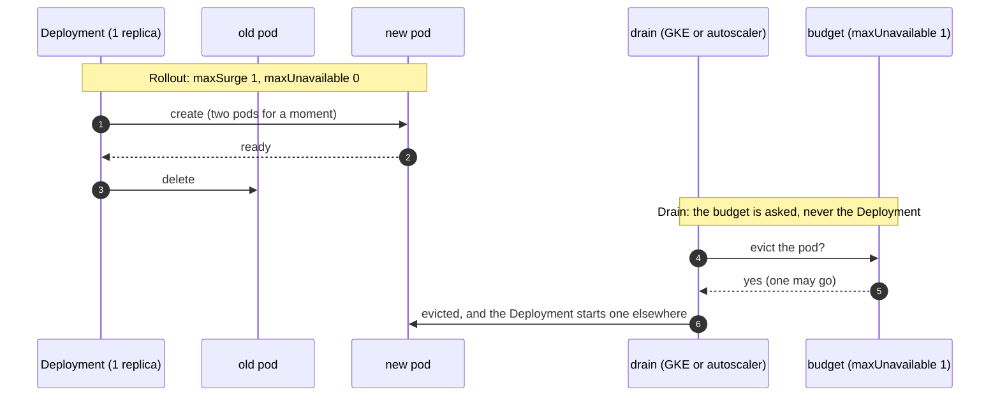
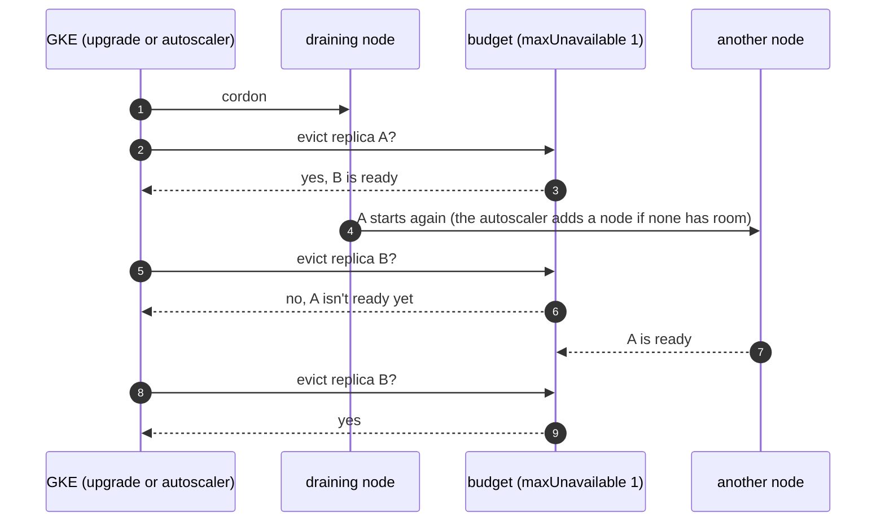
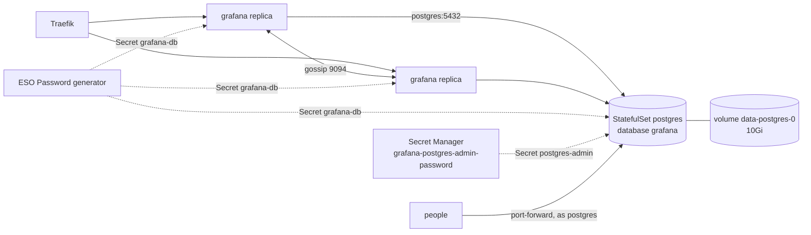

# Disruption budgets

**Decision**: Every Deployment and StatefulSet of the hub's services has a PodDisruptionBudget of `maxUnavailable: 1`, and every Deployment rolls out by surging (`maxSurge: 1`, `maxUnavailable: 0`). The services others depend on run two replicas or more, spread over nodes when the pool has several: Traefik, oauth2-proxy, the docs and tests sites, `go-import`, Grafana, KEDA's three components, Keycloak, and NATS's three servers. Every other workload runs one replica, whose budget also sets `unhealthyPodEvictionPolicy: AlwaysAllow`, so a drain can always evict it. Grafana keeps its state in a PostgreSQL in its namespace, so that two replicas can run. Octomaton's `deploy/` holds its own budgets, by this design ([Octomaton's deployment](../../octomaton/designs/deployment.md)), and Fin's `deploy/` its own. Facts: [reference](../../hub/reference.md#kubernetes-platform). Pull requests: two replicas, [delivery#12](https://github.com/arikkfir-org/delivery/pull/12) and [octomaton#11](https://github.com/arikkfir-org/octomaton/pull/11); Grafana on PostgreSQL, [infra#14](https://github.com/arikkfir-org/infra/pull/14) and [delivery#13](https://github.com/arikkfir-org/delivery/pull/13); every workload budgeted and surging, [delivery#53](https://github.com/arikkfir-org/delivery/pull/53) and [octomaton#29](https://github.com/arikkfir-org/octomaton/pull/29).

## Why

- GKE drains nodes on purpose: the old node in a surge upgrade, and a node the cluster autoscaler removes. A drain evicts pods, and a service with one replica is down until its pod runs again elsewhere, which takes an image pull, a start and a readiness probe. For Traefik and oauth2-proxy that is every request; for Octomaton, GitHub's webhook deliveries, which GitHub doesn't retry on its own.
- The owner wants every component budgeted, without running a second replica of each.
- Kubernetes' default rollout (25% each way) surges only by rounding: `maxSurge: 1`, `maxUnavailable: 0` at one to three replicas, but at five, which the Tekton webhooks' autoscalers can reach, it lets one go first. Argo CD's notifications controller used `Recreate`, which stops the old pod first.

## Design

A rollout and a drain are different paths: the Deployment controller replaces pods itself and never asks the budget, and only an eviction (a drain, a GKE node upgrade, the cluster autoscaler removing a node) does.

With two replicas, the budget keeps one serving through a drain:

### Two replicas or more

| Service | Replicas | Why several replicas work |
| --- | --- | --- |
| Traefik | 2 | Stateless; both serve both load balancers |
| oauth2-proxy | 2 | Sessions live in cookies |
| Docs and tests sites | 2 each | Each pod mounts its bucket read-only ([docs and tests servers](docs-and-tests-servers.md)) |
| `go-import` | 2 | Static answers ([Go import pages](../../hub/designs/go-import-pages.md)) |
| Grafana | 2 | State in PostgreSQL, shared; alert state gossiped between the replicas, so each alert notifies once ([below](#grafana-on-postgresql)) |
| KEDA's operator, metrics server and admission webhooks | 2 each | KEDA keeps one operator and one metrics server active and the other on standby; both webhook replicas serve |
| Keycloak | 2 | Sessions live in its PostgreSQL ([Keycloak](keycloak.md)) |
| NATS | 3 | JetStream keeps a quorum with two of three servers |
| Octomaton | 2 | Every replica serves webhooks; the Lease holder reports, schedules and cleans up |

The replicas spread by host with `whenUnsatisfiable: ScheduleAnyway`. They land on different nodes when the system pool has several, and share one otherwise, instead of making the pool grow. A drain still keeps one replica serving with a single node: the evicted replica waits for room, which the autoscaler adds, and the budget holds the second until the first is ready. What each replica requests: [resource requests](resource-requests.md).

### Single replicas

A single replica's budget needs no pod healthy, so a ready pod may always go. An unready one may go only because the budget sets `unhealthyPodEvictionPolicy: AlwaysAllow`: under the default (`IfHealthyBudget`) the API server lets an unready pod skip the budget only when the budget needs at least one healthy pod, and otherwise refuses it while no disruption is allowed, which with the only pod unready is always. A crash-looping single replica would then hold a drain until GKE's hour runs out. The evicted replica is down until its replacement is ready elsewhere. Where a workload runs more (the services above, the Tekton webhooks under their autoscalers), the budget keeps all but one serving.

### Where each is set

| Component | Workloads | Strategy set in | Budget set in |
| --- | --- | --- | --- |
| Argo CD | server, repo server, ApplicationSet and notifications controllers, Redis; the application controller (StatefulSet) | `global.deploymentStrategy`, and `notifications.deploymentStrategy` over the chart's `Recreate` (`platform/argocd/values.yaml`). Redis's Deployment takes none; the default surges its one replica | each component's `pdb` |
| cert-manager | controller, webhook, cainjector | `strategy`, `webhook.strategy`, `cainjector.strategy` | `podDisruptionBudget` of each |
| External Secrets Operator | operator, webhook, cert controller | `strategy`, `webhook.strategy`, `certController.strategy` | `platform/external-secrets/manifests`: the chart's budgets take no eviction policy |
| oauth2-proxy, Grafana, KEDA | two replicas each | `strategy`, `deploymentStrategy`, `upgradeStrategy` | the charts' |
| Traefik | two replicas | the chart's default, `maxSurge: 1`, `maxUnavailable: 0` | the chart's |
| docs, tests, `go-import` | two replicas each | the Deployment | `platform/<component>/manifests` |
| NATS | servers (StatefulSet), nats-box | `natsBox.deployment.merge` | the chart's for the servers; `platform/nats/manifests` for nats-box |
| NACK | controller | none in the chart; the default surges its one replica | `platform/nack/manifests` |
| NUI | StatefulSet | n/a | `platform/nui/manifests` |
| Reloader | controller | none in the chart; the default surges its one replica | `platform/reloader/manifests`: the chart's budget takes no eviction policy |
| Keycloak | server (the operator's StatefulSet, two instances), its operator, PostgreSQL | a patch on the operator's Deployment (`platform/keycloak-operator/manifests`) | `platform/keycloak/manifests` (server; PostgreSQL) and `platform/keycloak-operator/manifests` |
| Grafana's PostgreSQL | StatefulSet | n/a | `platform/grafana/manifests/postgres.yaml` |
| Tekton operator | operator, its webhook | the patch that places them (`platform/tekton-operator/manifests`) | `platform/tekton-operator/manifests` |
| Tekton | Pipelines' controller, webhook, remote resolvers and events controller; the proxy webhook; Triggers' controller, webhook and core interceptors; the Dashboard | TektonConfig's `options.deployments` under `pipeline`, `trigger` and `dashboard`. The operator replaces each named Deployment's whole strategy | `platform/tekton/manifests/pod-disruption-budgets.yaml` |
| Octomaton | `octomaton` (two replicas), `octomaton-logs` | its `deploy/` | its `deploy/` |

Each budget selects exactly what its workload selects. An eviction refuses a pod that two budgets select, so a broader selector would block every drain of those pods.

### Grafana on PostgreSQL

- PostgreSQL 18 (the official image, `postgres:18.6-trixie`) runs as StatefulSet `postgres` in namespace `grafana`: one replica on a 10Gi volume, with a budget of `maxUnavailable: 1` and `AlwaysAllow`. Grafana connects to `postgres.grafana.svc.cluster.local:5432` over plain TCP. NetworkPolicy `postgres` admits only Grafana's pods.
- `grafana.sql` (ConfigMap `postgres`) creates role `grafana` and database `grafana` when they're missing. It also sets the passwords of `postgres` and `grafana` from their Secrets. It is safe to run any number of times.
- The image runs `/docker-entrypoint-initdb.d` only when it creates the database. An init container runs it before every start instead. It uses the image's own functions, the way the image's `docker-ensure-initdb.sh` does, on a server that listens on its socket only. So clients connect only after the script has run, a new password applies on the next start, and a failed first start heals on the next one.
- Role `grafana`'s password is generated in the cluster, and no person handles it. An ESO `Password` generator creates it once (`refreshPolicy: CreatedOnce`, 32 letters and digits) into Secret `grafana-db`, which PostgreSQL and Grafana both read. If that Secret is deleted, the generator makes a new password. Reloader then restarts `postgres`, which sets it, and Grafana, which reads it.
- People sign in as the superuser `postgres`. Its password is the one the owner sets in Secret Manager `grafana-postgres-admin-password`, which ExternalSecret `postgres-admin` reads. A new value applies at the next start, which Reloader also triggers. They connect with `kubectl port-forward -n grafana svc/postgres 5432`. Every TCP connection needs a password, localhost included, since that's where port-forwarded connections arrive. Only the local socket is trusted, for the init container and `kubectl exec`. Long-lived roles for people or Terraform can come later.
- The database, the generator and both ExternalSecrets are sync wave -1 in the `grafana` Application. Argo CD changes Grafana only once they are healthy, so Grafana never starts without its database.
- The two replicas share sessions, users, dashboards and alert rules through the database. Their alert managers gossip over Service `grafana-headless` (port 9094), so an alert notifies once. The NetworkPolicy admits that gossip between Grafana's own pods only.

Keycloak's PostgreSQL has the same shape ([Keycloak](keycloak.md)).

## Decisions

| Decision | Why | Rejected |
| --- | --- | --- |
| `maxUnavailable: 1` on every budget, single replicas included | Drains, GKE's upgrades and the autoscaler's scale-down keep working, one replica always serves through a drain where there are two, and the budget stays right at any replica count | `minAvailable: 1`: refuses every eviction of a single replica. The autoscaler could never remove a system node holding one, GKE's upgrades would wait an hour per node and then evict anyway, and `kubectl drain` would hang. No budget for a single replica, as until 13 October |
| `AlwaysAllow` on every single replica's budget | Without it, a single replica's budget refuses to evict its pod while it isn't ready (a crash loop, an image pull), which blocks the drain. An unready pod serves nothing a budget could protect | The default `IfHealthyBudget`; setting it on the multi-replica services' budgets too, which need at least one healthy pod and so let an unready pod go already |
| Two replicas of the services others depend on, not of everything | Every other service is reached through Traefik and oauth2-proxy, so their budgets would protect nothing without those two | Two replicas of everything (the owner declined); Traefik and oauth2-proxy single |
| KEDA's three components run two each | Fin's environments scale through it: the scraper is a `ScaledJob` | One of each |
| Soft spread by host | Keeps the system pool at the size its load needs | Required anti-affinity: one node per replica, so a pool of at least two nodes |
| No surge on a drain | Kubernetes has none. Azure's eviction-autoscaler adds a replica when a budget blocks a drain, but it began as an intern project, has no tagged releases, and Argo CD's self-heal would undo its replica changes | eviction-autoscaler |
| An explicit surge on every Deployment | The default surges only by rounding, which depends on the replica count | Relying on the default |
| StatefulSets keep replacing pods in place | A StatefulSet can't run two pods of one ordinal; PostgreSQL's and NUI's volumes attach to one pod | Running Argo CD's application controller as a Deployment, which changes how it shards |
| The notifications controller surges too | It takes no lease, so for the moment both pods run a notification could go twice; none is configured | Keeping `Recreate` |
| Grafana on a PostgreSQL in its own namespace | Two replicas need a shared database. The owner chose one in the cluster, next to Grafana | Cloud SQL (about $12 a month, plus a VPC peering and a private zone); Grafana stateless with dashboards only as code (UI edits lost on restart); Grafana single |
| One PostgreSQL replica | Grafana is its only client, and a move takes about a minute | A replicated PostgreSQL (an operator, and more than Grafana needs) |
| Migrations before every start | The image's init scripts run on an empty volume only. Running them on every start keeps them applied, new passwords included | The image's mechanism alone (a new password would need a manual `ALTER ROLE`); a Job (Grafana could connect before it ran) |
| Grafana's password generated in the cluster | Only the cluster uses it, so no person needs to see, store or rotate it | A Secret Manager value set by hand |
| The superuser's password by hand, in Secret Manager | People sign in with it. As with every secret value in the hub, Terraform state never holds it | No superuser password (the socket only); a Terraform-generated password (it would sit in state) |
| Passwords on localhost too | `kubectl port-forward` arrives on localhost, which the image trusts by default | The image's default trust on localhost |
| No TLS to PostgreSQL | Both ends are in one namespace, the NetworkPolicy admits only Grafana, and port-forwards travel through the API server | A cert-manager certificate for traffic that never leaves the namespace |

## Security and failure modes

- Budgets cover voluntary disruptions only. A node crash still takes every replica on it, and with one system node that is all of them.
- GKE honours a budget for up to an hour per node during an upgrade, then drains anyway.
- A drain still takes a single replica down until its replacement is ready elsewhere: Argo CD's syncs, cert-manager's and ESO's reconciles and admission webhooks, Tekton's admission (new PipelineRuns), NACK, Reloader, NUI, and the PostgreSQLs (Keycloak's sign-in, Grafana).
- A surge needs room for one more pod. On a full system pool the new pod waits for the autoscaler's node, and the old one keeps serving until it is ready.
- While both pods of a surge run, components without leader election run twice: NACK (it applies the same desired state), Reloader (a change could restart a workload twice) and Argo CD's notifications controller.
- Grafana depends on `postgres`, a single pod. Grafana loses its database while that pod moves: during a drain (the volume detaches and attaches, about a minute), a restart, or a password change. Grafana is a UI; nothing else waits on it.
- No backups of Grafana's database. The volume is a zonal persistent disk, replicated within its zone. Losing it loses what was made in Grafana's UI; users come back on their next sign-in, and the data source is provisioned. Deleting the StatefulSet keeps the volume (the default retention).
- `kubectl get pdb -A` lists one budget per workload above, each allowing one disruption while its pods are ready.

## Open questions

- Grafana's dashboards and alert rules could also live in Git (provisioned from `delivery`), so the database holds only what is made in the UI.
- Backups, if what is made in Grafana's UI becomes worth keeping: a scheduled `pg_dump` to a bucket, or volume snapshots.
