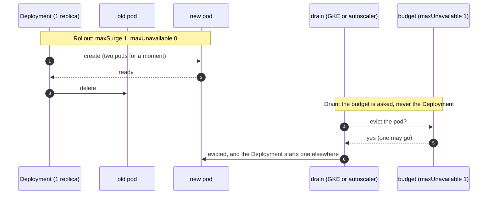

# Disruption budgets for every hub service

**Decision**: every Deployment and StatefulSet of the hub's services has a PodDisruptionBudget of `maxUnavailable: 1`,
single replicas included (with `unhealthyPodEvictionPolicy: AlwaysAllow`), and every Deployment rolls out by surging (`maxSurge: 1`, `maxUnavailable: 0`). Replica
counts stay as they are. This replaces "No budget for a single replica" in the hub's
[disruption budgets](../../hub/designs/disruption-budgets.md); its two-replica services keep their budgets as they
were. Fin's and Octomaton's `deploy/` hold their own; Octomaton's follow this design
([octomaton#29](https://github.com/arikkfir-org/octomaton/pull/29)).

## Why

- The owner wants every component budgeted, without running a second replica of each.
- 30 workloads had no budget, all but the Tekton webhook (under its autoscaler) single replicas. Most Deployments surged
  only because Kubernetes' default (25% each way) rounds to `maxSurge: 1`, `maxUnavailable: 0` at one to three
  replicas; the Tekton webhooks' autoscalers can reach five, where it lets one go first. Argo CD's notifications
  controller used `Recreate`, which stops the old pod first.

## Design

A rollout and a drain are different paths: the Deployment controller replaces pods itself and never asks the budget,
and only an eviction (a drain, a GKE node upgrade, the cluster autoscaler removing a node) does.

A single replica's budget needs no pod healthy, so a ready pod may always go. An unready one may go only because the
budget sets `unhealthyPodEvictionPolicy: AlwaysAllow`: under the default (`IfHealthyBudget`) the API server lets an
unready pod skip the budget only when the budget needs at least one healthy pod, and otherwise refuses it while no
disruption is allowed, which with the only pod unready is always. A crash-looping single replica would then hold a
drain until GKE's hour runs out. The evicted replica is down until its replacement is ready elsewhere. Where a workload runs more (the two-replica services, the Tekton webhooks under their autoscalers),
the budget keeps all but one serving.

| Component | Workloads | Strategy set in | Budget set in |
| --- | --- | --- | --- |
| Argo CD | server, repo server, ApplicationSet and notifications controllers, Redis; the application controller (StatefulSet) | `global.deploymentStrategy`, and `notifications.deploymentStrategy` over the chart's `Recreate` (`platform/argocd/values.yaml`). Redis's Deployment takes none; the default surges its one replica | each component's `pdb` |
| cert-manager | controller, webhook, cainjector | `strategy`, `webhook.strategy`, `cainjector.strategy` | `podDisruptionBudget` of each |
| External Secrets Operator | operator, webhook, cert controller | `strategy`, `webhook.strategy`, `certController.strategy` | `platform/external-secrets/manifests`: the chart's budgets take no eviction policy |
| oauth2-proxy, Grafana, KEDA | as before, two replicas each | `strategy`, `deploymentStrategy`, `upgradeStrategy` | the charts', as before |
| Traefik | two replicas | the chart's default, `maxSurge: 1`, `maxUnavailable: 0` | the chart's, as before |
| docs, `go-import` | two replicas each | the Deployment | `platform/<component>/manifests`, as before |
| NATS | servers (StatefulSet), nats-box | `natsBox.deployment.merge` | the chart's for the servers; `platform/nats/manifests` for nats-box |
| NACK | controller | none in the chart; the default surges its one replica | `platform/nack/manifests`, a new source of Application `nack` |
| NUI | StatefulSet | n/a | `platform/nui/manifests` |
| Reloader | controller | none in the chart; the default surges its one replica | `platform/reloader/manifests`, a new source of Application `reloader`: the chart's budget takes no eviction policy |
| Keycloak | server (the operator's StatefulSet), its operator, PostgreSQL | a patch on the operator's Deployment (`platform/keycloak-operator/manifests`) | `platform/keycloak/manifests` (server, as before; PostgreSQL) and `platform/keycloak-operator/manifests` |
| Grafana's PostgreSQL | StatefulSet | n/a | `platform/grafana/manifests/postgres.yaml` |
| Tekton operator | operator, its webhook | the patch that places them (`platform/tekton-operator/manifests`) | `platform/tekton-operator/manifests` |
| Tekton | Pipelines' controller, webhook, remote resolvers and events controller; the proxy webhook; Triggers' controller, webhook and core interceptors; the Dashboard | TektonConfig's `options.deployments` under `pipeline`, `trigger` and `dashboard`. The operator replaces each named Deployment's whole strategy | `platform/tekton/manifests/pod-disruption-budgets.yaml` |

Each budget selects exactly what its workload selects. An eviction refuses a pod that two budgets select, so a
broader selector would block every drain of those pods.

## Decisions

| Decision | Why | Rejected |
| --- | --- | --- |
| `maxUnavailable: 1` on a single replica | Drains, GKE's upgrades and the autoscaler's scale-down keep working; every component has a budget that holds once it runs more than one |
| `AlwaysAllow` on every budget this design adds | Without it, a single replica's budget refuses to evict its pod while it isn't ready (a crash loop, an image pull), which blocks the drain. An unready pod serves nothing a budget could protect | The default `IfHealthyBudget`; setting it on the two-replica services' budgets too, which need at least one healthy pod and so let an unready pod go already | `minAvailable: 1`: refuses every eviction of a single replica. The autoscaler could never remove a system node holding one, GKE's upgrades would wait an hour per node and then evict anyway, and `kubectl drain` would hang |
| No surge on a drain | Kubernetes has none. Azure's eviction-autoscaler adds a replica when a budget blocks a drain, but it began as an intern project, has no tagged releases, and Argo CD's self-heal would undo its replica changes | eviction-autoscaler; two replicas of everything (the owner declined) |
| An explicit surge on every Deployment | The default surges only by rounding, which depends on the replica count | Relying on the default |
| StatefulSets keep replacing pods in place | A StatefulSet can't run two pods of one ordinal; PostgreSQL's and NUI's volumes attach to one pod | Running Argo CD's application controller as a Deployment, which changes how it shards |
| The notifications controller surges too | It takes no lease, so for the moment both pods run a notification could go twice; none is configured | Keeping `Recreate` |

## Failure modes

- A drain still takes a single replica down until its replacement is ready elsewhere: Argo CD's syncs, cert-manager's
  and ESO's reconciles and admission webhooks, Tekton's admission (new PipelineRuns), NACK, Reloader, NUI, and the
  PostgreSQLs (Keycloak's sign-in, Grafana).
- A surge needs room for one more pod. On a full system pool the new pod waits for the autoscaler's node, and the old one
  keeps serving until it is ready.
- While both pods of a surge run, components without leader election run twice: NACK (it applies the same desired
  state), Reloader (a change could restart a workload twice) and Argo CD's notifications controller.

## Rollout

Merging changes only Deployments' strategies and adds budgets: no pod template changes, so nothing restarts. Then
`kubectl get pdb -A` lists one budget per workload above, each allowing one disruption.
