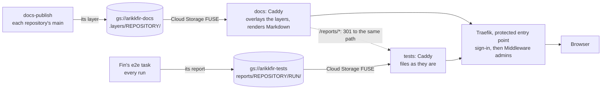

# The docs and tests servers

**Decision**: two servers serve the hub's private files, each from a bucket of its own, behind the hub's sign-in and for
group `admins` only. `docs.dev.kfirs.com` serves the knowledge base: every repository's layer of `arikkfir-docs`, its
Markdown rendered on request. `tests.dev.kfirs.com` serves what CI runs keep: `arikkfir-tests` as it is, which today
holds Fin's end-to-end reports. The reports moved from the docs server to the tests server at the same paths, and the
docs server redirects their old addresses there. Tracked in ENG-122.

## Why

- The reports were a special case of the docs server: a route apart from the layers, a hidden prefix of the docs
  bucket, and a lifecycle rule for that prefix alone.
- A report is pages and scripts that any of Fin's branches can upload. On the docs host they ran on the knowledge
  base's origin and could read its every page; on a host of their own they can't.
- Pages last as long as their repository keeps them, and reports 30 days: a bucket each keeps its own rule.

## Design

| | Docs server | Tests server |
| --- | --- | --- |
| Host | `docs.dev.kfirs.com`; `legal.kfirs.com`, public, for four exact paths | `tests.dev.kfirs.com` |
| Application and namespace | `docs` (`platform/docs`) | `tests` (`platform/tests`) |
| Bucket | `arikkfir-docs`, mounted read-only at `/srv/site` | `arikkfir-tests`, mounted read-only at `/srv/tests` |
| Identity | ServiceAccount `docs`: `roles/storage.objectViewer` on its bucket | ServiceAccount `tests`: the same on its bucket |
| Serves | Every repository's layer, overlaid in order: `X.md` as it is, `X.md.html` rendered ([docs site composition](../../hub/designs/docs-site-composition.md)) | Every object at its own name; a folder serves its `index.html` |
| Answers 404 | Hidden paths, folders, and paths no layer has | Hidden paths, and folders without an `index.html` |
| Written by | Each repository's `docs-publisher`, its own layer, from `main` | `ci-fin/ci-fin-ci`, under `reports/fin/`, from any branch ([end to end](../../fin/designs/end-to-end.md)) |
| Kept | As long as its repository keeps the file | 30 days |

The docs site's layers, pipelines and names: [docs site composition](../../hub/designs/docs-site-composition.md). The
buckets and their grants: [infra's buckets](../../infra/terraform/gcp.md#buckets).

### Serving

Each server is Caddy reading its bucket through GKE's Cloud Storage FUSE sidecar, with `implicit-dirs`, since writers
upload objects without folder placeholders. The Caddyfile is the ConfigMap of the same name, and Reloader restarts the
pods when it changes.

| Request | Docs server | Tests server |
| --- | --- | --- |
| `/healthz` | `200 ok`, without touching the bucket | the same |
| `/reports/*` | `301` to `https://tests.dev.kfirs.com` and the same path and query | the bucket's `reports/…` |
| A hidden path (a name that starts with `.`) | `404`, the layers' own prefix included | `404` |
| `X.md.html` | `X.md` from the first layer that has it, rendered | the file, if there is one |
| `X.html` that no layer has | `301` to `X.md.html`, for links from before the composition | `404` |
| Anything else | the first layer that has it; `.md` as `text/markdown` | the file, or a folder's `index.html` |

Every answer from the bucket carries `Cache-Control: private, max-age=300`. Both run two replicas on node pool `system`,
spread over nodes, with a PodDisruptionBudget of `maxUnavailable: 1` and surging rollouts, and a NetworkPolicy that
admits only namespace `traefik`, on port 8080.

## Decisions

| Decision | Why | Rejected |
| --- | --- | --- |
| A host and a bucket of their own for what CI keeps | Reports run on an origin apart from the knowledge base's, the docs bucket holds only layers, and each bucket keeps its own lifecycle rule | The docs server's `/reports/` route and the docs bucket's `.reports/` prefix, as until now |
| The same paths, `/reports/<repository>/<run>/` | Moving a report changes only its host, so the redirect keeps every path, and the copy every name but its first folder (`reports/` for `.reports/`). The bucket has room for other kinds of test files beside `reports/` | Paths without `/reports/`, shorter but a rewrite for every old link |
| A permanent redirect (`301`) | The reports won't move back. Browsers and agents go straight to the new host next time | `302`, which asks the docs server each time |
| Caddy over Cloud Storage FUSE, as the docs server | One way to serve a private bucket, one image, and the same sign-in | A public bucket or signed URLs: reports stay behind the sign-in |
| Admins only | Reports show what the tests typed and saw, test users' sign-ins included | Every signed-in user, Fin's test users included ([admins only](admins-only.md)) |

## Security

- **Reports run code.** Their pages and scripts come from any of Fin's branches, and only people who can push to Fin can
  upload them. On `tests.dev.kfirs.com` they can't read the docs server's pages, which are another origin. They still
  run in the browser of someone signed in to the hub, whose session cookie covers `.kfirs.com`.
- **Nothing public changes.** `legal.kfirs.com` still serves only its four exact paths from the docs server.
- **`/reports/` stays reserved on the docs server.** A layer's page under `reports/` is never served: the redirect
  answers first.

## Failure modes

| Failure | Effect |
| --- | --- |
| The tests server is down | Reports, through either host, answer `503`; the docs server is unaffected |
| A run's report never uploaded, or expired | `404` on the tests host, also through the redirect |
| The tests server loses its grant on the bucket | Every report answers an error; pages on the docs server still work |
| A branch of Fin that predates the move uploads to `.reports/fin/` | Its link redirects to the tests host, where its report appears once the runbook copies it |

## Rollout

1. `docs`: the hub reference (arikkfir-org/docs#55).
2. `infra`: bucket `arikkfir-tests`, its grants and host `tests.dev`, applied on merge (arikkfir-org/infra#66).
3. `delivery`: Application `tests` and the docs server's redirect, with this design (arikkfir-org/delivery#59).
4. `fin`: its e2e task uploads to `arikkfir-tests` and links the tests host (arikkfir-org/fin#139).
5. The owner moves the reports already in the docs bucket ([runbook](../runbooks/move-ci-reports.md)). Then `infra` drops
   `ci-fin-ci`'s grant on `arikkfir-docs` and its rule for `.reports/`, and `docs` drops the hub's CI reports design.
