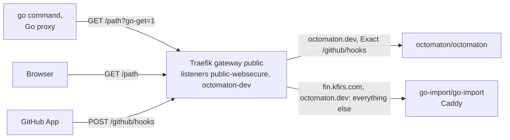

# Go import pages

**Decision**: one Caddy, Application `go-import`, answers Go's import requests for every hub domain that is a Go module path: `fin.kfirs.com` and `octomaton.dev`. A table in its configuration names each domain's repository and where people who open the domain in a browser go: today each domain's own repository, and for any other host the organization's page, `https://github.com/arikkfir-org`. Built in [delivery#50](https://github.com/arikkfir-org/delivery/pull/50), which replaced Octomaton's own Caddy ([octomaton#27](https://github.com/arikkfir-org/octomaton/pull/27)).

## Why

The `go` command resolves a module path such as `octomaton.dev/cmd/octomaton` by fetching `https://octomaton.dev/cmd/octomaton?go-get=1` and reading its `go-import` tag, which names the repository ([octomaton.dev](../../octomaton/designs/octomaton-dev.md#go-module-resolution)). Octomaton's `deploy/` ran a Caddy for `octomaton.dev`, and this repository added a second for `fin.kfirs.com`: Fin's `deploy/` can't serve its own, since it also deploys from pull requests and its namespaces are held off the public gateway. Two workloads, four pods, gave the same static answer for two domains.

## Design

| Request | Answer |
| --- | --- |
| A listed domain, `go-get=1`, any path | `200` with `<meta name="go-import" content="<domain> git <repository>">` |
| A listed domain, anything else | `302` to the domain's redirect URL |
| Any other host | `302` to `https://github.com/arikkfir-org` (no route sends one) |

Caddy's `map` turns the request's host into the domain's repository and redirect URL, one row per domain; the `default` row, and `-` in a row's redirect column, give the organization's page. HTTPRoute `go-import` lists the same domains and attaches to each one's listener: `public-websecure` for names under `*.kfirs.com`, `octomaton-dev` for `octomaton.dev`. Octomaton's route keeps only `/github/hooks`, and an exact path takes precedence over `go-import`'s prefix. Adding a domain: a row in the ConfigMap's `map` and a host name in the route; a domain outside `*.kfirs.com` also needs a listener and certificate of its own, the listener admitting namespace `go-import`.

### In the cluster

| Piece | Value |
| --- | --- |
| Application | `go-import`, wave 4 (its route needs Traefik's Gateway API), `platform/go-import/manifests` |
| Namespace | `go-import`, labelled `kfirs.com/public-ingress: "true"` by the Application, so it may attach to the `public` gateway |
| Deployment | Two replicas of `docker.io/library/caddy:2.11.4-alpine`, spread over nodes, on node pool `system`; a PodDisruptionBudget ([disruption budgets](disruption-budgets.md)); restarted by Reloader when the ConfigMap changes |
| Container | Port 8080, `/healthz` for its probes; non-root, read-only root filesystem, every capability dropped but `NET_BIND_SERVICE`, which the image's binary needs to start; requests: [resource requests](resource-requests.md) |
| Service | `go-import`, port 80 to 8080 |
| NetworkPolicy | `go-import`: only namespace `traefik`, on 8080 |
| Listener `octomaton-dev` | Admits routes only from namespaces `octomaton` and `go-import` |

## Decisions

| Decision | Why | Rejected |
| --- | --- | --- |
| One `go-import` in this repository | The answer is static, the same for every domain but its row; one workload to pin, spread and budget | One per product (the domain's owner serves it, as Octomaton did): two copies of the same Caddy, and Fin can't serve one |
| A table in one Caddyfile (`map`) | A new domain is one row; the handlers stay the same | A handler block per domain; a small Go server |
| Redirect per domain, organization's page by default | Each product points people where it wants; a domain without a page of its own still lands somewhere useful | `404` for every request without `go-get=1` |
| Listener `octomaton-dev` admits namespace `go-import` too | The route lives with the workload it points at | A route in `octomaton` pointing across namespaces: it needs a ReferenceGrant, and splits the page's wiring across two repositories |

## Security and failure modes

- The pages are public and static, without the hub's sign-in: the `go` command fetches them anonymously. They name only repositories; reading a private one (`fin`) still takes access to it.
- A second namespace can attach routes to `octomaton.dev`. Both namespaces' contents come from `main` of their repositories, and Octomaton's webhook path is an exact match, which `go-import`'s prefix never outranks.
- If `go-import` is down, new `go install`s and builds that resolve these modules directly fail; versions already in the Go proxy keep working.
