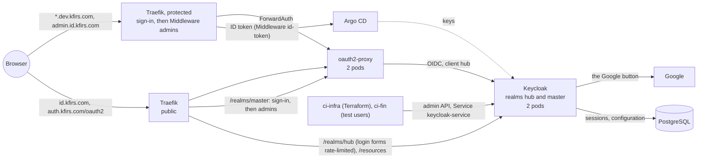
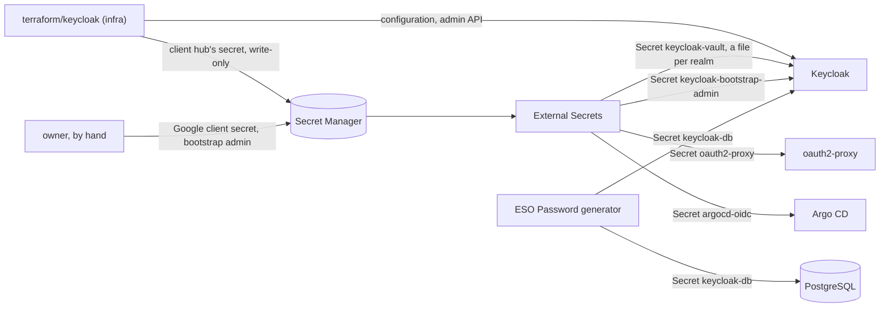
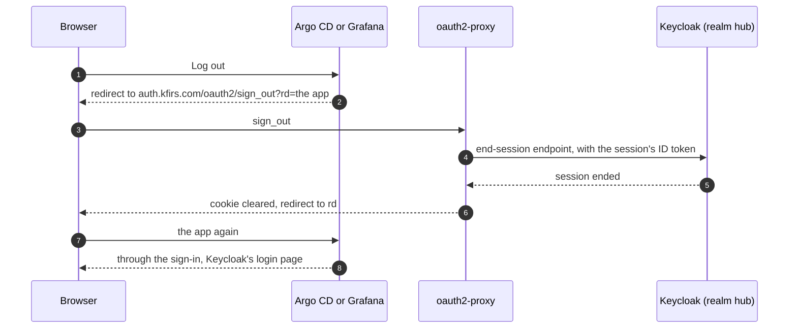

# Keycloak

**Decision**: The hub runs its own identity provider, Keycloak 26.8.0, in namespace `keycloak` under Keycloak's official operator: two instances on a PostgreSQL of their own, realm `hub` public at `id.kfirs.com`, and the admin console only behind the hub's sign-in at `admin.id.kfirs.com`. oauth2-proxy signs every protected host in through it, Argo CD verifies the ID tokens oauth2-proxy forwards, and every sign-out ends the Keycloak session too. Terraform configures what runs inside it ([infra's Keycloak](../../infra/terraform/keycloak.md)). It replaced Descope on 2 October 2026 (ENG-52 to ENG-63). Names, hosts, secrets and identities: [reference](../../hub/reference.md#authentication).

## Why

- Every protected host (Argo CD, Grafana, the Tekton Dashboard, NUI, the Traefik dashboard, the docs and tests sites, Fin) signs in through oauth2-proxy, so the identity provider is on the path of every request.
- Who may sign in is reviewed code. Descope's users and sign-in flow lived in its console, outside Git ([phase 3](phase-3-ingress-and-auth.md)); Keycloak's live in `terraform/keycloak`.
- Apps beyond the hub will need sign-up, organizations and users of their own, which an identity provider the hub runs can grow into.

## Design

A sign-in goes from oauth2-proxy to Keycloak's login page, which offers Google beside a password form that only Fin's test users can use ([test users](../../infra/designs/test-users.md)). Keycloak links the Google identity to the user Terraform declared with the same email, or refuses it. It keeps its sessions in PostgreSQL, so restarting a pod signs nobody out.

Terraform owns Keycloak's configuration: realm `hub` and its flows, the Google identity provider (its client secret only as the vault reference `${vault.google-client-secret}`), the clients, the declared users, the pipelines' service accounts in realm `master`, and the client secrets it generates and writes write-only to Keycloak and Secret Manager ([infra's Keycloak](../../infra/terraform/keycloak.md)). This side runs Keycloak and hands each piece its secret.

### In the cluster

| Piece | Design |
| --- | --- |
| Operator | Application `keycloak-operator` (wave 3): Keycloak's release kustomization at `26.8.0` (CRDs, RBAC, the operator), in namespace `keycloak`, watching that namespace only. Server-side apply, for its large CRDs. Patches add what the release lacks: requests, the system node pool and a surging rollout; and a PodDisruptionBudget of `maxUnavailable: 1` with `unhealthyPodEvictionPolicy: AlwaysAllow` |
| Keycloak | Application `keycloak` (wave 4), namespace labelled `kfirs.com/public-ingress: "true"`. Resource `keycloak`: two instances of `quay.io/keycloak/keycloak:26.8.0`, started unoptimized; spread over nodes (`ScheduleAnyway`) on the system pool, through a required node affinity since the operator takes no node selector; PodDisruptionBudget `keycloak` of `maxUnavailable: 1`. The spread and the budget select the labels the operator sets, `app=keycloak` and `app.kubernetes.io/instance=keycloak`. Hostname `https://id.kfirs.com`, admin hostname `https://admin.id.kfirs.com`, backchannel URLs from each request (`backchannelDynamic`, for the in-cluster admin API), plain HTTP on 8080 behind Traefik, trusting its `X-Forwarded-*` headers. The file vault is Secret `keycloak-vault`, mounted at `/opt/keycloak/vault`; the bootstrap admin comes from Secret `keycloak-bootstrap-admin` |
| Database | PostgreSQL 18 (`postgres:18.6-trixie`) as StatefulSet `postgres`, the shape of [Grafana's](disruption-budgets.md#grafana-on-postgresql): one replica on a 10Gi volume, with a budget of `maxUnavailable: 1` and `AlwaysAllow`. The image creates role and database `keycloak` on the volume's first start, with a password an ESO `Password` generator makes once in the cluster (Secret `keycloak-db`). Every TCP connection needs it; only the local socket is trusted. People connect with `kubectl exec -n keycloak postgres-0 -- psql -U keycloak` |
| `id.kfirs.com` | Public gateway, HTTPRoute `keycloak`: `/realms/hub` (the login page, the Google callback, the OIDC endpoints, the account console) and `/resources` open. POSTs under `/realms/hub/login-actions`, the login page's forms and the only place passwords go, pass Middleware `sign-in-attempts`: 30 a minute per client address, in bursts of up to 30, counted by each Traefik replica. `/realms/master` passes Middlewares `oidc` (a ForwardAuth to oauth2-proxy, the hub's sign-in) and `admins`, because the admin console signs in against this frontend hostname |
| `admin.id.kfirs.com` | Protected gateway, HTTPRoute `keycloak-admin`: `/` (Keycloak redirects it to the console), `/admin`, `/realms/master` and `/resources`, through Middleware `admins` after the entry point's sign-in ([admins only](admins-only.md)). The gateways' `*.kfirs.com` listeners match it; the wildcard certificate names it, being two labels deep |
| Network | The operator's NetworkPolicy (the resource's `networkPolicy.http`) admits port 8080 from namespaces `traefik` (both hosts), `ci-infra` (Terraform) and `ci-fin` (Fin's end-to-end runs, which create and delete test users) only. The last two reach the admin API through Service `keycloak-service`; no public host routes it but the console's, behind the sign-in. NetworkPolicy `postgres` admits only pods labelled `app.kubernetes.io/instance: keycloak`: the servers, and the update job the operator runs |
| Sync waves | In `keycloak`: the database, its password, the ExternalSecrets and the Middlewares in wave 0, Keycloak in wave 1, the routes in wave 2 |
| Resources | Each instance requests 25m and 1Gi, with a memory limit of 1360Mi; the operator 20m and 320Mi; PostgreSQL 50m and 128Mi ([resource requests](resource-requests.md)) |

### Signing in through it

| Client | Design |
| --- | --- |
| oauth2-proxy | Application `auth`, two replicas: OIDC client `hub`, issuer `https://id.kfirs.com/realms/hub`, callback `https://auth.kfirs.com/oauth2/callback` on the public gateway. Its client and cookie secrets come from ExternalSecret `oauth2-proxy` (`keycloak-hub-client-secret`, `oauth2-proxy-cookie-secret`). Scopes `openid email profile`. It refreshes a session's tokens after 5 minutes (`cookie-refresh`), within the realm's 10-minute access tokens, so the ID token it hands on never expires first. It admits every user Keycloak authenticates (`emailDomains: ["*"]`) and keeps their groups from the ID token, which Middleware `admins` checks. Its session cookie is on `.kfirs.com` |
| Argo CD | Its route's Middleware `id-token` copies oauth2-proxy's `Authorization: Bearer <ID token>` to Argo CD, which verifies it against the same issuer and client (`oidc.config`, its secret from ExternalSecret `argocd-oidc`), so the hub session signs the person in. "Log in via Keycloak" is the fallback. Every signed-in user is `role:admin`, and only group `admins` gets past the route |
| Grafana | Trusts `X-Auth-Request-Email`, which the entry point's sign-in sets (auth proxy mode) |

### Sign-out

| Piece | Design |
| --- | --- |
| oauth2-proxy's sign-out | `https://auth.kfirs.com/oauth2/sign_out?rd=<URL under .kfirs.com>` calls realm `hub`'s end-session endpoint itself, with the session's ID token, before it clears its cookie: `backend-logout-url`, `https://id.kfirs.com/realms/hub/protocol/openid-connect/logout?id_token_hint={id_token}`. Fin's signed-out page sends people there too |
| Its log lines | A template, `standard-logging-format` in `platform/auth/values.yaml`, keeps the default format of oauth2-proxy's standard log lines but writes `[redacted]` for whatever follows `id_token_hint=`, up to the closing quote of the URL that Go's error quotes |
| Argo CD's Log out | A rule for `/auth/logout` on its route, whose Middleware `argocd/logout` (Traefik's `redirectRegex`) redirects to the sign-out with `rd=https://argocd.dev.kfirs.com/` |
| Grafana's Log out | `signout_redirect_url`: the sign-out with `rd=https://grafana.dev.kfirs.com/` |

## Decisions

| Decision | Why | Rejected |
| --- | --- | --- |
| The official Keycloak operator, from its release kustomization at a pinned tag | Keycloak's own deployment, released with Keycloak. The hub adds what it lacks: budgets, requests, placement and HTTPRoutes | codecentric `keycloakx` (lags upstream); Bitnami (versioned images no longer free) |
| A local PostgreSQL: one StatefulSet in namespace `keycloak`, like Grafana's | The simplest option, and a pattern the hub already runs. Terraform recreates all of Keycloak's configuration, so losing the data costs sessions, Google links and one apply by hand. The price: sign-in pauses while the database pod restarts | CloudNativePG with two instances (an operator to run; worth it once apps keep their users here, see [later](#later)); Cloud SQL (cost) |
| Argo CD signs in from the hub session: oauth2-proxy and Argo CD share client `hub` | Argo CD verifies the ID tokens oauth2-proxy forwards, so both must share the audience. One sign-in covers every tool | Separate clients (Argo CD would need `allowedAudiences`); Argo CD's own login only |
| The Google client secret reaches Keycloak through its file vault | It is the one secret Terraform can't generate, so it takes the hub's usual path: the owner sets it in Secret Manager, External Secrets syncs it into Secret `keycloak-vault`, one file per realm (`hub_google-client-secret`, `master_google-client-secret`), and Keycloak's pods read it from the mounted files. Terraform stores only the reference. Keycloak's vault serves identity providers' secrets, never a client's own secret, so Terraform generates those | Reading it in Terraform, which pull request plans would then need access to |
| oauth2-proxy requests no `offline_access` | Since 26.1, requesting it at the first login skips Keycloak's SSO cookie. The refresh token then lives as long as the realm's SSO session | Keeping `offline_access` |
| oauth2-proxy's sign-out ends the Keycloak session too: it calls realm `hub`'s end-session endpoint itself, with the session's ID token (`backend-logout-url`) | Clearing only oauth2-proxy's cookie signs nobody out: the next protected page goes to Keycloak, whose session signs the person straight back in, as Fin's "sign out of every hub app" did (ENG-65). The ID token names the session, so the call needs no browser cookie, no confirmation page and no post-logout redirect URI on client `hub`, and the sign-out still redirects to its `rd`. Google's own session doesn't sign the person back in: realm `hub`'s login page waits for them to choose | Sending the browser through Keycloak's end-session endpoint (`rd`): no app's page holds the ID token, so Keycloak asks the person to confirm, and client `hub` needs post-logout redirect URIs for every app |
| oauth2-proxy's standard log lines redact the sign-out's ID token, through a template | A sign-out whose call fails before Keycloak answers logs that URL, ID token included (ENG-119), and the token must stay in the URL for Keycloak to find the session. The template looks for the parameter, not for the message's wording, so it still holds if oauth2-proxy rewords the line; with no closing quote after the token, the rest of the line goes. The scan costs a fraction of a millisecond per standard line, and those are rare: start-up, errors, and a session's refresh every 5 minutes. A template that fails panics oauth2-proxy, so every slice is guarded by a length | Turning standard logging off: it hides every error. Waiting for oauth2-proxy to redact it: its `master` doesn't. A relay in front of Keycloak that takes the token another way: one more service on every sign-out, whose own errors would need the same care |
| Argo CD's and Grafana's Log out go to oauth2-proxy's sign-out, with `rd` back to the app | Their own logout ends only their own session, and the hub's sign-in signs the person straight back in. Argo CD's fails outright: it needs its `argocd.token` cookie, and the hub's sign-in hands it a bearer token instead (ENG-118). Without `rd`, the sign-out lands on a 404 at `auth.kfirs.com/` | Argo CD's `logoutURL` (its handler fails without the cookie before it gets there); the HTTPRoute's own `RequestRedirect` filter (it can't set a query, so no `rd`) |
| The admin console only on `admin.id.kfirs.com`, behind the protected gateway | `/admin` and realm `master` are reachable only behind the hub's sign-in, and only for group `admins`. The console signs in against Keycloak's frontend hostname (ENG-66), so `id.kfirs.com` also serves `/realms/master`, but through the same sign-in and Middleware `admins`. It is the identity platform's own console, not a dev tool, so it sits under `id.kfirs.com` rather than `dev.kfirs.com`, and it needs a host of its own because it uses the protected gateway's IP. `*.kfirs.com` doesn't cover a name two labels deep, so it joins the wildcard certificate; the issuer already solves DNS-01 in zone `kfirs-com`. Break-glass: `kubectl exec` and `kcadm.sh` | A public admin console; `keycloak.dev.kfirs.com` (it isn't a dev tool); `id-admin.kfirs.com` (no certificate change, but reads as a sibling of `id`, not part of it); `*.id.kfirs.com` on the certificate (only one host needs it) |
| A per-address limit on the login page's forms, in Traefik | Realm `hub`'s login page takes passwords for Fin's test users, and Keycloak limits no address. 30 a minute fits Fin's runs, which sign in once per test; only the forms' POSTs count, so the page's own resources never do ([test users](../../infra/designs/test-users.md)) | Every path of `id.kfirs.com`; 10 a minute, which Fin's runs would exceed |
| The HTTPRoutes sync in wave 2, after Keycloak | Argo CD marks a route whose backend Service is missing Degraded, which fails the sync. The operator creates `keycloak-service` only once Keycloak (wave 1) exists, so routes in an earlier wave would never let Keycloak be created | The routes in wave 0 with everything else |
| The Keycloak image is pinned and started unoptimized (`startOptimized: false`) | Naming an image makes the operator start it `--optimized`, which the stock image, never built for PostgreSQL or the file vault, can't run | Leaving the image to the operator's default (pinned only through the operator's release) |

## Security and failure modes

- **Keycloak down means every protected host is down.** The way back doesn't need it: `kubectl` through the GKE DNS endpoint, the Argo CD CLI through a port-forward, and CI through Octomaton, which only needs GitHub. Two Keycloak pods and a PodDisruptionBudget make it rare; the database is the one single instance.
- **Sign-in pauses while the database moves.** A node drain, a GKE upgrade or a crash of the one PostgreSQL pod stops new sign-ins and token refreshes for the minute or so it takes to run again elsewhere: its budget lets a drain evict it ([disruption budgets](disruption-budgets.md)). Existing oauth2-proxy sessions keep working until their next refresh. CloudNativePG removes this ([later](#later)).
- **Bootstrapping from nothing needs a placeholder secret.** Argo CD's own Application (wave 2) and oauth2-proxy read `keycloak-hub-client-secret`, which `terraform/keycloak` writes only once Keycloak (wave 4) runs. Without a placeholder version, their ExternalSecrets have nothing to read, and the root Application never reaches wave 4 ([bootstrap runbook](../../infra/runbooks/bootstrap.md)).
- **Each quarterly minor upgrade restarts every pod.** Only the latest minor gets fixes, and pods of two minors can't run side by side. Each upgrade is a pull request that bumps the operator's release and the image together, merged at a quiet time: sign-in pauses for about a minute.
- **Losing the database loses sessions and Google links, and the pipelines' access.** Keycloak starts as a fresh install, which creates the bootstrap admin again from Secret `keycloak-bootstrap-admin`; the owner applies `terraform/keycloak` by hand as that admin, as in the [bootstrap runbook](../../infra/runbooks/bootstrap.md), since the pipelines' own clients went with the data, and people link again at their next sign-in. Backups come before any app keeps users that Terraform doesn't declare; Fin's test users, which live for one run, came first by the owner's choice.
- **Memory.** Two pods request 1Gi each and may use up to 1360Mi, Java's heap taking 70% of it: the system pool may grow to a second node ([resource requests](resource-requests.md)).
- **Exposure.** Only realm `hub` and static resources are public. The admin console and realm `master` are reachable only behind the hub's sign-in and for group `admins`: on the protected gateway, and on `id.kfirs.com/realms/master` through the same ForwardAuths. Keycloak's pods admit only Traefik, `ci-infra` and `ci-fin`, and trust the `X-Forwarded-*` headers of whatever reaches them, which only those three can.
- **The login forms' limit binds only what passes through Traefik.** Pods in `ci-infra` and `ci-fin` reach `keycloak-service:8080` directly, for the admin API, and a NetworkPolicy can't tell paths apart; Keycloak's brute-force detection still applies. The owner accepted it ([test users](../../infra/designs/test-users.md)).
- **Secrets.** None is in Git: the Google client secret, the bootstrap admin and client `hub`'s secret come from Secret Manager through External Secrets, and the database's password is generated in the cluster. The bootstrap admin, a full administrator, is deleted in Keycloak once the pipelines apply `keycloak`; its Secret stays for a fresh install.
- **A failed sign-out call would write an ID token to oauth2-proxy's logs.** The call to realm `hub`'s end-session endpoint carries the session's ID token in its query (`id_token_hint`), which Keycloak needs to find the session. When the call fails before Keycloak answers (DNS, connection, TLS, timeout), oauth2-proxy logs Go's error, which quotes the whole URL; an answer Keycloak refuses logs only its status. oauth2-proxy (7.15.3, chart 10.7.0, and its `master`) redacts nothing there, so its standard log template does (ENG-119): the line keeps the failure's cause, but the token reads `[redacted]`. Each oauth2-proxy upgrade checks that a failed sign-out still logs no token.

## Later

Needed once apps beyond the hub sign users in, or sooner where it says so. What the realm itself would gain then, an email provider (its password through the vault) and sign-up and organizations for apps, is configuration, in `terraform/keycloak` ([infra's Keycloak](../../infra/terraform/keycloak.md)).

| What | When |
| --- | --- |
| Move the database to CloudNativePG (two instances with failover), backed up to Cloud Storage with its Barman Cloud plugin | Before any app keeps users that Terraform doesn't declare, or when a minute of sign-in downtime per node drain matters |
| Metrics: a `PodMonitoring` for Keycloak's management port 9000 | Any time |
| Argo CD roles from Keycloak groups instead of admin for everyone. Its route already admits only group `admins` | Any time |
