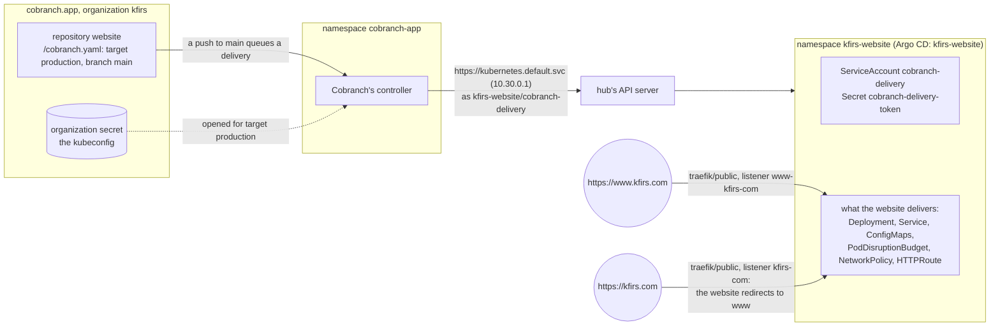

# The family's website, delivered by Cobranch

**Decision**: `www.kfirs.com` is repository `website` of organization `kfirs` on `cobranch.app`, which Cobranch's own delivery deploys to the hub the way it deploys Cobranch's website ([Cobranch's website, delivered by Cobranch](cobranch-website.md)): target `production` of its `main` applies, through a kubeconfig the organization keeps as a secret, into namespace `kfirs-website`, as ServiceAccount `cobranch-delivery`, which may change only the kinds the website needs, there alone. It replaces the GitHub Pages site of GitHub's `arikkfir/arikkfir.github.io`. This repository makes the namespace, the account and the listeners; Cobranch delivers everything that runs in the namespace. Linear: [ENG-298](https://linear.app/arikkfir/issue/ENG-298).

## Why

The owner wants the family's website on `cobranch.app`, changed and delivered through Cobranch, and the GitHub repository gone (owner, 2026-11-27). Organization `kfirs` gets a namespace of its own, as `cobranch` did, rather than `cobranch.app` delivering into its own cluster for every organization ([Cobranch's website](cobranch-website.md#decisions)).

## Design

| Piece | Value |
| --- | --- |
| Application | `kfirs-website`, `platform/kfirs-website/manifests`, project `default` |
| Namespace | `kfirs-website`, labelled `pod-security.kubernetes.io/enforce: restricted` and `kfirs.com/public-ingress: "true"` by the Application |
| ServiceAccount | `cobranch-delivery`, no token mounted anywhere; its token in Secret `cobranch-delivery-token` |
| Role `cobranch-delivery` | Every verb on ConfigMaps, Services, Deployments, PodDisruptionBudgets, NetworkPolicies and HTTPRoutes, in `kfirs-website` |
| ClusterRole `kfirs-website-namespace` | `get` on namespace `kfirs-website` alone |
| Policy `kfirs-website-cluster-ip-services` | Every Service in `kfirs-website` is of type `ClusterIP`, with no external IPs |
| Policy `kfirs-website-http-routes` | Every HTTPRoute in `kfirs-website` attaches to listeners `kfirs-com` and `www-kfirs-com` of Gateway `traefik/public` alone |
| Listeners `kfirs-com` and `www-kfirs-com` of `traefik/public` | `kfirs.com` and `www.kfirs.com`, from namespace `kfirs-website` alone, while it carries `kfirs.com/public-ingress: "true"` |
| Certificate `traefik/kfirs-com` | `kfirs.com` and `www.kfirs.com`, Secret `kfirs-com-tls`, issued by DNS-01 in zone `kfirs-com`, so before the names point at the hub |
| `cobranch.app`'s `delivery.clusters.allowedCIDRs` | Unchanged: `10.30.0.1/32` already admits the API server ([hosting cobranch.app](cobranch-app.md)) |

The website's repository holds what runs here: a Caddy that serves its static pages from ConfigMaps, two replicas on node pool `system` ([node pools](node-pools.md)), with a PodDisruptionBudget ([disruption budgets](disruption-budgets.md)), requests ([resource requests](resource-requests.md)), a NetworkPolicy that admits only Traefik, and one HTTPRoute on both listeners; Caddy answers `kfirs.com` with a permanent redirect to `https://www.kfirs.com`, as GitHub Pages did.

The kubeconfig is built as for Cobranch's website ([the kubeconfig](cobranch-website.md#the-kubeconfig)), with `ns=kfirs-website`, and added as a secret of organization `kfirs`.

## Decisions

| Decision | Why | Rejected |
| --- | --- | --- |
| A namespace and account of its own, beside `cobranch-website` | Each organization's kubeconfig reaches its own namespace and nothing else; a leak of one doesn't reach the other's site | Delivering into `cobranch-website`: one organization could change the other's website. `delivery.inCluster.enabled`: every organization could make namespaces in the hub |
| Listeners of their own on `traefik/public` | `public-websecure` admits every labelled namespace for any `*.kfirs.com` host, and doesn't cover `kfirs.com`; exact listeners admit `kfirs-website` alone, and the policy holds its routes to them | Attaching to `public-websecure`: the policy would be the only thing between another labelled namespace and `www.kfirs.com` |
| A certificate of its own for both names | The wildcard doesn't cover the bare domain, and a problem with these names stays off the wildcard's renewal | Adding `kfirs.com` to the wildcard |
| The website redirects `kfirs.com`, not the Gateway | The redirect is the website's behaviour and changes with it, as GitHub Pages' did | An HTTPRoute redirect filter here: the website's own route would then be split between two repositories |

## Security and failure modes

- **The account's reach** is the Role's kinds in one namespace, as for [Cobranch's website](cobranch-website.md#security-and-failure-modes); Pod Security `restricted` holds whatever its Deployments run.
- **A leaked kubeconfig** gives that much and no more. Revoke it by deleting Secret `kfirs-website/cobranch-delivery-token` (Argo CD makes it again), then replace the organization's secret.
- **Public exposure** is `kfirs.com` and `www.kfirs.com` alone: policy `kfirs-website-http-routes` keeps the website's routes off `public-websecure` and `traefik/protected`. Whoever may push to the website's `main` decides what the family's site serves.
- **Cobranch's delivery fails**: the environment shows it, and what runs stays as it was.

## Rollout

1. Merge this: Argo CD makes the policies, the namespace and the account, and `traefik` the certificate and listeners. Nothing points at them yet: `kfirs.com` still resolves to GitHub Pages.
2. The owner builds the kubeconfig and adds it as a secret of organization `kfirs`.
3. The website's `/cobranch.yaml` names target `production`; its principal gets Secret reader on that secret; its push to `main` delivers. Check it through the hub before the cutover: `curl --resolve www.kfirs.com:443:<public gateway IP> https://www.kfirs.com/`.
4. The cutover is `infra`'s: `kfirs.com` and `www.kfirs.com` point at the public gateway ([DNS](../../infra/terraform/gcp.md)). Roll it back by pointing the two records back at GitHub Pages in `infra` (the apex at GitHub Pages' four addresses, `www` at `arikkfir.github.io.`), while GitHub Pages still serves the site; reverting the cutover would delete the records, which Terraform then owns.

Rolling this back deletes Application `kfirs-website` but not what it made, since it carries no resources finalizer; revoke the token by deleting Secret `kfirs-website/cobranch-delivery-token` or the namespace, and the cluster-scoped ClusterRole, ClusterRoleBinding and policies go by hand.
