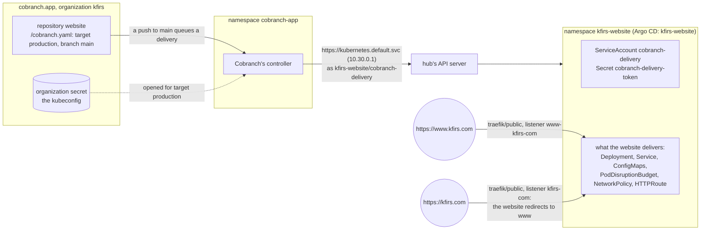
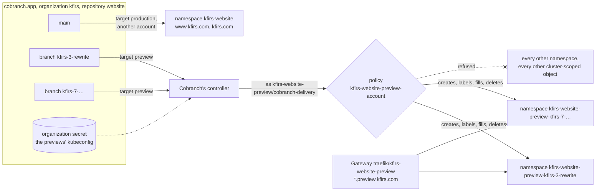

# The family's website, delivered by Cobranch

**Decision**: `www.kfirs.com` is repository `website` of organization `kfirs` on `cobranch.app`, which Cobranch's own delivery deploys to the hub the way it deploys Cobranch's website ([Cobranch's website, delivered by Cobranch](cobranch-website.md)): target `production` of its `main` applies, through a kubeconfig the organization keeps as a secret, into namespace `kfirs-website`, as ServiceAccount `cobranch-delivery`, which may change only the kinds the website needs, there alone. It replaces the GitHub Pages site of GitHub's `arikkfir/arikkfir.github.io`. This repository makes the namespace, the account and the listeners; Cobranch delivers everything that runs in the namespace. Linear: [ENG-298](https://linear.app/arikkfir/issue/ENG-298).

## Why

The owner wants the family's website on `cobranch.app`, changed and delivered through Cobranch, and the GitHub repository gone (owner, 2026-11-27). Organization `kfirs` gets a namespace of its own, as `cobranch` did, rather than `cobranch.app` delivering into its own cluster for every organization ([Cobranch's website](cobranch-website.md#decisions)).

## Design



| Piece | Value |
| --- | --- |
| Application | `kfirs-website`, `platform/kfirs-website/manifests`, project `default` |
| Namespace | `kfirs-website`, labelled `pod-security.kubernetes.io/enforce: restricted` and `kfirs.com/public-ingress: "true"` by the Application |
| ServiceAccount | `cobranch-delivery`, no token mounted anywhere; its token in Secret `cobranch-delivery-token` |
| Role `cobranch-delivery` | Every verb on ConfigMaps, Services, Deployments, PodDisruptionBudgets, NetworkPolicies and HTTPRoutes, in `kfirs-website` |
| ClusterRole `kfirs-website-namespace` | `get` on namespace `kfirs-website` alone |
| Policy `kfirs-website-cluster-ip-services` | Every Service in `kfirs-website` is of type `ClusterIP`, with no external IPs |
| Policy `kfirs-website-http-routes` | Every HTTPRoute in `kfirs-website` attaches to listeners `kfirs-com` and `www-kfirs-com` of Gateway `traefik/public` alone |
| Listeners `kfirs-com` and `www-kfirs-com` of `traefik/public` | `kfirs.com` and `www.kfirs.com`, from namespace `kfirs-website` alone, while it carries `kfirs.com/public-ingress: "true"` |
| Certificate `traefik/kfirs-com` | `kfirs.com` and `www.kfirs.com`, Secret `kfirs-com-tls`, issued by DNS-01 in zone `kfirs-com`, so before the names point at the hub |
| `cobranch.app`'s `delivery.clusters.allowedCIDRs` | Unchanged: `10.30.0.1/32` already admits the API server ([hosting cobranch.app](cobranch-app.md)) |

The website's repository holds what runs here: a Caddy that serves its static pages from ConfigMaps, two replicas on node pool `system` ([node pools](node-pools.md)), with a PodDisruptionBudget ([disruption budgets](disruption-budgets.md)), requests ([resource requests](resource-requests.md)), a NetworkPolicy that admits only Traefik, and one HTTPRoute on both listeners; Caddy answers `kfirs.com` with a permanent redirect to `https://www.kfirs.com`, as GitHub Pages did.

The kubeconfig is built as for Cobranch's website ([the kubeconfig](cobranch-website.md#the-kubeconfig)), with `ns=kfirs-website`, and added as a secret of organization `kfirs`.

### Previews

Every branch of the website that target `preview` of its `/cobranch.yaml` matches gets an environment of its own, to try a change before it reaches `main` (owner, 2026-11-27): namespace `kfirs-website-preview-<branch>`, served at `https://<branch>.preview.kfirs.com`, where `<branch>` is Cobranch's `${branch.slug}`. Cobranch makes the namespace on the branch's first delivery and deletes it when the branch goes ([delivery](../../cobranch/designs/delivery.md)); nothing here names a branch.



| Piece | Value |
| --- | --- |
| Application | `kfirs-website-preview`, `platform/kfirs-website/preview`, project `default` |
| Namespace `kfirs-website-preview` | The account's home, made by the Application, labelled `pod-security.kubernetes.io/enforce: restricted`; it runs nothing and takes no routes |
| Account | ServiceAccount `cobranch-delivery`, no token mounted anywhere; its token in Secret `cobranch-delivery-token` |
| ClusterRole `kfirs-website-preview-delivery`, bound cluster-wide | `get`, `create` and `delete` on namespaces; `get`, `create`, `patch` and `delete` on ConfigMaps, Services, Deployments, PodDisruptionBudgets, NetworkPolicies and HTTPRoutes. No `list`, no `watch`, no Secrets: what Cobranch's apply, health read and teardown call, and nothing else |
| Policy `kfirs-website-preview-account` | Every request of the account that changes anything is refused unless it is in, or makes or deletes, a namespace named `kfirs-website-preview-<branch>`. A namespace it makes carries Cobranch's own labels, `pod-security.kubernetes.io/enforce: restricted` and `kfirs.com/kfirs-website-preview: "true"`, no other label and no annotation |
| Policy `kfirs-website-preview-cluster-ip-services` | Every Service in such a namespace is of type `ClusterIP`, with no external IPs |
| Policy `kfirs-website-preview-http-routes` | Every HTTPRoute in such a namespace attaches to Gateway `traefik/kfirs-website-preview` alone, and names its namespace's own host alone |
| Gateway `traefik/kfirs-website-preview` | Listener `previews`, `*.preview.kfirs.com` on the public entry point (9443), from namespaces labelled `kfirs.com/kfirs-website-preview: "true"` |
| Certificate `traefik/kfirs-website-preview` | `*.preview.kfirs.com`, Secret `kfirs-website-preview-tls`, issued by DNS-01 in zone `kfirs-com` |
| DNS | `*.preview.kfirs.com` on the public gateway ([DNS](../../infra/terraform/gcp.md)) |

The website's target sets the two labels the policy requires, through its `namespaceLabels`:

```yaml
delivery:
  targets:
    preview:
      branches: ["kfirs-*"]
      cluster: <the ID of the secret that holds the previews' kubeconfig>
      namespace: kfirs-website-preview-${branch.slug}
      namespaceLabels:
        pod-security.kubernetes.io/enforce: restricted
        kfirs.com/kfirs-website-preview: "true"
      url: https://${branch.slug}.preview.kfirs.com
```

Its kubeconfig is built as production's, with `ns=kfirs-website-preview`, the account's namespace, and added as a second secret of organization `kfirs`: production's kubeconfig never reaches a preview, nor the previews' production.

## Decisions

| Decision | Why | Rejected |
| --- | --- | --- |
| A namespace and account of its own, beside `cobranch-website` | Each organization's kubeconfig reaches its own namespace and nothing else; a leak of one doesn't reach the other's site | Delivering into `cobranch-website`: one organization could change the other's website. `delivery.inCluster.enabled`: every organization could make namespaces in the hub |
| Listeners of their own on `traefik/public`, held by policy `kfirs-website-http-routes` | `public-websecure` admits every labelled namespace for any `*.kfirs.com` host, and doesn't cover `kfirs.com`. Traefik 3.7 doesn't isolate listeners: a route on another listener of the Gateway still answers for its own hostnames, so the policy, not the listeners' namespace selectors, is what keeps another namespace's routes off these names, and every public namespace whose routes this repository doesn't review needs such a policy | Attaching to `public-websecure`: nothing but the policy would tell the website's routes from another labelled namespace's |
| A namespace per branch, made by Cobranch, its account bound cluster-wide and held by an admission policy | Each branch gets its own URL, and two branches never overwrite each other (owner, 2026-11-27). RBAC grants neither by a namespace's prefix nor in a namespace that doesn't exist yet, so the account's role is cluster-wide; policy `kfirs-website-preview-account` refuses every change it makes outside the previews' namespaces, and the role reads only by name (`get`), the kinds the website renders, no Secrets | One shared namespace `kfirs-website-preview` at `preview.kfirs.com`: one branch at a time, the next overwriting the last. `delivery.inCluster.enabled` on `cobranch.app`: every organization could make namespaces in the hub, which is for KFIRS's own organizations alone (owner, 2026-11-27) |
| A Gateway of their own for the previews | A listener on `traefik/public` would need `kfirs.com/public-ingress` on every preview's namespace, which admits a namespace to `public-websecure` for any `*.kfirs.com` host; the previews' own label admits them here alone | A listener `*.preview.kfirs.com` on `traefik/public` |
| A certificate of its own for both names | The wildcard doesn't cover the bare domain, and a problem with these names stays off the wildcard's renewal | Adding `kfirs.com` to the wildcard |
| The website redirects `kfirs.com`, not the Gateway | The redirect is the website's behaviour and changes with it, as GitHub Pages' did | An HTTPRoute redirect filter here: the website's own route would then be split between two repositories |

## Security and failure modes

- **The account's reach** is the Role's kinds in one namespace, as for [Cobranch's website](cobranch-website.md#security-and-failure-modes); Pod Security `restricted` holds whatever its Deployments run.
- **A leaked kubeconfig** gives that much and no more. Revoke it by deleting Secret `kfirs-website/cobranch-delivery-token` (Argo CD makes it again), then replace the organization's secret.
- **Public exposure** is `kfirs.com` and `www.kfirs.com` alone: policy `kfirs-website-http-routes` keeps the website's routes off `public-websecure` and `traefik/protected`. Whoever may push to the website's `main` decides what the family's site serves.
- **The previews' account** is the one cluster-wide grant here. It changes nothing outside namespaces `kfirs-website-preview-<branch>`: the policy matches the account by name on every resource and operation, and fails closed. It can read, by exact name only, a ConfigMap, Service, Deployment, PodDisruptionBudget, NetworkPolicy or HTTPRoute of any namespace, which admission can't hold; it can't list them, and reads no Secret. A leaked previews' kubeconfig gives that; revoke it by deleting Secret `kfirs-website-preview/cobranch-delivery-token`.
- **A preview's exposure** is its own host: a branch can't take another branch's, `www.kfirs.com`'s, or any `*.kfirs.com` name. Previews are public, as the website is; whoever may push a matching branch to the website's repository decides what its preview serves, and how many previews run.
- **Cobranch's delivery fails**: the environment shows it, and what runs stays as it was.

## Rollout

1. Merge this: Argo CD makes the policies, the namespace and the account, and `traefik` the certificate and listeners. Nothing points at them yet: `kfirs.com` still resolves to GitHub Pages.
2. The owner builds the kubeconfig and adds it as a secret of organization `kfirs`.
3. The website's `/cobranch.yaml` names target `production`; its principal gets Secret reader on that secret; its push to `main` delivers. Check it through the hub before the cutover: `curl --resolve www.kfirs.com:443:<public gateway IP> https://www.kfirs.com/`.
4. The cutover is `infra`'s: `kfirs.com` and `www.kfirs.com` point at the public gateway ([DNS](../../infra/terraform/gcp.md)). Roll it back by pointing the two records back at GitHub Pages in `infra` (the apex at GitHub Pages' four addresses, `www` at `arikkfir.github.io.`), while GitHub Pages still serves the site; reverting the cutover would delete the records, which Terraform then owns.

The previews came after, with Application `kfirs-website-preview`: once it syncs and `infra`'s `*.preview.kfirs.com` resolves, the owner builds the previews' kubeconfig and adds it as a secret, the website's `main` names target `preview`, its principal gets Secret reader on that secret, and a push to a matching branch makes its environment. Rolling them back deletes that Application and its objects by hand, as below, and the namespaces `kfirs-website-preview-*` that Cobranch made.

Rolling this back deletes Application `kfirs-website` but not what it made, since it carries no resources finalizer; revoke the token by deleting Secret `kfirs-website/cobranch-delivery-token` or the namespace, and the cluster-scoped ClusterRole, ClusterRoleBinding and policies go by hand.
