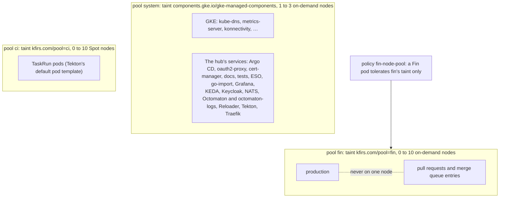

# Node pools

**Decision**: Every hub service runs on node pool `system`, which carries GKE's own taint for its managed components,
`components.gke.io/gke-managed-components=true:NoSchedule`: only GKE's components and the hub's services tolerate it.
CI runs go to pool `ci` through Tekton's default pod template, and Fin's environments to pool `fin` through Fin's
`deploy/`, which policy `fin-node-pool` holds to that pool. [infra's node pools](../../infra/designs/node-pools.md) designs the pools
themselves; Fin's [environments](../../fin/designs/environments.md) keep production and pull requests on separate nodes.

## Why

- On 12 October one `e2-standard-4` node ran everything: Argo CD, Traefik, Keycloak, NATS, Tekton's controllers,
  production and four pull requests' environments. Their end-to-end suites held it at 85 to 110% CPU, and sign-ins
  timed out, NATS lost its stream leaders and Traefik answered late, failing the suites themselves.
- Nothing kept a workload on its own nodes: CI's pool had a taint, but the system pool took whatever didn't select CI.

## Design

Each hub service's pods select `kfirs.com/pool: system` and tolerate the system pool's taint. The selector keeps them
off any pool that might come untainted; the toleration lets them past the taint. DaemonSets need neither: GKE's tolerate
every taint, and the hub runs none of its own.

| Component | Where its placement is set |
| --- | --- |
| Argo CD | `global.nodeSelector` and `global.tolerations` (`platform/argocd/values.yaml`), which every component and the `redis-secret-init` hook take |
| oauth2-proxy, Grafana, KEDA, NACK, NUI, Traefik | the chart's top-level `nodeSelector` and `tolerations` |
| cert-manager | `global.nodeSelector`, and `tolerations` for the controller, `webhook` and `cainjector` (the chart has no global ones) |
| External Secrets Operator | `global.nodeSelector` and `global.tolerations`, which the operator, webhook and cert controller take |
| NATS | `podTemplate.merge.spec` (the servers) and `natsBox.podTemplate.merge.spec` |
| Reloader | `reloader.deployment.nodeSelector` and `tolerations` |
| docs, tests, go-import, Grafana's and Keycloak's PostgreSQL | their pod templates (`platform/<component>/manifests`) |
| Keycloak | the resource's `scheduling`: a required node affinity (the operator takes no node selector) and the toleration |
| Keycloak's operator, Tekton's operator and its webhook | kustomize patches on the release manifests' Deployments |
| Pipelines, Triggers, the Dashboard, the proxy webhook, the pruner | TektonConfig `spec.config`, which the operator sets on every Deployment and StatefulSet it makes, replacing theirs, and on the pruner's CronJob |
| Octomaton and octomaton-logs | a patch on every Deployment in the `kustomize` options of Applications `octomaton` and `octomaton-logs` |
| Fin | its own `deploy/`: every pod template selects `fin` and tolerates its taint |
| TaskRun pods | Tekton's `default-pod-template`: pool `ci` |

### Fin's pods

A pull request's `deploy/` runs as its environment, and a toleration is no privilege: any pod may claim any. So policy
`fin-node-pool` checks every pod made in `fin` and `fin-pr-*`, whatever made it (Deployments, the StatefulSet, Jobs,
KEDA's ScaledJob): it tolerates no taint but `kfirs.com/pool=fin` (operator `Equal`), beside the `not-ready` and
`unreachable` ones Kubernetes adds to every pod, and names no node, which would skip the scheduler and every taint. A
pod without the toleration passes and waits for a node it tolerates.

### Logs of a gone pod

The cluster autoscaler removes an empty CI node about a minute after its last pod ends, and the node's pods go with it,
so the Dashboard could no longer show their logs. Its backend now asks `octomaton-logs` instead, whenever reading a pod's
log fails (TektonConfig's `dashboard.external-logs`):
`http://octomaton-logs.octomaton.svc.cluster.local/logs/<namespace>/<pod>/<container>?startTime=…&completionTime=…`.
`octomaton-logs` reads the step's log from Cloud Logging, which keeps every container's output 30 days. It runs with
Octomaton, from Octomaton's `deploy/logs/` through Application `octomaton-logs`, and only the Dashboard's pods reach it
([archived step logs](../../octomaton/designs/archived-step-logs.md)).

## Decisions

| Decision | Why | Rejected |
| --- | --- | --- |
| The system pool takes GKE's managed-components taint | kube-dns, metrics-server, konnectivity, the event exporter and the managed Prometheus operator tolerate it and no other taint of ours. A taint of our own would leave them no node, and GKE's answer to that is an untainted pool, which would take anything without a selector | A taint of our own and an untainted pool for GKE's components (a fourth pool to pay for); `PreferNoSchedule`, which keeps nothing off; no taint |
| Selector and toleration on every hub service | The toleration alone would let it land on any untainted pool; the selector alone can't pass the taint | Either alone |
| A policy on Fin's pods, by their tolerations | Taints decide only what doesn't tolerate them, and a pull request's code decides its tolerations. Checking pods catches whatever makes them | Checking the workloads' pod templates, which misses the Jobs KEDA makes; injecting the placement (MutatingAdmissionPolicy is beta); trusting review |
| No such policy for CI's namespaces | Their runs come from the organization's own repositories, which choose their pod templates already, and Tekton's default places them on `ci` | A policy like Fin's (a residual risk below) |
| The Dashboard's external logs from Cloud Logging | GKE already ships every line there, and reading it races nothing | Archiving each TaskRun's logs to a bucket when it ends, which loses the logs of a node gone first |

## Security and failure modes

- A hub service without the toleration, a new component's for instance, waits for a node once the system pool is
  tainted. Nothing checks it before the sync: "Add a component" in the README says to set it.
- A CI run whose own pod template tolerates the system pool's taint would run beside the hub's services. Every
  repository's runs can do that today; only the organization's members push branches.
- If GKE ever makes a managed component that doesn't tolerate its own taint, that component waits for a node. GKE
  documents the taint for exactly this pool.
- `octomaton-logs` down: the Dashboard shows a gone pod's log as unavailable, as it did before.
- Removing a hub service's placement while the system pool is tainted leaves it waiting for a node once it restarts: infra removes the taint first.

## Rollout

Done on 12 October 2026: infra added pool `fin`, fin moved its pods there, this design placed every hub service ([delivery#51](https://github.com/arikkfir-org/delivery/pull/51)), and infra then tainted the system pool.
