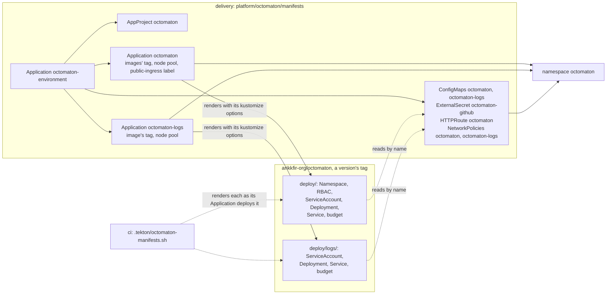

# Hosting Octomaton

**Decision**: the hub hosts [Octomaton](https://github.com/arikkfir-org/octomaton) the way any installation does
([host-agnostic Octomaton](../../octomaton/designs/host-agnostic.md)): Octomaton's `deploy/` is applied as written,
at a version of Octomaton, and everything the hub decides lives here, in `platform/octomaton/manifests`: the servers' settings,
the GitHub App's credentials, the webhook's route, who reaches each Service, the images' tag and the node pool. This
repository's CI renders Octomaton's `deploy/` the way its Applications deploy it, so a change on either side that no
longer fits fails a check before Argo CD syncs it. Pull requests: [delivery#76](https://github.com/arikkfir-org/delivery/pull/76)
(the host objects and the check), with [octomaton#40](https://github.com/arikkfir-org/octomaton/pull/40) before it.

## Why

Octomaton's `deploy/` held the hub: its route on `traefik/public`, an ExternalSecret on the hub's secret store, the
hub's ConfigMap values, NetworkPolicies naming the hub's namespaces. A second host had to patch every one of them, and a
rename on either side broke the other silently. Octomaton now keeps only what every installation needs, and asks its
host for the rest under one contract, its README's
[the host contract](../../octomaton/designs/host-agnostic.md#the-host-contract). This page is the hub's side of it.

## Design

Octomaton's pods read the host's objects by name: ConfigMap `octomaton` through `envFrom`, Secret `octomaton-github`
through three `env` entries, ConfigMap `octomaton-logs` through `envFrom` like the first. The route and the policies select its Services and pods by the labels
`deploy/` gives them. Nothing in `deploy/` names the hub, and nothing here patches an object of `deploy/` except to add
to it.

### The hub's side of the contract

| Octomaton asks for | The hub provides |
| --- | --- |
| A GitHub App, its webhook at `https://<host>/github/hooks` | App `octomaton-dev`, created by hand ([below](#the-github-app)), webhook `https://octomaton.dev/github/hooks` |
| Secret `octomaton-github`: `app-id`, `private-key`, `webhook-secret` | ExternalSecret `octomaton-github` on ClusterSecretStore `gcp-secret-manager`, refreshed hourly from `infra`'s secrets `octomaton-github-app-id`, `octomaton-github-private-key` and `octomaton-github-webhook-secret` ([Secret Manager](../../infra/terraform/gcp.md#secret-manager)) |
| ConfigMap `octomaton`, the server's settings | [Settings](#settings) below |
| `deploy/` applied as written, the images tagged | Application `octomaton`: source `deploy` of `https://github.com/arikkfir-org/octomaton` at a version's tag (`targetRevision: v0.0.1`); `kustomize.images` tags `me-west1-docker.pkg.dev/arikkfir/octomaton/octomaton` with the same version, which Octomaton's `tag` pipeline adds to the images its `main` published for that commit ([versioned releases](../../octomaton/designs/releases.md)); a new version deploys by a pull request here that bumps both Applications; automated sync with prune and self-heal, retries, `SkipDryRunOnMissingResource=true`; no finalizer and no `CreateNamespace` |
| `deploy/logs/` optionally, with ConfigMap `octomaton-logs` | Application `octomaton-logs`: source `deploy/logs` of the same repository at the same version, project `octomaton`, the image `…/octomaton-logs` tagged the same way, the Deployment on node pool `system`; the same sync policy. ConfigMap `octomaton-logs` here. The hub wants the archived step logs in its Tekton Dashboard, so it applies it |
| Additions through kustomize options | `patches`: Namespace `octomaton` gets `kfirs.com/public-ingress: "true"` (the webhook's route attaches to the public gateway); every Deployment, of both Applications, gets node pool `system` ([node pools](node-pools.md)) |
| A route to Service `octomaton` | HTTPRoute `octomaton`: `octomaton.dev`, exact `/github/hooks`, Gateway `traefik/public`, listener `octomaton-dev`; everything else on that host is `go-import`'s ([Go import pages](go-import-pages.md)) |
| Network admission | NetworkPolicy `octomaton`: only namespace `traefik`, on 8080. NetworkPolicy `octomaton-logs`: only the Tekton Dashboard's pods (namespace `tekton-pipelines`, label `app.kubernetes.io/name: dashboard`), on 8080 |
| Cloud identities and grants | Workload Identity principals of ServiceAccounts `octomaton/octomaton` (telemetry) and `octomaton/octomaton-logs` (the log view), granted by `infra` ([IAM](../../infra/terraform/gcp.md#iam)) |
| Where the Dashboard finds archived logs | TektonConfig `config`'s external logs URL, `http://octomaton-logs.octomaton.svc.cluster.local/logs` ([platform](../platform.md#components)) |
| An admission boundary, if wanted | AppProject `octomaton`: source Octomaton's repository only, destination namespace `octomaton`, cluster-scoped objects by name, the namespaced kinds `deploy/` and `deploy/logs/` hold. The host objects here are synced by `octomaton-environment` under project `default`, so the project admits only what Octomaton's versions may create |
| Validation of `deploy/` as the host renders it | [CI](#ci) below |

### The GitHub App

Created by hand, once. What Octomaton needs of any App: the README's
[GitHub App](https://github.com/arikkfir-org/octomaton#github-app).

| Item | Value |
| --- | --- |
| Name | `octomaton-dev` (`Octomaton` is taken on GitHub) |
| App ID | `5114814`. Octomaton (`OCTOMATON_GITHUB_APP_ID`) and the `Default branch` ruleset's required checks ([`infra`'s GitHub root](../../infra/terraform/github.md#the-default-branch-ruleset)) identify the App by it, never by its name |
| Homepage | `https://github.com/arikkfir-org/octomaton` |
| Installation | All `arikkfir-org` repositories |
| Webhook URL | `https://octomaton.dev/github/hooks` |
| Repository permissions | Checks: read and write; Contents: read; Metadata: read; Pull requests: read and write; Merge queues: read |
| Organization permissions | Members: read, for the `teams` of comment commands' allow-lists ([comment commands](../../octomaton/designs/comment-commands.md)) |
| Events | `push`, `pull_request`, `issue_comment`, `check_suite`, `check_run`, `merge_group`; also `pull_request_review`, `pull_request_review_comment` and `pull_request_review_thread`, which Octomaton ignores ([reviewer](../../octomaton/designs/pr-reviewer.md)) |
| Credentials | Its ID, private key and webhook secret, in Secret Manager, reach Octomaton through ExternalSecret `octomaton-github` |

The domain `octomaton.dev` is Octomaton's own ([octomaton.dev](../../octomaton/designs/octomaton-dev.md)); the hub
serves it: zone and certificate from `infra`, listener `octomaton-dev` on Gateway `traefik/public`, which admits routes
only from namespaces `octomaton` and `go-import`. Every request but the webhook's is `go-import`'s
([Go import pages](go-import-pages.md)). The migration that gave Octomaton the domain:
[rename runbook](../runbooks/octomaton-rename.md).

### Settings

ConfigMap `octomaton` ([server configuration](https://github.com/arikkfir-org/octomaton#server-configuration)):

| Variable | Value |
| --- | --- |
| `OCTOMATON_GITHUB_ALLOWED_OWNERS` | `arikkfir-org`: installations on any other owner are ignored |
| `OCTOMATON_TEKTON_DASHBOARD_URL` | `https://tekton.dev.kfirs.com` |
| `OCTOMATON_NAMESPACE_TEMPLATE` | `ci-{{ .Repository.Name }}`, the CI tenants' namespaces ([CI tenants](../platform.md#ci-tenants)) |
| `OCTOMATON_ORGANIZATION_REPOSITORY` | `tooling` |
| `OCTOMATON_RELAY_URLS` | `http://argocd-server.argocd.svc.cluster.local/api/webhook`: Argo CD refreshes on pushes |
| `OCTOMATON_RETENTION_FREE_PVCS_AFTER` | `1h` |

ConfigMap `octomaton-logs` ([step logs server](https://github.com/arikkfir-org/octomaton#archived-step-logs-octomaton-logs)):

| Variable | Value |
| --- | --- |
| `OCTOMATON_LOGS_VIEW` | `projects/arikkfir/locations/global/buckets/_Default/views/_Default` |
| `OCTOMATON_LOGS_CLUSTER` | `hub` |
| `OCTOMATON_LOGS_LOCATION` | `me-west1-a` |

Reloader restarts the Deployments when a ConfigMap or the Secret changes, as `deploy/` annotates them.

### CI

The `octomaton` step of `ci` (`.tekton/octomaton-manifests.sh`) finds every Application under `apps/` and `platform/`
whose source is Octomaton's repository, fetches that repository at the Application's `targetRevision`, and renders the
source path with the Application's `kustomize` options the way Argo CD applies them: `images`, with
`ARGOCD_APP_REVISION*` substituted from the fetched commit, then `patches` appended to the kustomization. A targeted
patch that matches nothing fails the step: kustomize would skip it and Argo CD would deploy without it, so a rename on
either side is caught here. The rendered manifests land in `.ci/rendered/octomaton/`, where the `kubeconform` step
validates them with the built-in kinds' schemas and the CRDs catalog. Any other kustomize option fails the step too,
until the script applies it.

The step runs in `docker.io/alpine/k8s`, whose kustomize is Argo CD's. Octomaton's own CI validates `deploy/` as
written and nothing of any host.

## The hand-over

Done. While Octomaton's `deploy/` still held the ConfigMap, the ExternalSecret, the route and the policies
([octomaton#40](https://github.com/arikkfir-org/octomaton/pull/40) to
[octomaton#42](https://github.com/arikkfir-org/octomaton/pull/42)), both copies carried
`argocd.argoproj.io/sync-options: Prune=false`, which Argo CD reads from the live object, so neither Application pruned
what the other synced. `octomaton-logs` changed hands the same way: Application `octomaton` stopped naming its objects
when `deploy/logs/` split off, and Application `octomaton-logs` adopted them by name. The annotation is off the host's
copies here; Octomaton removes it from `deploy/logs/` in a change of its own, after which an object that leaves either
kustomization is pruned by the Application that held it, as it should be.

## Security and failure modes

| Case | What happens |
| --- | --- |
| ConfigMap `octomaton` missing or `OCTOMATON_GITHUB_ALLOWED_OWNERS` empty | The pod waits in `CreateContainerConfigError`, or the server exits at startup listing the problem. Nothing serves webhooks for everyone |
| Secret Manager's secrets missing a version | The ExternalSecret stays `SecretSyncedError`, the Secret is not created, the pod waits in `CreateContainerConfigError` |
| A patch's target renamed in `deploy/` | CI fails the pull request here that bumps the version to the one that renamed it, before Argo CD syncs it |
| `go-import` and `octomaton` both match `octomaton.dev` | Exact `/github/hooks` takes precedence over `go-import`'s prefix, as before |
