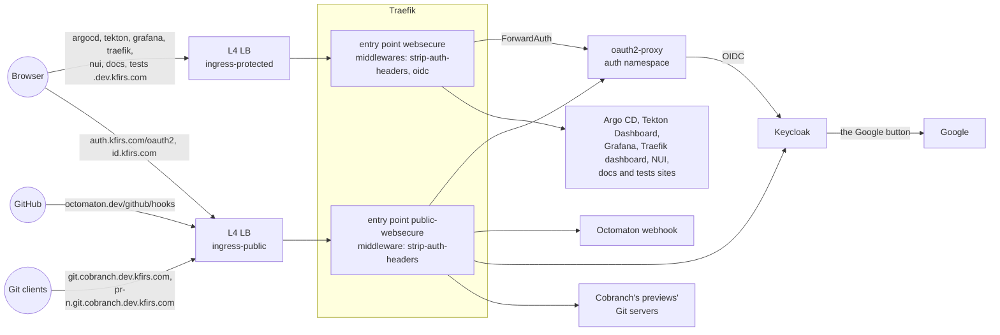
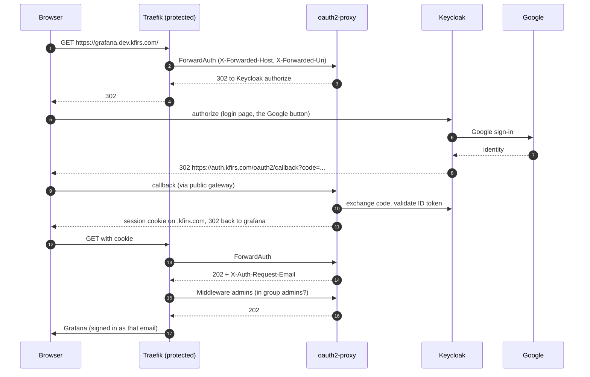

# Phase 3: Ingress and authentication

**Superseded for sign-in** by [Keycloak](keycloak.md): since 2 October 2026, Keycloak's realm `hub` signs everyone in, and Descope is retired. The ingress design and the interceptor below still hold, with Keycloak where they named Descope; the Descope decisions are history.

**Goal**: expose cluster applications through Traefik on L4 (passthrough network) load balancers, and make OpenID
authentication of a closed set of users the default for everything, so an internal application can't be exposed
unauthenticated by forgetting a setting. Hosts, IPs and names: [the hub platform](../platform.md#ingress).

## Design

One Traefik deployment serves two entry points, each with its own load balancer IP, and the Gateways on them:

| Gateway | Entry point | Load balancer | Interceptor | Routes allowed from |
| --- | --- | --- | --- | --- |
| `protected` | `websecure` (8443 → 443) | `ingress-protected` | every request authenticated | any namespace |
| `public` | `public-websecure` (9443 → 443) | `ingress-public` | none | namespaces labelled `kfirs.com/public-ingress=true` |
| `cobranch-git` | `public-websecure` (9443 → 443) | `ingress-public` | none | listener `previews`: namespaces labelled `kfirs.com/cobranch-pull-request`, whose routes policy `cobranch-http-routes` holds to their own Git host and Service `cobranch-git-server` ([Cobranch's previews](cobranch-previews.md)) |
| `cobranch-app` | `public-websecure` (9443 → 443) | `ingress-public` | none | listeners `app` (`cobranch.app`) and `git` (`git.cobranch.app`): namespace `cobranch-app` ([cobranch.app](cobranch-app.md)) |

The interceptor is attached to the **entry point**, not to routes: every route on the protected gateway is
authenticated, including routes added later, and there is no per-route switch to forget. Going public requires two
deliberate acts in `delivery`: labelling the namespace and attaching to the `public` gateway. Only `auth` (the login callback), `keycloak` (realm `hub`'s login page), `octomaton` (HMAC-verified webhooks), `go-import` (Go import pages), `cobranch-site` (Cobranch's static site and its Go import page) and `docs` (`legal.kfirs.com`, four exact paths) are public that way. The one other public path is Gateway `cobranch-git`, on the same entry point, for Cobranch's previews' Git servers, which sign every request in with a personal token themselves (owner, 2026-11-01): its listener names its namespaces, so no preview namespace carries `kfirs.com/public-ingress`, and policy `cobranch-http-routes` holds each preview's route there to its own Git host and its Git server, unfiltered ([Cobranch's previews](cobranch-previews.md)). Gateway `cobranch-app` is the third: `cobranch.app`, Cobranch's hosted service, which anyone signs up to and which signs everyone in itself, with Google, its listeners admitting only namespace `cobranch-app` ([cobranch.app](cobranch-app.md)). A new Gateway on `public-websecure` is a third deliberate act.

The `protected` and `public` gateways terminate TLS with a wildcard certificate for `*.kfirs.com`, `*.dev.kfirs.com` and `admin.id.kfirs.com` (cert-manager, Let's Encrypt, DNS-01), and redirect HTTP to HTTPS. The public gateway's `octomaton.dev` listener has a certificate of its own, as `cobranch-git` has for `*.git.cobranch.dev.kfirs.com`, and `cobranch-app` for `cobranch.app` and `git.cobranch.app`.

## Login

## Who can sign in

Keycloak decides: the people Terraform declares in realm `hub`, and Fin's test users while a run needs them ([Keycloak](keycloak.md)). oauth2-proxy admits every user Keycloak authenticates, and the hub's tools then admit only group `admins` ([admins only](admins-only.md)). Until 2 October 2026, Descope's user list was the only gate, kept closed by a sign-in-only flow and blocked self-registration, both set by hand in its console.

## Applications behind the interceptor

| Application | Application-level login |
| --- | --- |
| Grafana | Trusts `X-Auth-Request-Email` (auth proxy mode); users are created on first visit |
| Argo CD | Signed in from the hub session: its route's `id-token` middleware passes oauth2-proxy's `Authorization: Bearer <ID token>`, which Argo CD verifies against the same Keycloak client; every authenticated user is admin. Its own "Log in via Keycloak" remains the fallback |
| Tekton Dashboard, NUI, Traefik dashboard, docs and tests sites | None; the interceptor is the only gate |

Each of them also admits only group `admins`, through Middleware `admins` on its route ([admins only](admins-only.md)).

Header safety: `strip-auth-headers` removes `X-Auth-Request-*` headers sent by clients before ForwardAuth runs, and
ForwardAuth copies the verified values from oauth2-proxy's response. NetworkPolicies let protected backends accept
traffic only from the `traefik` namespace (Argo CD's server also admits its own namespace and Octomaton's webhook
relay), so the interceptor can't be bypassed from inside the cluster.

| Entry-point middleware (namespace `traefik`) | What it does |
| --- | --- |
| `strip-auth-headers` | Deletes the client's `X-Auth-Request-User`, `X-Auth-Request-Email` and `X-Auth-Request-Preferred-Username` |
| `oidc` | ForwardAuth to `http://oauth2-proxy.auth.svc.cluster.local/`. oauth2-proxy, whose one upstream is `static://202`, answers `202` for a valid session and starts the sign-in otherwise; Traefik copies `X-Auth-Request-User`, `X-Auth-Request-Email` and `X-Auth-Request-Preferred-Username` from its answer onto the request |

## Decisions

| Decision | Why | Rejected |
| --- | --- | --- |
| Traefik behind L4 load balancers | Simple, portable, fast to change; TLS and routing stay in the cluster | GKE Gateway / L7 load balancers (unreliable for this use, slow to converge) |
| Gateway API resources | Standard, portable routing API; Traefik implements it | Traefik-only `IngressRoute`s (still used for the dashboard, which is internal to Traefik) |
| Two load balancers, interceptor on the entry point | Authentication by default, no per-route opt-in | One load balancer with a per-route auth filter (easy to forget) |
| Descope as identity provider, until 2 October 2026 | Users managed individually, not by email domain, with Google login; on the free plan, one OIDC application that Argo CD and oauth2-proxy shared | Google OAuth directly (domain-oriented, no user management). Replaced by [Keycloak](keycloak.md), whose users are reviewed code |
| The identity provider alone decides who signs in | One user list | An email allowlist in oauth2-proxy as well (a second list to keep in step, edited in Secret Manager) |
| One `.kfirs.com` session cookie | One login covers every hub application | Per-application logins |

## Manual setup

Secret Manager: `oauth2-proxy-cookie-secret` (`openssl rand -base64 32 | tr -- '+/' '-_'`). Descope's setup went with Descope (ENG-61, ENG-62): `oidc-client-secret` is gone, and the hub no longer trusts Descope's issuer. Keycloak's: [Keycloak](keycloak.md).

## Open questions

- Short-lived access for non-browser clients (the Argo CD CLI uses `--port-forward` today).
