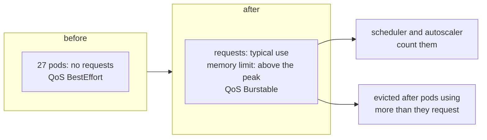

# Resource requests of the remaining components

**Decision**: Every container of the hub's Deployments and StatefulSets requests the CPU and memory it uses and limits
its memory above its peak, by the hub's rule for [resource requests](../../hub/designs/resource-requests.md). That
design sized the sixteen workloads furthest from their use; this one sizes the 24 that still requested nothing. Tekton's
hourly pruner stays as it is: the operator builds its CronJob with no way to set its resources. Ticket:
[ENG-113](https://linear.app/arikkfir/issue/ENG-113).

## Why

- On 13 October, 27 of the system node's 80 pods requested nothing: every Argo CD component but its application
  controller, oauth2-proxy, cert-manager, External Secrets, NATS and its tools, Reloader, Tekton's operator, and
  Tekton's dashboard, events controller and Triggers.
- A pod that requests nothing is BestEffort: when its node runs short of memory, the kernel's OOM killer picks it
  first, and the kubelet evicts it with the pods using more than they asked for. NATS's three servers, which Fin's
  environments use, and oauth2-proxy, which every protected request waits on, were among them.
- The scheduler and the cluster autoscaler count such a pod as free. Together these use about 0.1 CPU on average and
  0.2 at the 95th percentile, too little to keep the pool from growing; the eviction order is what this changes.

## Design

Use is each container's over the week to 13 October, from Cloud Monitoring, per replica: the 95th percentile of
5-minute CPU averages over its last day, its highest 5-minute CPU average, its median memory over its last day and its
highest memory over the week, page cache included. The values follow from it:

- CPU request: the 95th percentile, rounded up to 10m, at least 10m.
- Memory request: the median plus a tenth, rounded up to 16, 32, 48, 64 or 96Mi.
- Memory limit: three times the peak, rounded up to a power of two, at least 64Mi. oauth2-proxy and nats-box get more
  (below).

| Workload | CPU p95, peak | Memory median, peak | Requests | Memory limit | Where |
| --- | --- | --- | --- | --- | --- |
| Argo CD's repo server | 16m, 113m | 81Mi, 313Mi | 20m, 96Mi | 1Gi | `platform/argocd/values.yaml` |
| Argo CD's API server | 2m, 9m | 32Mi, 75Mi | 10m, 48Mi | 256Mi | `platform/argocd/values.yaml` |
| Argo CD's ApplicationSet controller | 6m, 12m | 50Mi, 66Mi | 10m, 64Mi | 256Mi | `platform/argocd/values.yaml` |
| Argo CD's notifications controller | 2m, 5m | 28Mi, 38Mi | 10m, 32Mi | 128Mi | `platform/argocd/values.yaml` |
| Argo CD's Redis | 4m, 4m | 10Mi, 27Mi | 10m, 16Mi | 128Mi | `platform/argocd/values.yaml` |
| oauth2-proxy | 31m, 103m | 11Mi, 20Mi | 40m, 16Mi | 128Mi | `platform/auth/values.yaml` |
| cert-manager's controller | 1m, 2m | 32Mi, 70Mi | 10m, 48Mi | 256Mi | `platform/cert-manager/values.yaml` |
| cert-manager's CA injector | 2m, 7m | 64Mi, 80Mi | 10m, 96Mi | 256Mi | `platform/cert-manager/values.yaml` |
| cert-manager's webhook | 1m, 1m | 18Mi, 48Mi | 10m, 32Mi | 256Mi | `platform/cert-manager/values.yaml` |
| External Secrets' controller | 3m, 6m | 48Mi, 85Mi | 10m, 64Mi | 256Mi | `platform/external-secrets/values.yaml` |
| External Secrets' cert controller | 2m, 4m | 44Mi, 64Mi | 10m, 48Mi | 256Mi | `platform/external-secrets/values.yaml` |
| External Secrets' webhook | 1m, 2m | 34Mi, 48Mi | 10m, 48Mi | 256Mi | `platform/external-secrets/values.yaml` |
| NATS, each server | 17m, 35m | 34Mi, 95Mi | 20m, 48Mi | 512Mi | `platform/nats/values.yaml` (`container`) |
| NATS's config reloader, beside each server | 0m, 0m | 1Mi, 3Mi | 10m, 16Mi | 64Mi | `platform/nats/values.yaml` (`reloader.merge`) |
| nats-box | 0m, 0m | 1Mi, 1Mi | 10m, 16Mi | 256Mi | `platform/nats/values.yaml` (`natsBox.container`) |
| NACK | 9m, 12m | 27Mi, 42Mi | 10m, 32Mi | 128Mi | `platform/nack/values.yaml` |
| NUI | 18m, 20m | 28Mi, 39Mi | 20m, 32Mi | 128Mi | `platform/nui/values.yaml` |
| Reloader | 7m, 15m | 33Mi, 46Mi | 10m, 48Mi | 256Mi | `platform/reloader/values.yaml` |
| Tekton's operator, lifecycle | 9m, 18m | 59Mi, 110Mi | 10m, 96Mi | 512Mi | `platform/tekton-operator/manifests/kustomization.yaml` |
| Tekton's operator, cluster operations | 3m, 8m | 40Mi, 77Mi | 10m, 48Mi | 256Mi | `platform/tekton-operator/manifests/kustomization.yaml` |
| Tekton operator's webhook | 2m, 2m | 25Mi, 42Mi | 10m, 32Mi | 128Mi | `platform/tekton-operator/manifests/kustomization.yaml` |
| Tekton's dashboard | 1m, 2m | 8Mi, 27Mi | 10m, 16Mi | 128Mi | `platform/tekton/manifests/tekton-config.yaml` (`dashboard.options`) |
| Tekton's events controller | 4m, 15m | 55Mi, 94Mi | 10m, 64Mi | 512Mi | `platform/tekton/manifests/tekton-config.yaml` (`pipeline.options`) |
| Tekton Triggers' controller | 1m, 2m | 20Mi, 36Mi | 10m, 32Mi | 128Mi | `platform/tekton/manifests/tekton-config.yaml` (`trigger.options`) |
| Tekton Triggers' core interceptors | 1m, 1m | 21Mi, 35Mi | 10m, 32Mi | 128Mi | `platform/tekton/manifests/tekton-config.yaml` (`trigger.options`) |
| Tekton Triggers' webhook | 2m, 2m | 19Mi, 37Mi | 10m, 32Mi | 128Mi | `platform/tekton/manifests/tekton-config.yaml` (`trigger.options`) |

Together they request about 0.42 CPU and 1.3Gi, which takes the system node's requests from 2.26 to about 2.68 of its
3.92 CPUs and from 7.4 to about 8.7 of its 13Gi.

## Decisions

| Decision | Why | Rejected |
| --- | --- | --- |
| The hub's rule, with the values computed from the measurements | The same rule as the first sixteen, applied the same way to each, so a value can be checked against its row | Values picked one by one |
| At least 10m CPU | A request that small is noise, but it keeps the pod out of BestEffort and keeps the convention of the first design | 1m, the measured use of the idlest |
| Memory limits three times the peak, at least 64Mi | These are controllers and webhooks whose memory follows the cluster's objects, which grow with each of Fin's pull requests, and a week is short. A limit reserves nothing, so room above the peak costs nothing | Limits closer to the peak |
| oauth2-proxy's limit 128Mi, above its rule's 64Mi | Every protected request waits on it, and its two replicas see the same load, so one spike could kill both | Its rule's 64Mi |
| nats-box's limit 256Mi, above its rule's 64Mi | It is idle but for commands run in it by hand, and those share its limit | Its rule's 64Mi |
| No CPU limit on NATS, against its chart's advice | The chart asks for equal requests and limits, for Guaranteed QoS and a `GOMAXPROCS` that matches. The hub's rule keeps services unlimited, since a CPU limit throttles in 100 ms slices and slows every client even on an idle node; `GOMAXPROCS` then follows the node's four vCPUs, as it does for the hub's other Go services | Guaranteed QoS with a CPU limit |
| Tekton's pruner unchanged | The operator builds the pruner's CronJob in code (`pkg/reconciler/common/prune.go`) and TektonConfig's `pruner` has no field for its resources. It runs for seconds each hour; evicting it costs one run | A LimitRange in `tekton-pipelines` that defaults every container's requests, which would also reach anything the operator adds later |
| Argo CD's `redis-secret-init` hook unchanged | A Job that runs for seconds as Argo CD syncs itself, too short to measure | Guessed values |

## Failure modes

- A memory limit below a future peak kills the container, which restarts. Argo CD's repo server peaks while it renders
  manifests, so its limit is the largest, 1Gi.
- Under memory pressure, the kubelet evicts first the pods using more than they request. These are among them only
  while they do, like the rest of the hub's.
- A new component that sets no requests is BestEffort again. "Add a component" in the README asks for them.

## Rollout

Each component restarts once as Argo CD syncs it; those with two replicas roll one at a time under their
PodDisruptionBudgets. The Tekton operator rolls out the dashboard's, events controller's and Triggers' Deployments
once it reconciles the TektonConfig. Rollback: revert, and Argo CD restores the previous values.
