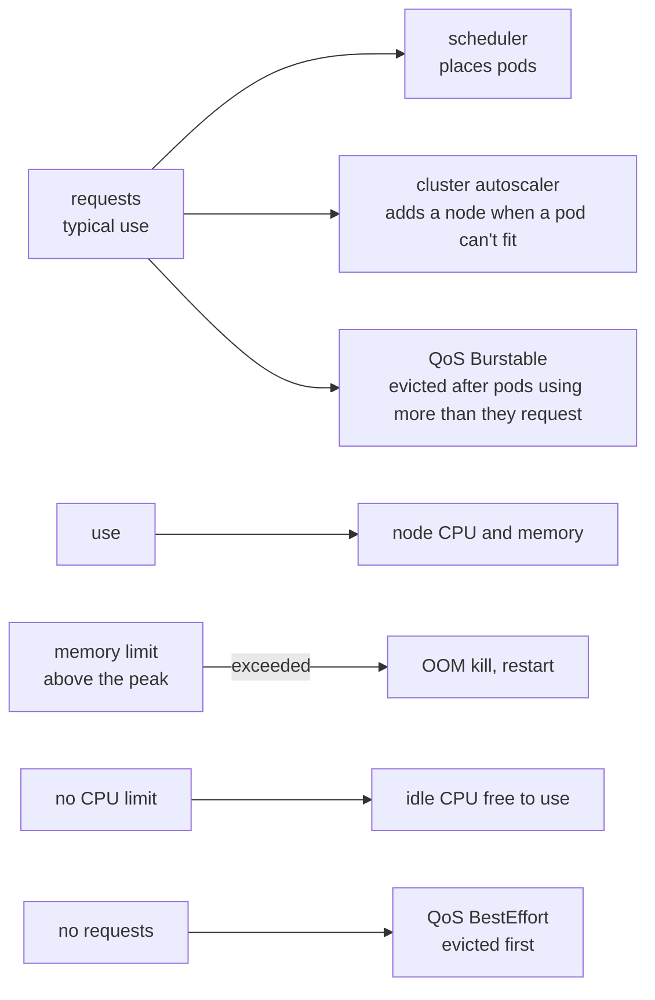

# Resource requests

**Decision**: Every container of the hub's Deployments and StatefulSets requests the CPU and memory it typically uses, as measured, and limits its memory above its peak, with no CPU limit: the house rule ([Code and configuration](../../CONTRIBUTING.md#code-and-configuration)). Keycloak's memory limit is the one its sizing guide asks for, since Java sizes its heap from it, and the CPU limits that charts and release manifests set far above use stay. Two rounds sized every hub component from what it used: on 11 October the eleven whose requests were furthest from their use ([delivery#49](https://github.com/arikkfir-org/delivery/pull/49)), on 13 October the 24 that still requested nothing ([ENG-113](https://linear.app/arikkfir/issue/ENG-113), [delivery#52](https://github.com/arikkfir-org/delivery/pull/52)). Tekton's hourly pruner and Argo CD's `redis-secret-init` hook, jobs that run for seconds, stay without requests. Fin's workloads, and the one CPU limit the hub sets on purpose (Fin's scrape jobs), are [Fin's resource requests](../../fin/designs/resource-requests.md); Octomaton's are in its `deploy/` ([Octomaton's deployment](../../octomaton/designs/deployment.md)).

## Why

- The scheduler places pods by their requests, and the cluster autoscaler grows a pool only when a pod's requests don't fit. With requests that match use, a busy node gets company instead of saturating.
- On 11 October, two of Fin's end-to-end suites ran side by side, and the one system node ran at 92–107% CPU for about ten minutes each time; the merge queue dropped fin#110 twice. The `system` pool autoscales from one node to three, but it never grew: its pods requested 3.26 of the node's 3.92 CPUs, so every new pod still fit.
- The requests said the opposite of the use. Argo CD's application controller, Grafana, Traefik and Tekton's pipelines controller requested nothing, while KEDA, Keycloak, its operator and Tekton's smaller components reserved about 1.8 CPUs and used about 0.1.
- On 13 October, 27 of the system node's 80 pods still requested nothing: every Argo CD component but its application controller, oauth2-proxy, cert-manager, External Secrets, NATS and its tools, Reloader, Tekton's operator, and Tekton's dashboard, events controller and Triggers. A pod that requests nothing is BestEffort: when its node runs short of memory, the kernel's OOM killer picks it first, and the kubelet evicts it with the pods using more than they asked for. NATS's three servers, which Fin's environments use, and oauth2-proxy, which every protected request waits on, were among them.

## Design

Use is each container's, per replica, from Cloud Monitoring: the 95th percentile of 5-minute CPU averages over its last day, its highest 5-minute CPU average, its median memory over its last day (second round only) and its highest memory over the week, page cache included.

### Sized on 11 October

Use over the week to 11 October. Each request is near typical use, and each memory limit above the peak.

| Workload | CPU p95, peak | Memory peak | Requests | Limits | Where |
| --- | --- | --- | --- | --- | --- |
| Argo CD's application controller | 185m, 933m | 1873Mi | 200m, 1Gi | 2560Mi | `platform/argocd/values.yaml` |
| Grafana, each replica | 83m, 98m | 342Mi | 50m, 256Mi | 512Mi | `platform/grafana/values.yaml` |
| Traefik, each replica | 46m, 115m | 119Mi | 50m, 128Mi | 256Mi | `platform/traefik/values.yaml` |
| Tekton's pipelines controller | 58m, 271m | 233Mi | 100m, 256Mi | 512Mi | `platform/tekton/manifests/tekton-config.yaml` (`pipeline.options`) |
| Tekton's remote resolvers | 1m, 1m | 19Mi | 10m, 32Mi | 1 CPU, 4Gi (the release's) | `platform/tekton/manifests/tekton-config.yaml` (`pipeline.options`) |
| Tekton operator's proxy webhook | 1m, 6m | 32Mi | 10m, 48Mi | 500m, 500Mi (the release's) | `platform/tekton/manifests/tekton-config.yaml` (`pipeline.options`) |
| KEDA's operator, each replica | 9m, 39m | 76Mi | 20m, 96Mi | 1 CPU (the chart's), 256Mi | `platform/keda/values.yaml` |
| KEDA's metrics server, each replica | 6m, 6m | 40Mi | 20m, 48Mi | 1 CPU (the chart's), 128Mi | `platform/keda/values.yaml` |
| KEDA's admission webhooks, each replica | 1m, 1m | 20Mi | 20m, 32Mi | 1 CPU (the chart's), 64Mi | `platform/keda/values.yaml` |
| Keycloak, each instance | 30m, 97m | 1180Mi | 25m, 1Gi | 1360Mi (its sizing guide's) | `platform/keycloak/manifests/keycloak.yaml` |
| Keycloak's operator | 6m, 51m | 304Mi | 20m, 320Mi | 700m, 450Mi (the release's) | `platform/keycloak-operator/manifests/kustomization.yaml` |

### Sized on 13 October

Use over the week to 13 October. The values follow from it by one rule:

- CPU request: the 95th percentile, rounded up to 10m, at least 10m.
- Memory request: the median plus a tenth, rounded up to 16, 32, 48, 64 or 96Mi.
- Memory limit: three times the peak, rounded up to a power of two, at least 64Mi. oauth2-proxy and nats-box get more (decisions).

| Workload | CPU p95, peak | Memory median, peak | Requests | Memory limit | Where |
| --- | --- | --- | --- | --- | --- |
| Argo CD's repo server | 16m, 113m | 81Mi, 313Mi | 20m, 96Mi | 1Gi | `platform/argocd/values.yaml` |
| Argo CD's API server | 2m, 9m | 32Mi, 75Mi | 10m, 48Mi | 256Mi | `platform/argocd/values.yaml` |
| Argo CD's ApplicationSet controller | 6m, 12m | 50Mi, 66Mi | 10m, 64Mi | 256Mi | `platform/argocd/values.yaml` |
| Argo CD's notifications controller | 2m, 5m | 28Mi, 38Mi | 10m, 32Mi | 128Mi | `platform/argocd/values.yaml` |
| Argo CD's Redis | 4m, 4m | 10Mi, 27Mi | 10m, 16Mi | 128Mi | `platform/argocd/values.yaml` |
| oauth2-proxy, each replica | 31m, 103m | 11Mi, 20Mi | 40m, 16Mi | 128Mi | `platform/auth/values.yaml` |
| cert-manager's controller | 1m, 2m | 32Mi, 70Mi | 10m, 48Mi | 256Mi | `platform/cert-manager/values.yaml` |
| cert-manager's CA injector | 2m, 7m | 64Mi, 80Mi | 10m, 96Mi | 256Mi | `platform/cert-manager/values.yaml` |
| cert-manager's webhook | 1m, 1m | 18Mi, 48Mi | 10m, 32Mi | 256Mi | `platform/cert-manager/values.yaml` |
| External Secrets' controller | 3m, 6m | 48Mi, 85Mi | 10m, 64Mi | 256Mi | `platform/external-secrets/values.yaml` |
| External Secrets' cert controller | 2m, 4m | 44Mi, 64Mi | 10m, 48Mi | 256Mi | `platform/external-secrets/values.yaml` |
| External Secrets' webhook | 1m, 2m | 34Mi, 48Mi | 10m, 48Mi | 256Mi | `platform/external-secrets/values.yaml` |
| NATS, each server | 17m, 35m | 34Mi, 95Mi | 20m, 48Mi | 512Mi | `platform/nats/values.yaml` (`container`) |
| NATS's config reloader, beside each server | 0m, 0m | 1Mi, 3Mi | 10m, 16Mi | 64Mi | `platform/nats/values.yaml` (`reloader.merge`) |
| nats-box | 0m, 0m | 1Mi, 1Mi | 10m, 16Mi | 256Mi | `platform/nats/values.yaml` (`natsBox.container`) |
| NACK | 9m, 12m | 27Mi, 42Mi | 10m, 32Mi | 128Mi | `platform/nack/values.yaml` |
| NUI | 18m, 20m | 28Mi, 39Mi | 20m, 32Mi | 128Mi | `platform/nui/values.yaml` |
| Reloader | 7m, 15m | 33Mi, 46Mi | 10m, 48Mi | 256Mi | `platform/reloader/values.yaml` |
| Tekton's operator, lifecycle | 9m, 18m | 59Mi, 110Mi | 10m, 96Mi | 512Mi | `platform/tekton-operator/manifests/kustomization.yaml` |
| Tekton's operator, cluster operations | 3m, 8m | 40Mi, 77Mi | 10m, 48Mi | 256Mi | `platform/tekton-operator/manifests/kustomization.yaml` |
| Tekton operator's webhook | 2m, 2m | 25Mi, 42Mi | 10m, 32Mi | 128Mi | `platform/tekton-operator/manifests/kustomization.yaml` |
| Tekton's dashboard | 1m, 2m | 8Mi, 27Mi | 10m, 16Mi | 128Mi | `platform/tekton/manifests/tekton-config.yaml` (`dashboard.options`) |
| Tekton's events controller | 4m, 15m | 55Mi, 94Mi | 10m, 64Mi | 512Mi | `platform/tekton/manifests/tekton-config.yaml` (`pipeline.options`) |
| Tekton Triggers' controller | 1m, 2m | 20Mi, 36Mi | 10m, 32Mi | 128Mi | `platform/tekton/manifests/tekton-config.yaml` (`trigger.options`) |
| Tekton Triggers' core interceptors | 1m, 1m | 21Mi, 35Mi | 10m, 32Mi | 128Mi | `platform/tekton/manifests/tekton-config.yaml` (`trigger.options`) |
| Tekton Triggers' webhook | 2m, 2m | 19Mi, 37Mi | 10m, 32Mi | 128Mi | `platform/tekton/manifests/tekton-config.yaml` (`trigger.options`) |

Together they request about 0.42 CPU and 1.3Gi.

### Set with the component

These requested what they need from the start, and neither round measured them.

| Workload | Requests | Limits | Where |
| --- | --- | --- | --- |
| Docs and tests sites, each replica: Caddy | 10m, 48Mi | 128Mi | `platform/docs/manifests/deployment.yaml`, `platform/tests/manifests/deployment.yaml` |
| Docs and tests sites, each replica: GKE's Cloud Storage FUSE sidecar | 10m, 64Mi | 256Mi | the same, as `gke-gcsfuse/*` pod annotations |
| `go-import`, each replica | 10m, 32Mi | 128Mi | `platform/go-import/manifests/deployment.yaml` |
| Grafana's and Keycloak's PostgreSQL (Grafana's init container too) | 50m, 128Mi | 512Mi | `platform/grafana/manifests/postgres.yaml`, `platform/keycloak/manifests/postgres.yaml` |
| Cobranch's demo: the REST and GraphQL servers, each replica; the Auth server, each replica, and the Admin server; the Console, each replica, and the Back-office; the migrate Job; the maintenance CronJob's job, which compacts repositories' packs; PostgreSQL; the Git server, each replica; the push worker, each replica | 100m, 128Mi; 50m, 64Mi; 10m, 32Mi; 50m, 64Mi; 50m, 64Mi; 100m, 256Mi; 100m, 128Mi; 50m, 64Mi | 512Mi; 256Mi; 128Mi; 256Mi; 1Gi; 1Gi; 1Gi; 1Gi | Cobranch's chart's defaults ([hosting Cobranch's demo](cobranch.md)) |
| Tekton's pipelines webhook | 100m CPU, the release's | the release's | unchanged (decisions) |

## Decisions

| Decision | Why | Rejected |
| --- | --- | --- |
| Requests from measured typical use | The scheduler and the cluster autoscaler count requests only. A request below use packs a node past its CPU while it still looks half empty; one above use reserves room nobody uses | Requests left to charts' defaults, or none |
| No CPU limits on services | The kernel enforces a CPU limit in 100 ms slices: a process using several threads can spend its slice in a few milliseconds and stall for the rest, so a limit slows responses even on an idle node, and it frees no room, since only requests reserve any. Keycloak's sizing guide reports that its performance dropped significantly when throttled. Under contention, each container already gets CPU in proportion to its request | A CPU limit on every workload |
| Existing CPU limits far above use stay: KEDA's, Tekton's remote resolvers' and proxy webhook's, and Keycloak's operator's | They never bind, and removing them takes overrides of charts and upstream manifests for nothing | Removing them |
| Memory limits above the measured peak, except Keycloak's | Go collects harder near a limit only when `GOMEMLIMIT` is set, PostgreSQL doesn't adapt at all, and Argo CD's controller holds a cache of the cluster's resources, which grows with every pull request's Application. Java sizes its heap from the limit, so Keycloak's 1360Mi is its guide's size for 10,000 sessions: a 952Mi heap and about 300 MB outside it | Limits at typical use, relying on garbage collection |
| The second round's values computed by one rule | Applied the same way to each, so a value can be checked against its row | Values picked one by one |
| At least 10m CPU | A request that small is noise, but it keeps the pod out of BestEffort | 1m, the measured use of the idlest |
| Memory limits three times the peak, at least 64Mi, in the second round | These are controllers and webhooks whose memory follows the cluster's objects, which grow with each of Fin's pull requests, and a week is short. A limit reserves nothing, so room above the peak costs nothing | Limits closer to the peak |
| oauth2-proxy's limit 128Mi, above its rule's 64Mi | Every protected request waits on it, and its two replicas see the same load, so one spike could kill both | Its rule's 64Mi |
| nats-box's limit 256Mi, above its rule's 64Mi | It is idle but for commands run in it by hand, and those share its limit | Its rule's 64Mi |
| No CPU limit on NATS, against its chart's advice | The chart asks for equal requests and limits, for Guaranteed QoS and a `GOMAXPROCS` that matches. A CPU limit throttles every client even on an idle node; `GOMAXPROCS` then follows the node's four vCPUs, as it does for the hub's other Go services | Guaranteed QoS with a CPU limit |
| Tekton's pipelines webhook keeps its 100m request | Its HorizontalPodAutoscaler adds replicas at 100% of the request, up to five, so a lower request would keep five running | A lower request |
| Tekton's pruner unchanged | The operator builds the pruner's CronJob in code (`pkg/reconciler/common/prune.go`) and TektonConfig's `pruner` has no field for its resources. It runs for seconds each hour; evicting it costs one run | A LimitRange in `tekton-pipelines` that defaults every container's requests, which would also reach anything the operator adds later |
| Argo CD's `redis-secret-init` hook unchanged | A Job that runs for seconds as Argo CD syncs itself, too short to measure | Guessed values |

## Failure modes

- A week of use is short. A memory limit below a future peak kills the container, which restarts. Argo CD's controller grows with the number of open pull requests, and rebuilds its cache when it restarts; the repo server peaks while it renders manifests, so its limit is the largest of the second round, 1Gi.
- Keycloak's heap is 952Mi. Its guide sizes that for 10,000 sessions, far more than the hub has.
- Under memory pressure, the kubelet evicts first the pods using more than they request. These are among them only while they do.
- A new component that sets no requests is BestEffort again. "Add a component" in the README asks for them, as the house rule does.
