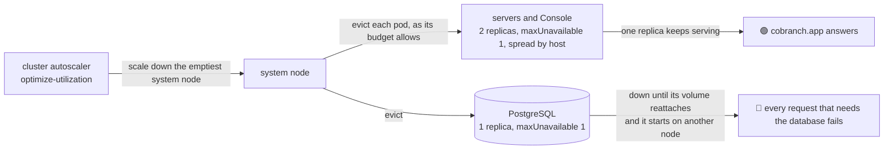

# cobranch.app is down while the cluster autoscaler moves its database

**Status**: 🟢 fixed on `main` by the change that adds this page, which Argo CD deploys · **Seen in**: cobranch.app, the hub cluster's system node pool · **Since**: cobranch.app's launch, 2026-11-01 · **Issue**: [ENG-243](https://linear.app/arikkfir/issue/ENG-243)

## 🎯 TL;DR

On 2026-11-02 cobranch.app failed every request that needed its database for three minutes, from 00:49:45 to 00:52:40 UTC, pushes included. The cluster autoscaler emptied a system node to consolidate the pool, and cobranch.app's PostgreSQL, a single replica whose budget lets it go, was on that node.

## 🧭 How it's meant to work

The hub's services run two replicas, or one with a budget that lets a drain take it ([disruption budgets](../designs/disruption-budgets.md)). The cluster autoscales with `optimize-utilization`, which consolidates the system pool often and accepts that each single-replica PostgreSQL restarts when it does ([node autoscaling](../../infra/designs/node-autoscaling.md#risks)). cobranch.app's servers ride through a drain. Its database can't, because it is the only copy of cobranch.app's state.

## 💥 Root cause

Application `cobranch-app` (`platform/cobranch-app/manifests/cobranch.yaml`) installs Cobranch's chart with PostgreSQL as one replica. Nothing stops the cluster autoscaler from removing the node it runs on. The trade-off was made for the hub's own databases, whose clients are the hub's people. It was never revisited when cobranch.app opened to outside users.

## 🔍 Evidence

| Claim | Evidence | Status |
|-------|----------|--------|
| The autoscaler emptied the node | Its visibility log at 00:49:38: scale-down of `gke-hub-system-1b09b8f8-6mve` (system pool), 78 pods to evict, cobranch.app's among them | ✅ |
| PostgreSQL stopped for the eviction | `cobranch-postgresql-0` on `…-6mve`, 00:49:45: `received fast shutdown request`, then `database system is shut down` | ✅ |
| It was back three minutes later, elsewhere | `cobranch-postgresql-0` on `…-c8rp`, 00:52:40: `database system was shut down at 2026-11-02 00:49:45 UTC`, `ready to accept connections` | ✅ |
| Requests failed meanwhile | The push worker, every 30 s from 00:49:49 to 00:52:21: `processing a push: beginning the transaction: … dial tcp …:5432: connect: connection refused` | ✅ |
| The servers weren't the cause | Each runs two replicas with a budget of `maxUnavailable: 1` and spreads by host. Only one replica of each was on the node, and no server logged an error of its own | ✅ |
| DNS wasn't a factor for cobranch.app | Both `kube-dns` replicas moved at 00:55 with no budget, and other namespaces logged failed lookups. cobranch.app's pods logged none | ✅ |

🔎 Why the move took three minutes

The cluster's event exporter was on the same node and was evicted in the same scale-down, so the pod's scheduling and volume events between 00:49:32 and 00:53:39 are missing. The three minutes cover the pod's eviction, the persistent disk detaching from `…-6mve` and attaching to `…-c8rp`, and PostgreSQL starting. Grafana's PostgreSQL, the same shape, moves in about a minute ([disruption budgets](../designs/disruption-budgets.md#decisions)).

## 🌍 Blast radius

- **Who**: everyone using cobranch.app. Sign-in, the Console's data, the APIs and Git all need the database.
- **Since**: the launch, 2026-11-01 22:48 UTC.
- **How often**: whenever the autoscaler consolidates the system pool and the node it empties holds the database. That happened once in cobranch.app's first two hours. The pool shrinks and grows with CI's controllers and the hub's load.

## 🩺 Still on `main`?

🟢 No: the change that adds this page annotates PostgreSQL's pod `cluster-autoscaler.kubernetes.io/safe-to-evict: "false"`, so the autoscaler never removes its node. GKE's node upgrades and repairs still drain the node, as its budget allows, and each one takes cobranch.app down for as long as a move takes. Upgrades run only in the cluster's maintenance window.

## 📊 Confidence

High for the cause: the autoscaler's decision, PostgreSQL's shutdown and start, and the clients' errors line up to the second. Medium for why the move took three minutes rather than one, since the events of those minutes are missing.

## 🏁 Outcome

[ENG-243](https://linear.app/arikkfir/issue/ENG-243): the autoscaler no longer moves cobranch.app's database ([cobranch.app](../designs/cobranch-app.md#security-and-failure-modes)). A database that survives a drain, meaning a replicated PostgreSQL that fails over, would also cover upgrades and repairs, and is left for later.
