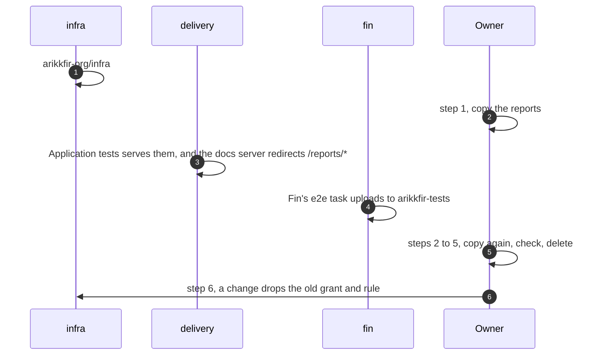

# Move CI reports to the tests server

One-off. It copies the CI reports in `gs://arikkfir-docs/.reports/` to `gs://arikkfir-tests/reports/`, where the tests
server serves them, then deletes them from the docs bucket ([design](../designs/docs-and-tests-servers.md)). The owner
runs it with `gcloud`, signed in as a project owner; every step can run again. Tracked in ENG-122.



## Steps

1. **Copy**, once infra's apply has created the bucket:

   ```bash
   gcloud storage rsync --recursive gs://arikkfir-docs/.reports gs://arikkfir-tests/reports
   ```

   Each object keeps its name, `reports/` for `.reports/`. A copy is a new object, so the bucket's 30 days start again
   at the copy.
2. **Wait for Fin's branches.** Once Fin's change merges, its runs upload to `arikkfir-tests`, but a pull request's
   runs use its own branch's e2e task: one that hasn't merged `main` since still uploads to `.reports/fin/`, and its
   link redirects to the tests server, where its report shows only after the next copy. Wait until every open pull
   request of Fin has merged `main` or closed. The newest object left in the old prefix shows when the last such
   upload was:

   ```bash
   gcloud storage ls --long --recursive 'gs://arikkfir-docs/.reports/**' | sort -k2 | tail -n 3
   ```

3. **Copy again**: step 1's command, which copies only what is new.
4. **Check** that the tests bucket has every report: a dry run lists nothing left to copy.

   ```bash
   gcloud storage rsync --recursive --dry-run gs://arikkfir-docs/.reports gs://arikkfir-tests/reports
   ```

   Then open one report through its old address, `https://docs.dev.kfirs.com/reports/fin/<run>/`: it redirects to
   `https://tests.dev.kfirs.com/reports/fin/<run>/` and shows the report.
5. **Delete** the old copies. This can't be undone; step 4 proved they are in `arikkfir-tests`.

   ```bash
   gcloud storage rm --recursive gs://arikkfir-docs/.reports/
   ```

6. **Clean up**, in a pull request to `infra` (`terraform/gcp`): drop `google_storage_bucket_iam_member.ci_reports`,
   `ci-fin-ci`'s grant on `.reports/fin/` of `arikkfir-docs`, and that bucket's rule for `.reports/` in `storage.tf`;
   and in `docs`, the hub's CI reports design and the reference's rows about the old prefix.

## If something goes wrong

| Problem | What to do |
| --- | --- |
| `rsync` stops partway | Run it again: it copies only what is missing |
| A report shows on the old address but not the new one | Its run uploaded after the last copy: run step 3 again |
| `AccessDeniedException` writing `arikkfir-tests` | The account isn't a project owner, or infra's apply hasn't run |
